# GeoPilot 产品需求规格与系统详细设计报告

**文档版本：** V2.0（个人原型设计稿）  
**项目名称：** GeoPilot  
**产品类型：** 单用户、本机 Web GIS 原型  
**编制日期：** 2026-11-11  
**文档状态：** 通用能力与实现计划整理稿  

> 本文按个人开发顺序说明 GeoPilot 原型的任务、模块、接口和检查方法，供实现与测试使用。

<!-- COVER_END -->

# 文档说明

## 修订记录

| 版本 | 日期 | 修订说明 | 状态 |
|---|---|---|---|
| V1.0 | 待补充 | 初始产品构想与方案草案 | 历史记录 |
| V2.0 | 2026-11-10 | 形成较完整的产品需求与系统设计稿 | 已重构 |
| V2.0 | 2026-11-11 | 保持个人本机原型，按通用需求与系统设计重排正文；区分产品能力、方法覆盖与验收样例，补充方法接入标准，整理目录及图表分页 | 通用能力与实现计划整理稿 |

## 文档目的

本文说明 GeoPilot 如何把 GIS 任务整理成分析方案，以及数据、计算进程和结果页面怎样协作。需求按通用能力定义，设计按模块职责展开；道路、地形、遥感和土地利用用于演示这些能力怎样组合成具体方法。

原型阶段主要回答三个问题：任务能否整理成清楚的分析方案，方案能否由本机 GIS 工具执行，结果能否通过明确规则发现常见错误。实现范围以这三个问题为依据。

## 阅读方式

正文先说明产品目标和通用需求，再展开处理流程、计算约束、模块与接口。任务样例放在系统设计之后，用于对照输入、步骤和结果；测试与实施计划紧随其后，开源比较集中说明设计选择的依据。

| 阅读目的 | 建议阅读内容 | 读后应能回答的问题 |
|---|---|---|
| 确定产品与需求 | 第 1、2、3 章 | 系统负责什么，能力怎样逐步扩展 |
| 开始模块开发 | 第 4、5、6—9 章 | 输入如何交接，谁调用谁，失败在哪里处理 |
| 对照样例与验收 | 第 10、11、12 章及附录 A—C | 方法怎样实例化，如何判断开发完成 |
| 核查选型依据 | 第 13 章及附录 D、E | 借鉴哪些实现，来源支持什么结论 |

图中的关系由箭头标签说明：运行图表示调用和数据流向，来源图表示对象引用，开源借鉴图的虚线表示设计参考。淡色分区帮助读者辨认阶段和职责，节点内的小字说明输入、处理或输出；固定方法图中的编号表示执行顺序。边界框用于归组，框内属性不作为执行步骤。

## 术语

| 术语 | 本文含义 | 使用说明 |
|---|---|---|
| 数据资产 | 一个可识别的矢量、栅格或表格数据源 | 登记来源、格式、坐标系和质量摘要，执行时按引用读取 |
| 数据上下文 | 与当前任务直接相关的数据摘要 | 只保留生成方案需要的信息 |
| 方法定义 | 按任务登记的输入、选项、处理步骤和成果规则 | 每个版本保存确定顺序，方法目录可继续增加 |
| 工具契约 | 一个可执行工具的输入、输出和约束 | 在执行前判断参数与数据是否适用 |
| 分析方案 | 对目标、输入、关键选项、步骤和成果的结构化说明 | 状态只有“草稿”和“已确认” |
| 执行流程 | 由已确认方案编译出的本地任务步骤 | 由本地调度按顺序执行 |
| 规则检查 | 按预先写明的规则检查输入、过程和成果 | 列出检查项、观察值与判定结果，含义见第 5.5 节 |
| 运行记录 | 一次执行的状态、日志、输入版本和成果位置 | 用于复现与排错 |
| CRS | 坐标参考系 | 决定坐标含义以及距离、面积的计算方式 |
| DEM | 数字高程模型 | 本文用于坡度、坡向和阈值提取场景 |

## 设计依据与使用说明

结构图采用分层、单向关系和渐进展开的表达方式，参考 C4、arc42 结构视图与运行时视图，以及微软关于架构图关系标签的建议。GIS 计算约束参考 ArcGIS、GDAL、USGS 和 Copernicus 的公开技术资料，具体链接列在附录 D。

文中的模块与接口是原型设计，项目尚未完成真实业务数据的性能实测。实现时记录实际工具版本、传感器配置和样本结果，作为调整设计的依据。

<!-- TOC -->

# 1 执行摘要

GeoPilot 将自然语言任务整理成可检查的分析方案，再交给本机工具执行。语言模型帮助整理目标、解释方案和选择候选工具；投影判断、测量口径、波段映射、数值计算和规则检查由本机程序负责。

原型采用单用户、本机 Web GIS 形态。浏览器提供数据、地图、任务、方案、运行和结果视图；本机 Web 服务保存状态并调度 QGIS 或 Python 进程；SQLite 保存元数据和运行状态；GeoPackage、GeoTIFF/COG 以及本地文件是默认数据源，PostGIS 只是可选适配器。

分析方案按所选方法列出影响结果的选项。测量任务显示距离或面积口径，筛选任务显示字段条件，栅格任务显示分辨率与数值处理方式；用户确认后，本机调度按该方法版本的步骤执行。

下图概括任务从输入到成果查看的六个阶段，模块之间的具体关系在第 6、7 章展开。

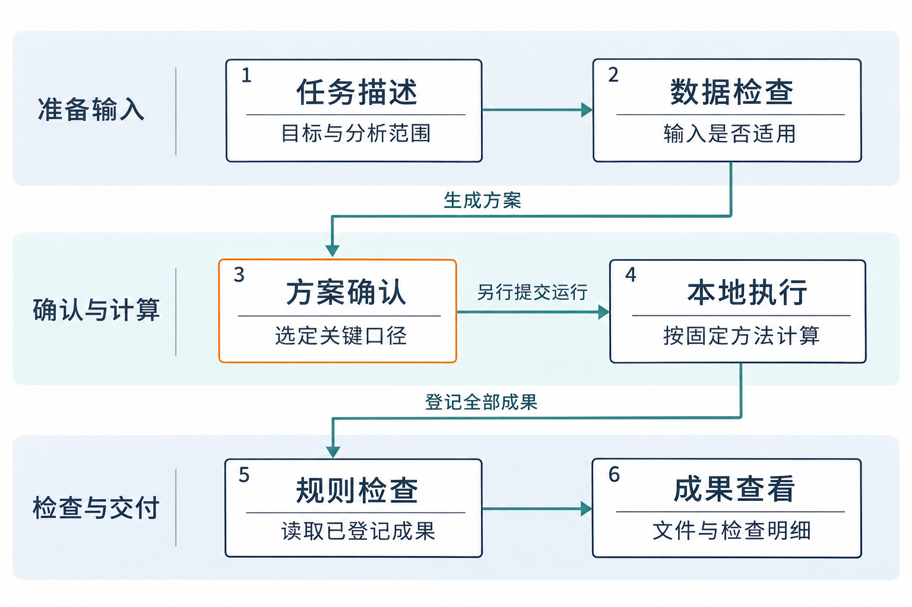

数据检查先判断输入能否支持任务；方案确认让影响结果的口径可见；本地执行只接收已确认的方案；规则检查独立于工具运行状态。即使工具没有报错，成果也可能因投影、范围或统计口径问题进入“有警告”或“未通过”状态。

道路缓冲统计、DEM 地形分析、遥感指数变化和土地利用变化是首批实现样例。它们用于检查矢量、栅格、元数据、边缘效应和统计口径；系统支持哪些任务，则由当前登记的方法、工具及其测试记录决定。增加任务时沿用同一套方案、执行、检查与成果管理。

## 1.1 原型成功的判定

原型完成情况按通用能力与已登记方法分别判断，具体检查以下各项：

1. 同一个固定任务能稳定生成结构一致的方案，关键选项不会被隐藏。
2. 方案中的固定方法顺序能被编译并交给 QGIS 或 Python 本地进程执行。
3. 不适用的坐标系、未知传感器配置和缺失参数会在计算前停止。
4. 工具运行状态与规则检查状态能够分开显示。
5. 成果可以追溯到输入数据、方案、工具参数和运行记录。
6. 现有 16 个固定用例能够检查首批计算约束，新方法带有自己的样本与断言。
7. 在既有执行适配器范围内增加一个方法，能够复用方案、调度和结果页面完成任务。

## 1.2 设计取舍

| 决策 | 原型选择 | 原因 |
|---|---|---|
| 运行形态 | 单用户、本机 Web GIS | 减少部署和协调成本，便于直接访问本机 GIS 环境 |
| 计算执行 | QGIS 与 Python 本地进程 | 复用成熟工具，同时保留脚本扩展空间 |
| 状态存储 | SQLite | 足够保存原型元数据、方案和运行状态 |
| 空间数据 | 本地文件、GeoPackage、GeoTIFF/COG | 适合个人数据整理和重复试验 |
| 可选数据源 | PostGIS 适配器 | 在需要时读取已有数据库，不把它设为前置条件 |
| 模型边界 | 只发送结构与统计摘要 | 避免原始坐标和样本内容离开本机，同时控制上下文长度 |
| 扩展方式 | 本地脚本区手动收录方法 | 先验证计算价值，再考虑更复杂的工具管理 |

# 2 产品目标与能力范围

## 2.1 要证明的核心问题

原型要解决的是任务描述与 GIS 操作之间的转换。例如，“统计道路周边 500 米内的建筑物”还缺少距离方式、空间关系和跨界统计规则。系统先把这些问题整理到方案中，用户选定后再执行，结果页保留本次选择及对应成果。

模型主要负责提取目标，并从有限的方法定义中选择路径。业务口径由用户确认；遇到未知传感器、缺失坐标系或未覆盖的任务，方案区列出需要补充的信息。

## 2.2 系统范围

下图说明个人用户、本机应用、本地数据、可选数据库和外部模型之间的边界。它回答“哪些东西在原型内部，哪些只是外部依赖”。

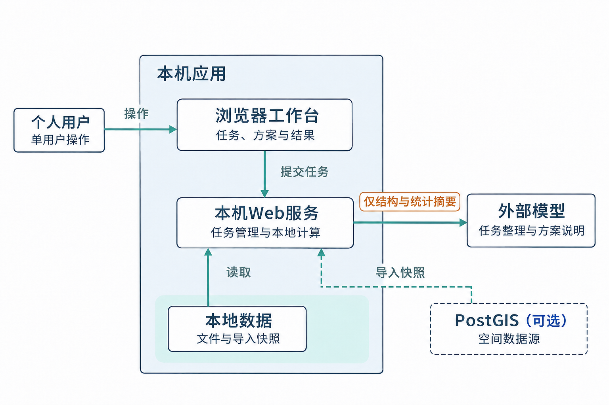

浏览器工作台和本机应用共同构成原型。QGIS、Python、SQLite 和工作目录都在本机。PostGIS 可以作为外部数据源，但不负责原型状态。外部模型只处理经过筛选的结构和统计摘要，不接触几何、坐标数组、原始文件、样本记录或本机路径。

## 2.3 通用能力范围

原型提供数据登记与上下文、方法与工具目录、分析方案、本地执行、规则检查、成果查看和脚本试验。不同方法共享这些模块，输入角色、参数和成果要求随方法配置变化。

用户在方案中确认关键选项，QGIS 或 Python 进程据此计算；运行记录保存输入版本、实际参数与成果来源。工作台读取同一份记录，供用户查看地图、文件和检查明细。

## 2.4 运行边界与推迟事项

首版以个人本机使用为范围。组织管理、细粒度权限、复杂确认链、令牌授权、正式发布、对外地图合规流程，以及 Outbox、幂等键和服务拆分，统一放入后续事项。灾备目标、备份演练、集中监控告警、安全物料清单、渗透测试、数据保留制度、删除证明和防篡改审计，也随共享服务需求再评估。

多人共享、长期运行或对外提供服务属于后续阶段，届时再根据实际需求评估上述能力。

## 2.5 个人用户的两种使用深度

日常使用先显示输入、方法、关键选项和成果，排查时再展开 CRS、单位、步骤与日志。两种查看方式读取同一份方案和运行记录；用户修改选项后，可查看受影响的参数与步骤。

## 2.6 产品能力、方法覆盖与样例

产品能力描述系统提供的共用工作方式，例如登记数据、填写方案、调用工具和查看成果。方法覆盖描述当前目录中已经配置并检查过的处理方法。样例给这些方法提供具体数据和预期结果，三者分别用于设计、实现和验收。

| 能力方向 | 可以组织的处理 | 在原型中的落实方式 |
|---|---|---|
| 数据准备 | 读取、字段筛选、坐标转换、格式转换 | 资产引用、数据前提与准备工具 |
| 矢量处理 | 关系判断、缓冲、裁剪、叠加、汇总 | 有序方法、工具参数与几何检查 |
| 栅格处理 | 裁取、对齐、邻域运算、栅格计算 | 网格信息、单位、NoData 与数值检查 |
| 多期与分类处理 | 指数差值、类别映射、变化汇总 | 时相、产品配置和分类规则 |
| 成果组织 | 图层、表格、文件、运行说明 | 成果类型、来源、预览和下载 |

目录记录已接入方法的版本、输入条件和可用状态。新任务优先复用工具组合方法；缺少算法时增加契约与适配，核心模块继续处理共用请求和结果。

“固定顺序”约束一个方法版本的计算过程。其他任务可以登记不同长度、不同输入输出的步骤列表；方法编号与业务名称属于配置，调度器按步骤和运行器执行。

# 3 通用功能需求

十组需求按数据准备、方案形成、执行与成果查看的次序排列。每组定义模块对各类方法都应提供的行为，编号用于关联第 7 章的模块、第 8 章的接口及第 11 章的检查。方法数量、业务名称与样例数据另在方法目录和测试清单中维护。

## 3.1 数据登记与读取

数据登记把路径、图层和格式差异转换为统一资产引用，后续模块据此找到相同版本的数据。本地文件按来源读取，PostGIS 图层先导入 GeoPackage 快照；两者都生成元数据与指纹。计算结果另写运行目录，使输入与输出便于分别核对。

| 编号 | 需求说明 | 判定方式 | 优先级 |
|---|---|---|---|
| DATA-001 | 登记本地文件、GeoPackage、GeoTIFF/COG 和可选 PostGIS 图层 | 能生成稳定资产标识并再次打开 | 必须 |
| DATA-002 | 提取格式、几何或栅格类型、CRS、范围、数量、字段和缺失摘要 | 固定样本的摘要与参考值一致 | 必须 |
| DATA-003 | 记录来源位置、修改时间和轻量指纹 | 输入变化后能识别版本变化 | 必须 |
| DATA-004 | 不覆盖原始输入，成果写入独立工作目录 | 执行前后输入指纹一致 | 必须 |

登记首先检查来源能否打开，再提取摘要并保存版本。打不开的来源返回文件、格式或连接错误；可以读取但缺少 CRS 的数据保留资产记录，并显示待补项。验收时关闭读取句柄后重新打开资产，再比较摘要，以检查引用是否足够完整。

## 3.2 数据上下文

同一份资产可用于不同任务，适用性也随任务变化。数据上下文按候选方法声明的输入角色分配资产，再检查类型、字段、覆盖和单位。道路、建筑物、DEM 是样例中的角色名称，其他方法可以声明自己的角色。输出是角色与资产的对应、适用状态及原因，供方案生成和界面共同使用。

| 编号 | 需求说明 | 判定方式 | 优先级 |
|---|---|---|---|
| CTX-001 | 根据任务对象、范围和成果筛选候选资产 | 无关资产不进入上下文 | 必须 |
| CTX-002 | 给出每个资产的适用、条件适用、不可用或未知状态 | 固定用例状态与规则一致 | 必须 |
| CTX-003 | 记录状态原因，如 CRS 缺失、范围不交叠或字段不足 | 界面能显示具体原因 | 必须 |
| CTX-004 | 外部模型请求只使用允许的结构与统计摘要 | 请求检查不含禁止字段 | 必须 |

缺少角色或关键元数据时，任务保留已有选择，方案列出待补项；补齐后重建上下文。验收比较入选资产、状态与原因，例如 DEM 已找到但垂直单位缺失时，提示补充单位。

## 3.3 方法定义

方法定义把一项处理方法写成可读取的配置：输入角色、固定步骤、开放选项、预期成果和检查规则。方案生成器展开这份配置，工具目录再为每一步提供实现。例如道路与 DEM 都先外扩，但外扩尺度分别来自缓冲距离和算法邻域。

| 编号 | 需求说明 | 判定方式 | 优先级 |
|---|---|---|---|
| MTH-001 | 登记与读取版本化方法，允许继续增加方法配置 | 新方法可被发现、选用并沿既有流程运行 | 必须 |
| MTH-002 | 步骤为有序列表，并可标记不可重排 | 编译结果保持原顺序 | 必须 |
| MTH-003 | 方法写明数据前提、关键选项、输出和检查项 | 缺少必要字段时配置加载失败 | 必须 |
| MTH-004 | 边缘效应方法明确外扩、计算和裁回顺序 | 固定用例能发现顺序变化 | 必须 |

方法加载时检查步骤标识、输入输出连接和必需字段，编译时保留配置中的顺序。任务没有对应方法时，界面列出未覆盖部分，用户可以调整目标或在本地脚本区试验。验收将编译后的步骤序列与方法配置逐项比较。

## 3.4 工具契约

工具契约把方法步骤转换成可检查的调用条件，说明输入类型、参数、输出和运行器。方案编译利用契约补齐参数，执行前检查则结合真实数据核对 CRS、单位和范围。两次检查共用契约，分别处理静态字段和运行时才可读取的信息。

| 编号 | 需求说明 | 判定方式 | 优先级 |
|---|---|---|---|
| TOOL-001 | 声明输入类型、输出类型、参数、运行器和工具版本 | 契约可被解析并生成调用 | 必须 |
| TOOL-002 | 提供 `measurement_policy` 字段 | 距离和面积用例按策略放行或拒绝 | 必须 |
| TOOL-003 | 明确 CRS、单位、范围和空值前置条件 | 不满足时在执行前返回原因 | 必须 |
| TOOL-004 | 声明预期成果和可执行的规则检查 | 成果登记后能找到检查器 | 必须 |

契约与步骤不匹配时，错误返回到具体参数或输入引用；涉及中间结果的条件，在该步骤启动前检查。验收既检查错误是否提前返回，也核对正确输入生成的请求值，确认单位和枚举转换符合方案。

## 3.5 分析方案

分析方案是用户选择与工具调用共同依据的记录。任务目标、输入角色和关键选项用于阅读，步骤、参数、输出和规则用于执行；两部分保存在同一版本中。用户确认该版本后，运行请求通过版本号取得相同快照。

| 编号 | 需求说明 | 判定方式 | 优先级 |
|---|---|---|---|
| PLAN-001 | 方案包含目标、输入、关键选项、有序步骤、工具参数、成果和检查项 | 固定方案模式校验成功 | 必须 |
| PLAN-002 | 状态只有草稿和已确认 | 状态转换符合规则 | 必须 |
| PLAN-003 | 关键选项变化后自动回到草稿 | 修改任一关键选项即可复现 | 必须 |
| PLAN-004 | 按方法定义显示关键选项、条件必填项和成果口径 | 修改选项可传到步骤参数；无关选项不出现 | 必须 |

缺失信息写入草稿的 `issues`，并定位到相应字段，用户可继续编辑已填内容。验收从页面选项跟踪到确认快照，再跟踪到步骤请求，比较同一个值是否一致；修改关键内容后，新版本应重新进入草稿状态。

## 3.6 本地执行

本地执行接收已确认方案，将步骤交给 QGIS 或 Python 适配器，并记录进度、日志和输出引用。调度器逐步等待结果，再决定启动下一步或结束运行。浏览器通过运行编号查询进展，计算时间与单次页面请求分开。

| 编号 | 需求说明 | 判定方式 | 优先级 |
|---|---|---|---|
| EXEC-001 | 将已确认方案编译为有序本地任务 | 步骤、参数与方案一致 | 必须 |
| EXEC-002 | 支持 QGIS 和 Python 两类执行适配器 | 两类固定样本均可运行 | 必须 |
| EXEC-003 | 分别记录任务和步骤状态、开始结束时间与日志位置 | 失败步骤可定位 | 必须 |
| EXEC-004 | 支持取消、修改方案后手动重试 | 取消后不继续启动后续步骤 | 必须 |

步骤失败后，调度器记录停止位置，保留日志和已产生文件，并把后续步骤留在未开始状态。手动重试创建新的运行目录与记录，便于比较修正前后的请求和结果。验收核对取消后是否停止派发，以及重试是否从第一步重新执行。

## 3.7 规则检查

规则检查把输入条件、实际步骤和成果文件放在同一份报告中核对。每条规则记录观察值、期望条件与严重程度，结果页可以从摘要展开到具体步骤。执行状态说明文件是否生成，检查状态说明这些文件符合哪些预设条件。

| 编号 | 需求说明 | 判定方式 | 优先级 |
|---|---|---|---|
| CHECK-001 | 支持输入、过程和成果三类检查 | 报告可区分检查阶段 | 必须 |
| CHECK-002 | 检查投影、单位、范围、固定顺序和输出结构 | 相关固定用例能触发 | 必须 |
| CHECK-003 | 生成通过、警告或未通过状态及明细 | 状态由明细规则汇总 | 必须 |
| CHECK-004 | 检查状态独立于执行状态 | 运行成功与检查失败可同时存在 | 必须 |

全部规则完成后，检查器按明细汇总为通过、有警告或未通过。检查中断则保存未完成项与原因，状态回到未检查，用户可对同一批成果重新检查。验收分别触发规则问题与检查器异常，核对两种情形的报告和状态。

## 3.8 成果与来源

成果模块把适配器返回的文件清单整理为可查询记录，包含用途、格式、位置与来源。结果页据此加载图层、下载文件并查看检查明细；预览记录再关联原始成果。文件与记录分开保存，便于同时处理大栅格和轻量状态查询。

| 编号 | 需求说明 | 判定方式 | 优先级 |
|---|---|---|---|
| ART-001 | 登记成果类型、位置、格式、范围和创建时间 | 每个输出均有记录 | 必须 |
| ART-002 | 关联分析方案、运行记录和输入资产版本 | 可沿关系回到输入 | 必须 |
| ART-003 | 关联规则检查报告 | 结果页能显示检查状态 | 必须 |
| ART-004 | 默认写入任务独立目录 | 两次运行不会相互覆盖 | 必须 |

登记时核对方案要求的成果是否齐全且可读，文件或记录保存失败则返回对应错误。文件后来被移动或删除，原记录仍显示来源与不可读原因，方便用户找回数据。验收沿成果回查运行、方案和输入版本，并检查重复运行各有独立输出。

## 3.9 Web GIS 界面

工作台围绕一个当前任务组织数据、地图、方案、运行和结果。关键选项先展示，步骤与日志按需展开；用户确认方案后再点击运行，并在结果页同时查看两类状态。不同方法共用这套操作顺序，表单内容来自方法的数据角色与选项定义，成果展示依据文件类型和元数据。

| 编号 | 需求说明 | 判定方式 | 优先级 |
|---|---|---|---|
| UI-001 | 在同一任务中关联地图、方案、运行和结果 | 任务切换后上下文一致 | 必须 |
| UI-002 | 关键选项优先展示，技术细节按需展开 | 用户无需展开日志即可确认方案 | 必须 |
| UI-003 | 执行状态和检查状态分开显示 | 两类状态不混用 | 必须 |
| UI-004 | 支持地图图层开关、范围定位和结果下载 | 固定成果可查看和取得 | 必须 |

面板分别加载任务、状态和成果，某个图层显示失败时，在该项旁保留错误原因与文件入口。刷新页面后按任务和运行编号恢复记录。验收检查任务切换、页面刷新和预览失败时，当前方案与成果是否仍对应同一次运行。

## 3.10 外部模型适配

模型适配将任务摘要与候选方法组织为请求，再把返回的选择和说明交给方案模块。本机程序检查结构、候选编号和参数范围，完整数据由后续执行适配器读取。几何、坐标和样本记录的外发限制集中在第 8.8 节实施。

| 编号 | 需求说明 | 判定方式 | 优先级 |
|---|---|---|---|
| MODEL-001 | 请求只包含字段结构、数据类型、数量和统计摘要 | 请求快照不含禁止内容 | 必须 |
| MODEL-002 | 禁止几何、坐标数组、范围坐标、样本记录、原始文件和本机路径 | 固定用例自动扫描 | 必须 |
| MODEL-003 | 模型输出必须通过结构模式和本地规则检查 | 无效输出不能生成可执行方案 | 必须 |
| MODEL-004 | 模型不可用时仍可从方法目录手动建立方案 | 断网时已接入方法仍可填写、确认和运行 | 应有 |

调用超时或返回结构错误时，保留现有草稿并提示缺失项，用户可改用表单填写方法和参数。验收检查错误返回是否能定位，以及手工入口是否进入同一套方案确认和本地执行流程。

# 4 从任务描述到成果查看

## 4.1 控制关系

任务模块先保存用户目标、所选资产及任务需要的范围，再构建数据上下文。方法目录按任务类型筛选候选，随后结合该方法的数据前提检查输入。模型参与时，只帮助整理目标和选择已有候选；手动填写同一组字段也能进入后续流程。

方案生成器将方法展开为有序步骤，绑定输入、工具、参数、预期成果和检查项。缺少数据或选项时保存草稿，并把缺失项返回界面。确认操作重新检查当前版本并保存快照，到此还没有启动计算。

用户点击运行后，本机服务检查方案版本、输入是否变化和当前是否已有任务，再创建运行记录并返回运行编号。调度器按固定顺序逐步执行；每步只接收方案输入或已经完成步骤的输出。执行期间浏览器轮询运行接口，不保持一条等待计算结束的请求。

全部步骤完成且预期文件登记成功后，一次更新把执行状态设为“运行成功”、检查状态设为“检查中”，随后开始成果规则检查。工具失败时停止后续步骤；检查发现问题时保留已生成成果，并单独显示检查状态。修改计算方案会产生新版本，手动重试从第一步开始；仅检查器中断时，可以对原成果重新检查。

## 4.2 方案依赖拓扑

下图进一步回答“一个分析方案由哪些信息共同约束”。箭头标签表示信息进入方案生成器时发挥的作用。

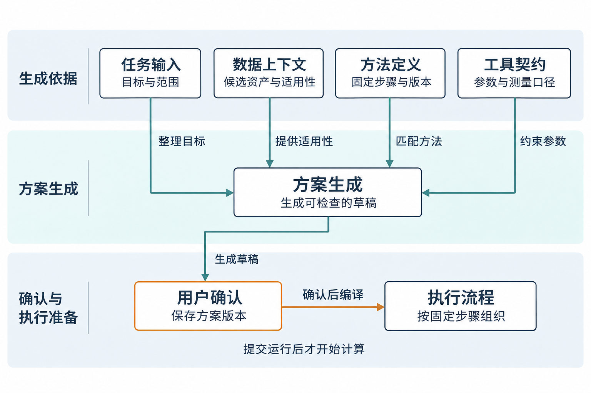

任务输入提供目标，数据上下文提供适用性，方法定义提供固定顺序，工具契约限制参数与测量口径。用户确认后保存方案快照，调度器据此编译任务，使界面选项与实际参数一致。

## 4.3 状态表达

执行状态使用“未开始、运行中、运行成功、运行失败、已取消”。检查状态使用“未检查、检查中、规则检查通过、规则检查有警告、规则检查未通过”。两个状态字段不得互相覆盖。

下图显示检查状态如何从“未检查”进入三个不同终态。关系标签给出分支条件。

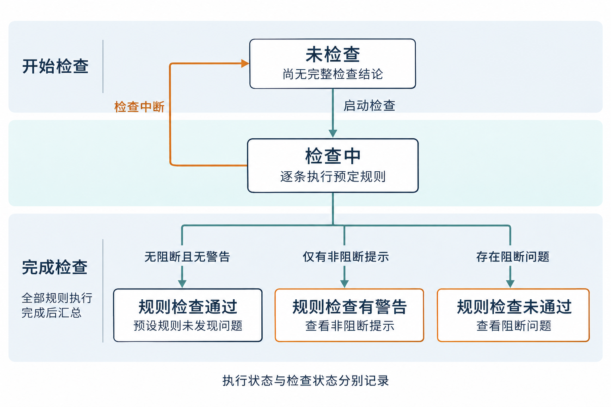

“有警告”表示成果可以查看，但存在需要读者注意的非阻断问题；“未通过”表示存在会显著影响结果的规则问题。具体阻断级别由方法定义给出。检查中断时回到“未检查”，同时记录中断原因。

# 5 GIS 计算正确性约束

GIS 计算规则由工具契约、方法定义和固定用例共同表达。契约判断输入是否适用于某个工具，方法规定数据准备与计算的顺序，用例比较实际成果。三者使用相同口径，才能把“参数已填写”进一步落实为“参数表达了当前任务”。

## 5.1 距离与面积口径

经纬度坐标表示角度，不适合直接做平面距离和面积。EPSG:3857 主要服务于 Web 地图显示，也不应作为本原型的平面测量坐标系。距离任务选择适用的局部投影或测地线方法，面积任务选择适用的等积投影。

下图列出允许的测量方式与应拒绝的平面计算方式。局部投影还需检查适用范围，测地线分支需有明确支持该算法的工具；只有检查满足后才允许执行。

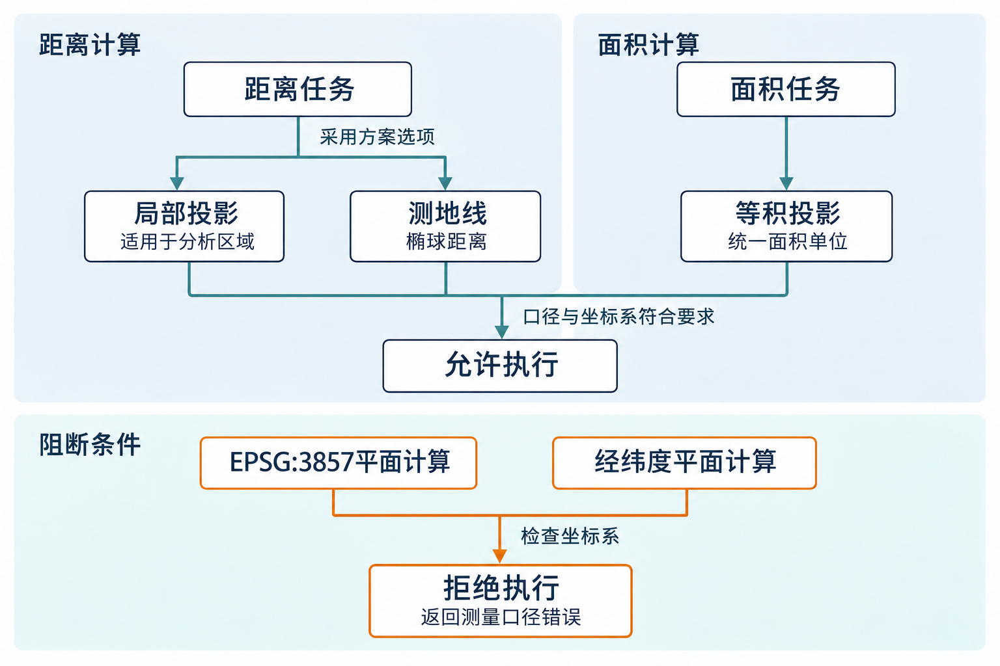

执行前检查根据 `measurement_policy` 读取任务类型、输入 CRS、计算单位和工具支持方式。局部投影距离核对适用范围，测地线距离核对算法入口，面积核对等积投影。失败时把具体字段与原因返回方案区，用户可据此调整方式或输入。

## 5.2 边缘效应

空间分析常依赖分析区外的数据。道路缓冲会受分析区外道路影响，坡度计算会依赖边界外像元。方法定义应把“外扩取数—计算—裁回范围”写成固定顺序。

外扩尺度由影响范围计算：道路缓冲使用目标距离加必要容差，DEM 使用算法邻域与像元大小。方法把外扩参数传给取数步骤，计算完成后再使用原分析区裁回。运行记录同时保留外扩范围引用和原范围引用，检查器据此核对取数与交付范围。

## 5.3 遥感元数据

传感器配置表至少使用传感器、产品级别和处理版本作为查找键。返回内容包括波段角色、缩放系数、偏移量、质量波段和质量位定义。表中每条配置应记录资料来源和更新时间。

查表结果需唯一匹配，缺少或多条匹配都返回配置错误，遥感步骤随即停止。错误中列出传感器、级别或版本的缺项，用户补充元数据或配置后再运行。系数和波段始终来自查表结果，T10—T12 检查这一传递过程。

## 5.4 空间关系与跨界规则

`intersects` 表示两个几何存在交集，包括仅边界接触；`within` 要求目标没有任何部分落在范围外，且两者内部存在交集。例如，边界上的点满足相交，却不满足 `within`；面要素的边界接触则需要结合其内部关系判断。方案按实际几何类型解释选项，T13 用固定样本核对边界行为。[Shapely 相交关系](https://shapely.readthedocs.io/en/stable/reference/shapely.intersects.html)，[Shapely within 关系](https://shapely.readthedocs.io/en/stable/reference/shapely.within.html)

跨界面对象可以按面积拆分、质心归属或最大重叠归属；点对象只使用点所在分区等适用规则，不提供面积拆分。质心和最大重叠使用裁剪前完整对象判断归属，范围内面积统计使用裁剪后几何与等积投影。方案、运行记录和统计表保存同一选项，具体连接见第 8.5 节。

## 5.5 规则检查的含义

规则检查分为输入检查、过程检查和成果检查。输入检查关注 CRS、范围、单位和元数据；过程检查关注固定步骤和实际参数；成果检查关注结构、数值范围、空间范围和来源关系。

“规则检查通过”表示本次预定规则全部完成且未发现问题，结论范围限于这些规则，不能证明业务结论绝对正确。报告列出检查对象、观察值与判定条件，用户可以据此判断结果是否满足自己的用途。业务含义与数据真实性仍需结合数据来源和任务背景解释。

# 6 系统总体架构

本架构采用第 13.13 节的 Python + Pydantic 基线：普通 Python 组织固定流程，Pydantic 校验结构化对象，QGIS/Python 进程执行空间计算。工具注册、参数发现与来源记录的设计依据见第 13.10 节。

## 6.1 分层结构

界面负责查看和填写，应用模块保存任务与组织流程，执行进程负责空间计算，SQLite 与文件目录保存记录和数据。应用模块位于同一本机 Web 服务内，通过函数和结构化对象交接；耗时计算交给子进程，浏览器继续查询服务中的运行状态。

下图按浏览器、方案与调度、本地执行进程、成果处理展开模块协作。两处“本机服务”分区属于同一应用；“成果”指汇总文件、来源和检查状态后的结果视图。详细调用顺序见第 7.6 节。

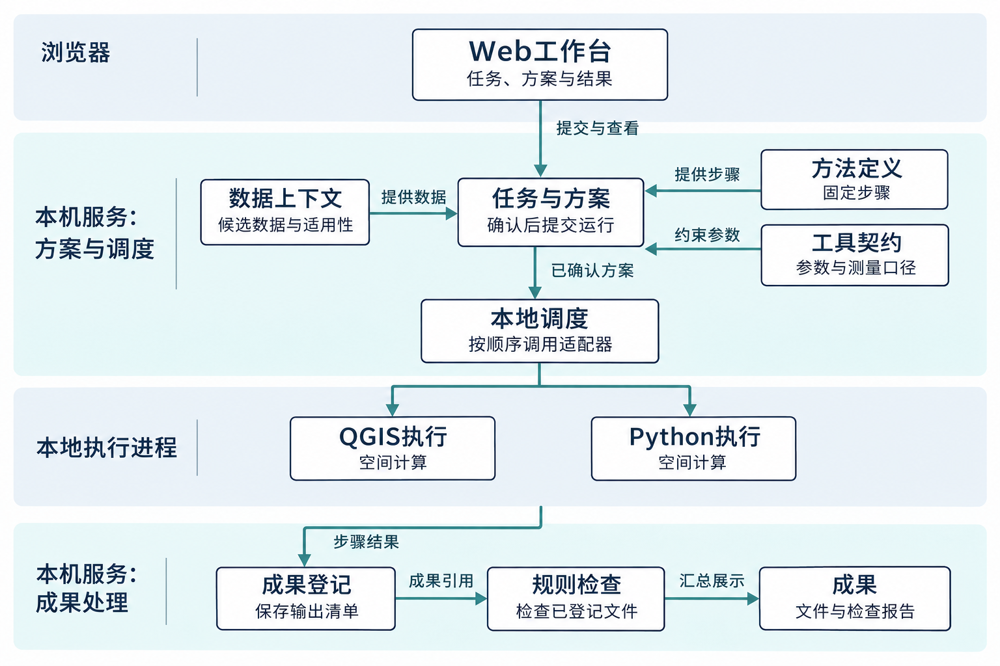

任务与方案模块组织一次分析，数据上下文、方法定义和工具契约提供生成方案所需的信息。调度器接手已确认版本，调用本地进程；成果登记和规则检查再处理返回结果。工作台通过服务读取这些记录，使页面显示与后台计算使用同一份状态。

## 6.2 本机运行结构

下图换一个角度说明进程与存储关系。它回答“哪些组件运行在本机、数据写到哪里、PostGIS 如何接入”。

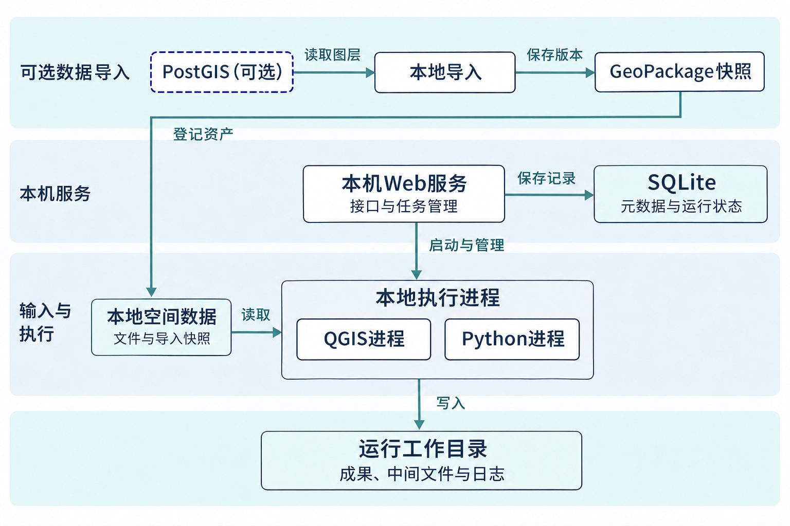

本机 Web 服务接收浏览器请求并写入 SQLite。调度器启动 QGIS 或 Python 子进程读取本地文件、GeoPackage 和 GeoTIFF/COG，把结果写入运行工作目录。图中的 PostGIS 连接用于导入本地快照，后续分析读取该快照。SQLite 只保存元数据、状态和路径，不承载大型栅格。

首版使用一个 Web 服务进程和一个后台调度循环，每次完成一条运行链及其规则检查，再处理下一次运行。顺序执行便于核对中间文件和状态，也简化取消与重试。浏览器轮询 SQLite 中保存的进度，页面刷新后按运行编号恢复。

## 6.3 外部模型边界

下图把允许发送和留在本机的内容分区展示。青灰色箭头表示可发送摘要，橙色阻断符号表示数据在本机边界内停止。

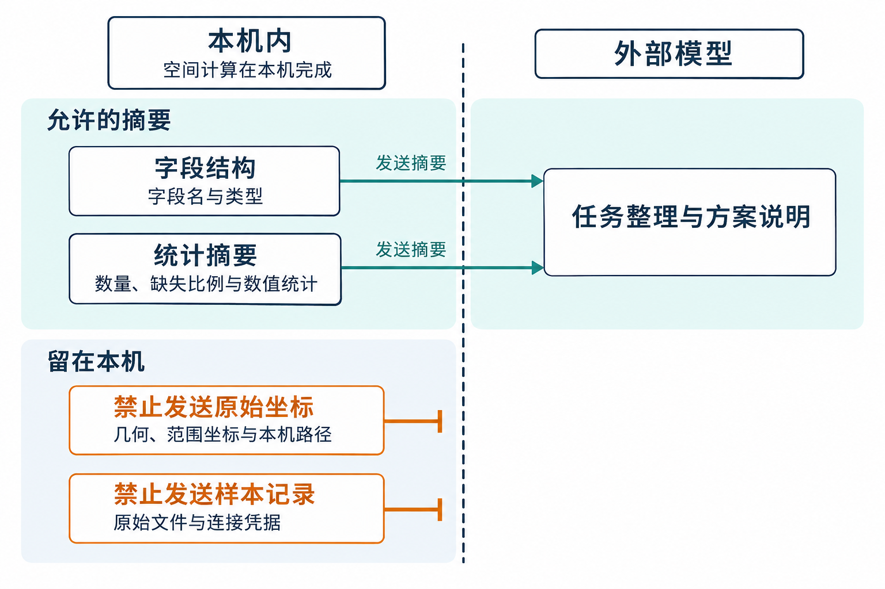

外部请求按允许字段重新构建，包括字段名与类型、数量、缺失比例、数值统计、栅格尺寸和分辨率。几何与范围坐标留在本机，空间关系由本机程序判断；方案模块可使用“范围相交”等不含坐标的结论。这样模型获得选择方法所需的信息，具体位置仍由本机数据引用承接。

## 6.4 模块关系与调用方向

浏览器只调用本机 Web 服务。任务模块读取数据上下文、方法定义和工具契约，生成方案草稿。用户在确认后发起运行，本地调度读取指定版本快照，产生运行记录并启动执行适配器。执行完成后，成果模块登记文件，规则检查模块读取成果与运行信息并生成报告。

SQLite 的写入统一由本机服务内的数据访问函数完成。调度、成果登记和规则检查模块调用这些函数；QGIS/Python 子进程只读取请求、计算并写文件，不直接更新任务状态。这样排查问题时，可以分别查看“进程实际做了什么”和“服务保存了什么”。

## 6.5 为什么使用应用内模块与独立进程

数据、方案、成果和检查模块经常读取同一组记录，放在一个应用内可以直接调用，并统一保存状态。QGIS 与 Python 的计算则具有独立环境、较长运行时间和单独的退出结果，适合用子进程承载。服务通过请求文件、输出清单和退出码与进程交接，排错时可以分别检查计算日志与状态记录。

性能排查先区分等待发生在哪一层：页面查询慢就查看服务与 SQLite 访问，计算进程内存高就检查数据读取和栅格分块，工具耗时长就查看步骤日志。根据实际瓶颈调整对应环节，初期保留一条运行链，便于比较修改前后的表现。

## 6.6 版本与来源记录

每次运行保留当时使用的配置和输入，按以下关系记录：

1. 已确认方案保存完整快照；启动运行时使用指定版本，后续配置更新不替换该快照。
2. 运行记录指向明确的方案版本和工具版本。
3. 成果记录能够回到运行记录和输入资产版本。
4. 规则检查报告说明使用的规则版本。
5. 输入数据发生变化时登记新版本，旧方案继续引用旧版本；源文件已被改写时，旧方案需要换用可读且指纹匹配的数据后才能再运行。

资产版本包含当时的元数据、来源与指纹，重新运行时据此检查当前文件是否仍对应原输入。需要保留历史计算条件时，把输入样本或快照放入工作目录；PostGIS 则在导入时就生成快照。版本记录与文件保存配合使用，才能找到可供复算的那一版数据。

## 6.7 通用核心与方法配置的分工

任务、方案、调度、运行记录和成果管理处理共用对象。方法配置提供输入角色、关键选项、有序步骤及检查规则，工具契约提供某个算法的参数与文件类型。核心模块据这些定义工作，业务名称只用于选择与说明。

| 需要变化的内容 | 修改位置 | 继续复用的部分 |
|---|---|---|
| 输入角色、选项或步骤组合 | 方法定义与版本 | 方案对象、确认与调度 |
| 已有引擎中的新算法 | 工具契约、参数映射及样本 | 运行请求、日志与成果登记 |
| 新产品的数值解释 | 产品配置及对应检查函数 | 数据引用、栅格执行与展示 |
| 新数据格式或成果类型 | 读取适配或预览处理 | 资产、运行与来源关系 |

例如字段筛选方法可以只有读取、筛选和导出，不需要距离方式、邻域外扩或传感器配置。其文件仍经由适配器返回清单，登记后执行该方法的检查。需要新增规则或算法时，在相应注册位置接入实现；调度器继续按工具标识和输入输出引用派发步骤。

# 7 核心模块详细设计

本章把第 13.10.4 节的借鉴选择落实为本机应用内的函数和对象。首版先让这些函数在命令行中接通，再由 Web 接口调用；外部模型和地图显示都接在同一组对象上。

模块之间通过结构化对象和文件引用交接。数据读取结束后可以关闭句柄，下一个模块再按资产版本或步骤输出重新打开文件；因此浏览器请求结束、进程退出和页面刷新都不会丢失交接信息。第 8 章给出字段示例，附录 A 列出固定方法。

## 7.1 数据源适配器

### 目的与交接对象

数据源适配器负责“找到并重新打开数据”。输入是本地来源描述，包括文件路径、图层名，或者 PostGIS 连接别名和表名；输出是带版本的数据资产。路径与连接信息只在本机保存。

下图表示不同读取方式如何汇入统一元数据。资产对象保存来源描述，执行时再打开数据；PostGIS 路径先经过导入快照。

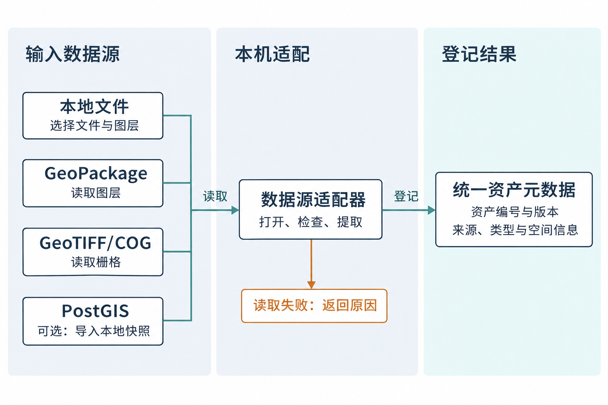

### 处理顺序与输出

登记函数先检查来源能否打开，再提取格式、类型、CRS、范围、字段、数量及缺失摘要，最后计算来源指纹并写入 SQLite。同一来源内容未变时返回原版本；内容变化时新增版本。后续模块使用 `asset_id` 和 `asset_version`，不依赖仍然存活的文件句柄。

PostGIS 适配器将选定图层导出为本地 GeoPackage，再按普通文件登记快照。每个分析步骤读取相同快照，输入内容由此固定在一次导出时点。来源记录保存连接别名、表名、筛选条件和导出时间；需要新数据时重新导出，形成新版本供方案选择。

### 异常处理与判定

文件不存在、格式无法读取、图层缺失或数据库连接失败时，返回来源错误，不创建可用资产。数据能够读取但 CRS 缺失时，仍可登记并显示缺项，由上下文模块判为不可用于测量；这样用户可以看见并修正问题数据。

最先检查的是资产能否脱离登记时的读取会话重新打开：关闭句柄后，仅凭资产编号和版本再次读取并比较摘要。运行前再核对文件指纹，发现变化就返回“输入已变化”，由用户刷新资产和方案。这能区分来源打不开与来源已更新两类问题。

## 7.2 数据资产与任务上下文

### 目的与交接对象

资产清单描述“有什么数据”，数据上下文描述“这些数据能否完成当前任务”。输入包括任务目标、所选资产版本、候选方法前提，以及该方法需要的范围引用；输出包括各输入角色对应的资产、适用性和具体原因。

下图把筛选和适用性判断放在上下文形成之前，任务目标同时决定范围与所需条件。

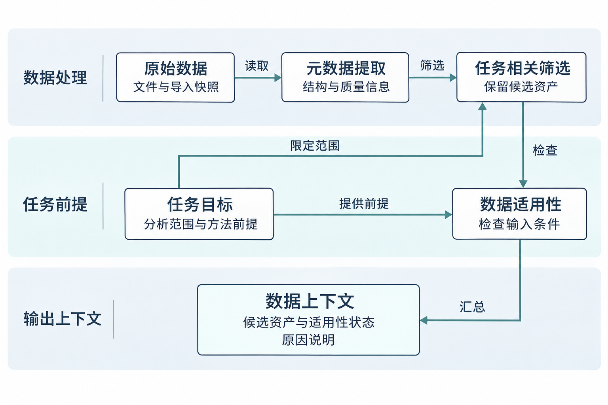

### 处理顺序与输出

上下文函数先读取方法声明的角色及数据类型，匹配资产后再检查该方法所需的范围、字段、时间、CRS 和覆盖条件。属性筛选重点检查字段，邻域计算关注外围覆盖，产品指数计算关注传感器元数据；检查项随方法选择。结果保存到任务的上下文快照，供方案生成器和界面共同读取；输出给模型的摘要由第 7.12 节另行筛选。

适用性分为四类：`READY` 表示前提已满足；`CONDITIONAL` 表示还需落实处理选项；`BLOCKED` 表示存在明确冲突；`UNKNOWN` 表示缺少判断依据。例如，已知 CRS 但需要重投影的数据可列为条件适用，方案补入合适转换后再确认；缺少来源 CRS 时则先补充元数据。

### 异常处理与判定

缺少必需角色时，任务保留已有数据，并返回角色名称与缺失原因。更换资产、范围或目标后重新构建上下文，相关草稿按新结果检查。验收同时比较候选资产、状态与说明，确认用户能从提示找到应补充的数据或选项。

## 7.3 分析方案对象

### 目的与交接对象

方案生成器接收任务、数据上下文、方法版本和候选契约，将它们整理为一份可编辑草稿。业务选项与精确参数关联保存，例如页面的“500 米”对应距离值、单位和计算方式。确认后，同一版本既用于页面回显，也用于编译步骤请求。

下图以空间分析选项示意方案结构。输入、步骤、工具参数、成果和检查项共同参与确认，具体选项随方法定义变化。

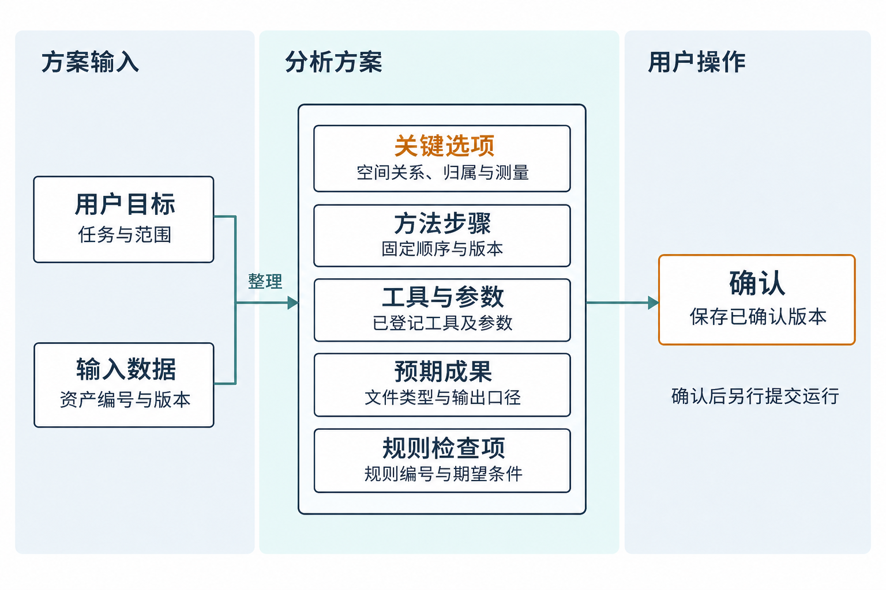

### 生成、确认与输出

生成时先展开固定方法，再为每步选择工具、连接前序输出并填入参数。缺项保存在 `issues` 中，草稿仍可查看和保存。确认函数检查全部必需输入、选项、步骤连接和工具前提；通过后把该版本标为 `confirmed` 并保存完整快照。

确认用于固定计算内容，运行用于分配资源并执行，两步通过方案版本连接。确认后的输入、方法、选项、参数、成果或规则发生变化时，保存新的 `draft` 版本，历史运行仍指向原快照。运行接口接收明确的版本号，用户查看的内容因此能与实际执行对应。

### 异常处理与判定

确认失败返回字段位置和原因，例如跨界归属未选，或候选工具缺少测地线实现。确认阶段核对方案是否完整，运行阶段再检查文件和工具是否仍可用；两次检查之间，用户可能移动文件或更新环境。联调时沿页面、快照和执行请求比较同一参数，定位转换差异。

## 7.4 方法定义与固定步骤

### 目的与交接对象

方法目录接收方法编号和版本，输出有序步骤、输入角色、开放选项、预期成果和检查规则。一个方法可以供多个业务任务复用，同一任务也可以选择不同的已登记方法。工具目录再为每个步骤提供实际可调用的实现；方法本身不保存机器上的命令路径。

下图以涉及边缘影响的方法说明外扩、计算和裁回的顺序。这一约束适用于对应方法；不涉及邻域或影响范围的方法使用自身步骤列表。

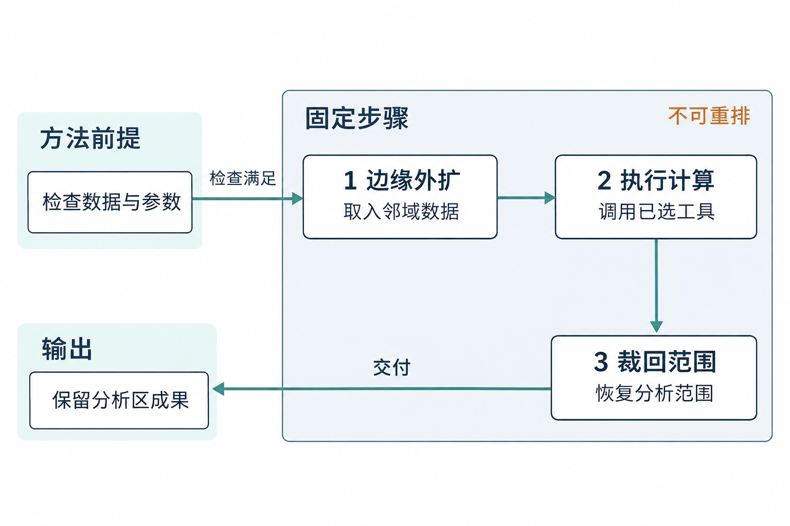

### 处理顺序与输出

应用启动时加载方法配置，检查步骤标识唯一性、前序引用和输出名称。方案生成时把固定步骤展开为工具调用及输入输出连接，调度器随后按列表执行。方法配置因此同时服务于方案展示和运行顺序，边缘处理等专业要求可以在加载和编译时检查。

涉及对象拆分与归属统计的方法在目标对象进入步骤链时保存 `source_feature_id`，裁剪后仍沿用该标识。一个对象可能被裁成多个部分，统计可据此将它们对应回原对象，分别处理计数和面积。加工工具自行生成的 FID 只用于当前文件内部。

步骤输入来自方案资产，或前序步骤的命名输出。调度器保存“步骤编号／输出名—本机文件引用”的映射，并将实际引用写入记录。前一步成功返回所需输出后，下一步才能解析输入并启动。

### 异常处理与判定

配置缺字段、引用后面的步骤或违反固定顺序时，在方法加载或方案编译时返回错误。每个方法以其版本化配置为顺序依据。附录 A 给出首批样例配置，第 8.5 节和道路样例图用于对照其中一项方法。

### 新方法的接入过程

新增方法先说明要接收什么数据、输出什么成果，再检查已有工具能否完成。能复用工具时，主要工作是配置步骤和选项；缺少实现时，再补充对应工具契约或脚本。方法与工具配置放在本地目录，由应用启动时加载，个人原型采用重启后更新目录的方式即可。

1. 声明方法编号、版本、输入角色和适用前提，按实际需求定义选项。
2. 选择已登记工具，为每一步连接输入与命名输出，并列出预期成果。
3. 绑定适用的输入检查、过程检查和成果检查；新增规则同时登记检查函数。
4. 准备最小样本、参考结果及失败输入，先直接运行，再经方案确认和调度运行。
5. 从方法目录选择该方法，核对表单、实际请求、结果页面和来源记录是否对应同一版本。

已有运行器支持的工具接入后，方案、调度与成果模块继续使用原接口。需要专用算法时，适配代码集中处理该工具的参数和文件；需要新预览方式时，在成果类型的展示位置接入。目录中的不可用项注明缺少的依赖或配置，其他方法继续可选。

## 7.5 工具契约与测量策略

### 目的与交接对象

工具契约声明实现所需的输入、参数、输出和测量条件。执行前检查把契约与已确认步骤、实际输入元数据相比较，生成规范化请求，或返回带字段位置的错误。适配器接收检查后的请求，再转换为具体软件调用。

下图将实际输入和契约条件汇入执行前检查，检查结果决定是否生成工具请求。测量口径和 CRS 节点表示判断依据，主流程按检查、请求和执行连接。

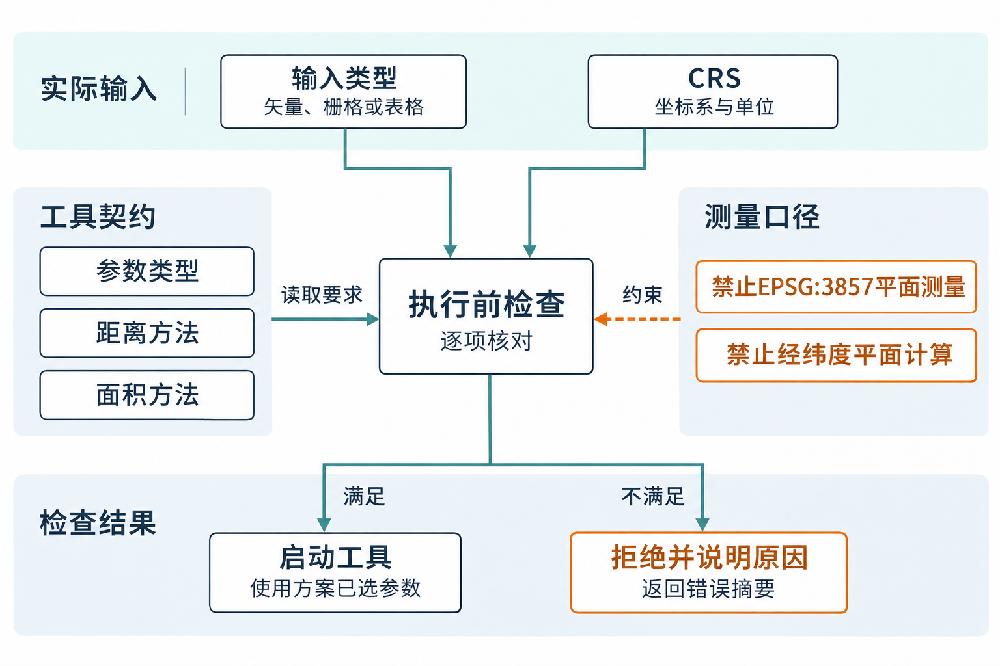

### 处理顺序与输出

执行前检查先确认工具存在、参数类型正确和输入可读，再核对几何类型、CRS、单位及测量口径。方案确认前展开工具默认值并统一单位，适配器随后转换软件参数名和枚举。运行请求由这些已保存的值构成，便于与页面逐项核对。

需要重投影时，由方案中列出的准备步骤生成新输入，契约检查读取这份输入的实际元数据。检查负责判断条件，准备步骤负责转换文件，两个环节各自留下参数和结果，便于回查坐标变化发生在哪里。

方法级规则检查整条链的成果，工具级规则检查具体输入输出；确认快照连同引用的契约内容一起保存。适配器先检查输出存在且可读，最终检查器再汇总方法规则、工具规则与过程记录。

同一方法可以调用不同契约，但每份契约只声明该实现真正支持的方式。局部投影缓冲与测地线缓冲分别登记；面积步骤使用等积投影。非测量工具把对应策略标为 `not_applicable`。

### 异常处理与判定

能从方案字段判断的错误在确认前返回，涉及中间文件的条件则在该步骤启动前核对。例如，距离方式可在草稿中检查，前序输出的实际 CRS 需要读取生成文件。后者失败时记录步骤位置并结束本次运行，T01—T06 核对测量方式及参考结果。

## 7.6 本地调度与执行时序

### 目的与交接对象

调度器接收指定版本的已确认方案，输出运行记录和逐步更新的状态。浏览器提交后立即取得运行编号，之后通过查询接口读取结果；本机服务中的后台循环负责长时间计算。

下图显示一次正常运行。步骤调用可以重复多次，成果登记和最终规则检查各在整条计算链完成后执行一次。浏览器收到编号后开始轮询，图末只展开一次查询与返回。

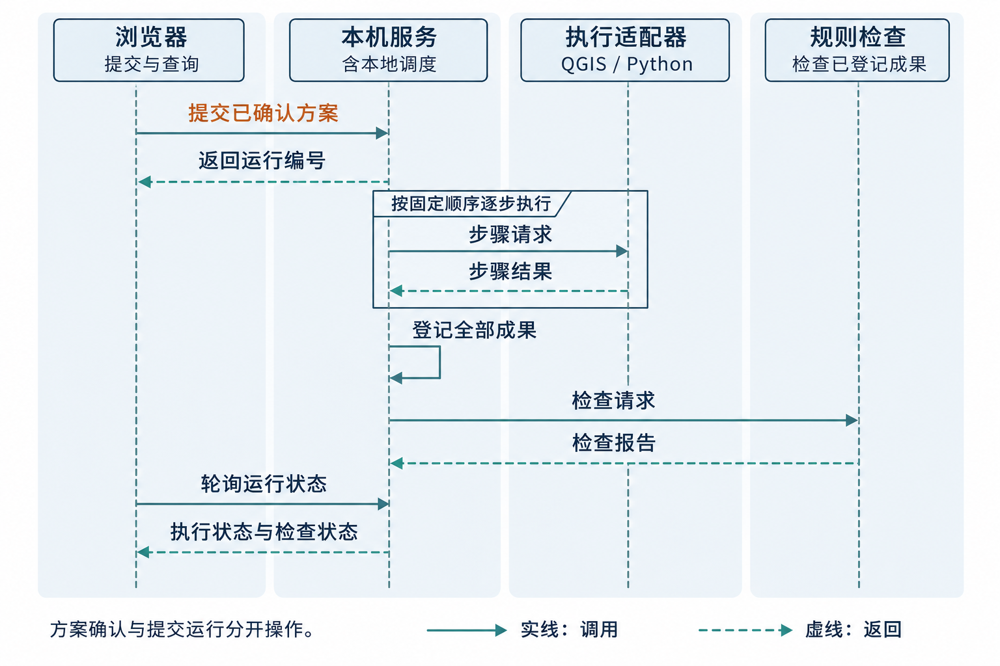

### 调用顺序

创建运行依次检查方案与输入、分配目录、写入请求快照，再保存 `NOT_STARTED` 记录。返回运行编号意味着这些准备已经完成，浏览器可据此查询；准备失败则直接返回对应错误。已有活动运行时，服务返回该编号，让界面继续显示正在处理的任务。

后台循环取得运行记录后，将执行状态改为 `RUNNING`，逐步完成输入解析、契约检查、适配器调用和输出登记。前一步成功返回命名输出后，调度器才启动下一步。

全部步骤完成后，服务核对并登记预期成果，再一起保存 `SUCCEEDED` 与 `CHECKING`，随后调用检查器。先登记再检查，使检查报告引用的是已经可以查询的成果；页面也能同时取得文件入口和检查进展。

### 失败、取消与重试

进程启动失败、非零退出、超时、结果解析失败或必需文件缺失时，调度器停止后续步骤，记录 `FAILED` 与 `NOT_CHECKED`。日志和部分文件保存在原目录，界面按排错文件展示。修复环境或方案后，新运行从第一步开始，便于与失败记录对照。

取消接口先记录 `cancel_requested`。调度器停止派发新步骤，并请求适配器结束当前子进程；确认进程已停止后才写入 `CANCELLED`。如果计算已经完成并进入规则检查，取消只中断检查，保留执行成功，检查状态回到 `NOT_CHECKED` 并记录原因。

服务关闭时停止所管理的子进程。异常退出后，重启时先确认本服务遗留的子进程已经停止；无法确认时提示用户关闭对应进程，暂不启动新任务。随后将遗留活动记录标为中断，不自动接续：尚未完成计算的记录记为执行失败，已完成计算但检查中断的记录保留执行成功。用户据此选择重新运行或仅重新检查。

## 7.7 QGIS 与 Python 执行适配器

### 目的与交接对象

适配器接收一条步骤请求，负责启动对应本地进程并返回统一步骤结果。QGIS 与 Python 共用请求和结果模式，各自处理命令参数、环境和输出解析。

下图区分服务内的适配器与外部子进程。子进程返回退出信息和文件，适配器负责整理结果，错误摘要也放在同一结果中。

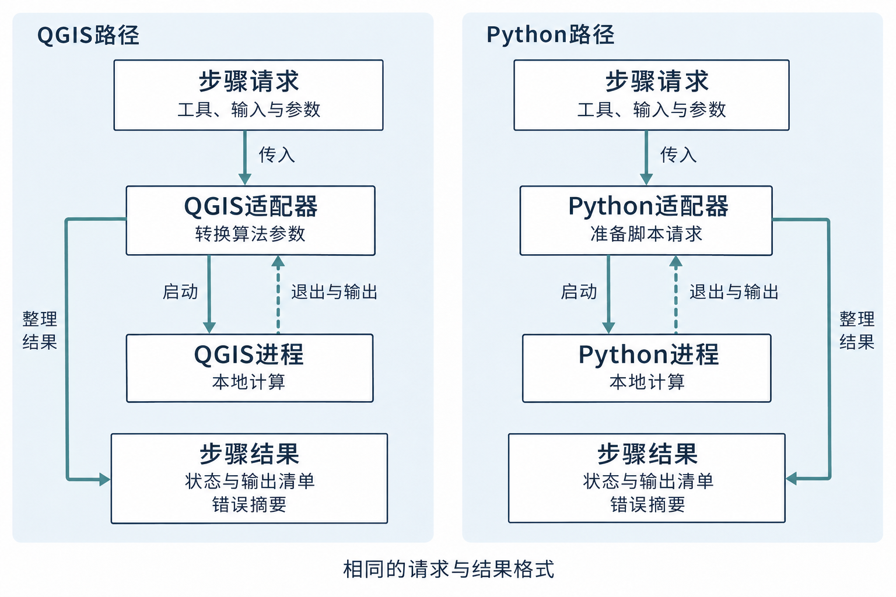

### 请求如何变成计算

步骤请求包含运行与步骤编号、工具版本、已解析输入、输出目标、参数和工作目录。调度器把资产或前序输出换成本地来源描述，适配器再用该描述打开数据。两个进程之间由文件引用交接，QGIS 图层对象和打开的句柄各自在所属进程中管理；示例见第 8.9 节。

QGIS 适配器把通用字段转换为算法参数，首选 `qgis_process`，确需 PyQGIS 会话的工具使用独立入口脚本。Python 适配器启动已登记脚本，并通过请求文件传参。程序路径和参数分开传入，日志写入本步目录；适配器等待进程退出后读取输出清单。

### 输出与异常

适配器将进程结果整理为步骤状态、退出码、起止时间、输出清单、日志位置和错误对象。它先核对必需文件是否存在、可读且类型匹配，调度器据清单连接下一步；最终规则检查再读取空间范围与数值。退出码为零却缺少输出的情况，在适配器处返回失败，防止后续引用空文件。

取消由适配器管理已启动的进程句柄；Python 脚本可在分块间读取取消标记，未响应的子进程按本地设置终止。工具超时按失败处理，用户取消按取消处理，两者不靠同一个退出码猜测。

## 7.8 本地执行与数据流拓扑

时序图回答“先调用谁”，下图回答“数据从哪里来、文件由谁写、记录由谁保存”。图中分别展开同一本机服务内的调度、适配、登记和检查模块，箭头标签说明交接内容。

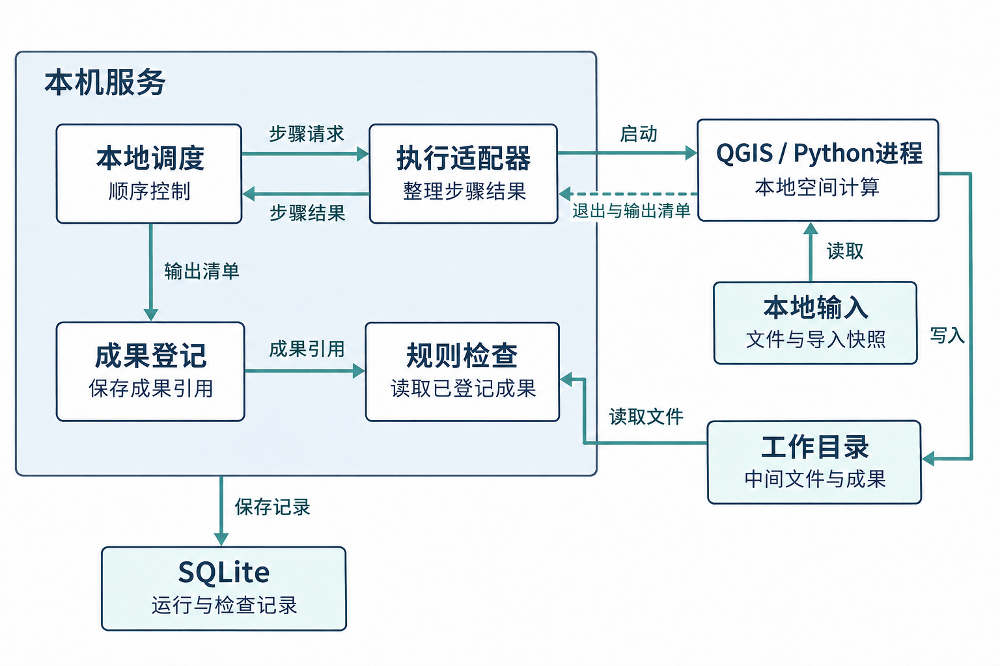

计算进程读取本地输入或 PostGIS 导入快照，向本次工作目录写文件。适配器核对文件后把输出清单交回调度器，成果模块按清单登记，检查器再按成果引用读取。文件在目录中流转，状态和引用在服务内流转，两条路径通过输出清单对应。

## 7.9 规则检查器

### 输入、处理与输出

最终检查接收方案中的规则、实际步骤记录、参数与已登记成果。输入准备阶段已经记录过 CRS 和单位判断，最终检查将这些过程记录与输出文件一起核对。同一规则使用相同编号，并通过阶段字段说明它在确认前、执行前还是成果阶段触发。

每条检查输出规则编号、阶段、严重程度、观察值、期望条件和说明。例如范围检查同时给出被检查成果和范围判定，数量检查给出明细总数与汇总值。所有预定规则结束后，有阻断问题汇总为 `FAILED`，仅有非阻断提示为 `WARNING`，其余为 `PASSED`；报告与运行的检查状态一起保存。

### 检查失败与检查中断

检查发现规则问题时，报告保存观察值与判定，计算完成的运行仍保留 `SUCCEEDED`。检查器异常、取消或服务中断时，则保存未完成项，检查状态回到 `NOT_CHECKED`。两类情况分别对应修改计算条件和修复后重查；空规则清单在方案检查中作为配置错误返回。

只修复检查器后，可以对原成果发起手动重查，并保存新的报告记录。重查前核对成果文件指纹，仍使用原方案的规则版本；文件或计算口径已变时重新建立运行。T16 同时核对执行成功、规则未通过和检查中断的显示区别。

## 7.10 成果来源关系

成果登记接收适配器的输出清单及运行引用，核对文件位置、可读性和预期类型，再写入成果记录。清单给出每个文件的角色，服务据此区分最终成果与中间文件；目录中即使还有日志或临时文件，也能按明确用途展示。

下图中箭头指向被引用对象。实现时，方案输入和运行使用明确版本，成果及检查报告引用本次运行。

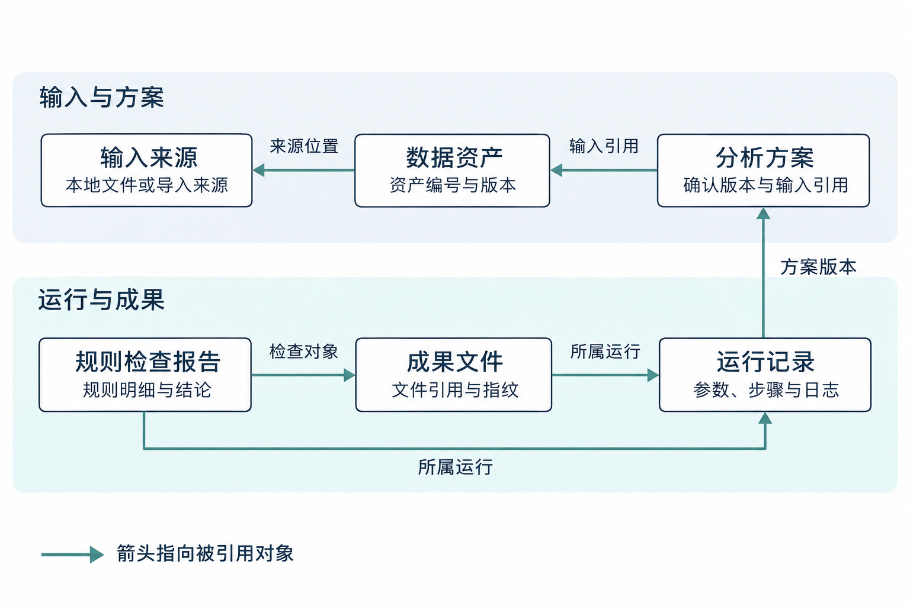

成果记录包括角色、文件引用、格式、指纹和元数据；地图预览另存记录，并指向原始成果。结果页据此组合文件、检查报告和来源说明。文件被移动或删除后，保留来源记录并标为不可读，界面仍可展示日志与元数据。

登记失败时停止进入检查阶段，并返回文件或存储错误。部分计算输出列为排错文件；只有与 `expected_artifacts` 对应的完整输出才进入正式成果清单。重新计算生成新的运行与成果编号。

## 7.11 传感器配置表

传感器配置以产品元数据中的传感器、级别和处理版本为输入，返回唯一的配置编号、版本及波段参数。声明了产品前提的方法通过它判断输入能否处理，后续步骤用同一版本准备波段。其他方法直接使用自身的数据前提。配置引用随方案与运行保存，后续可追查指数采用了哪组转换。

| 字段 | 含义 | 使用位置 |
|---|---|---|
| id、version | 配置标识与版本 | 保存到方案和运行快照 |
| sensor、product_level | 传感器与产品级别 | 初步查找 |
| processing_version | 可匹配的处理版本 | 确定唯一配置 |
| band_roles | 方法需要的波段角色，如红光、近红外和质量波段 | 定位实际波段 |
| scale_offset | 逐波段的缩放与偏移 | 将原始值转换为计算值 |
| quality_rules | 云、阴影、饱和等判定 | 生成有效像元掩膜 |
| source_reference | 产品资料或元数据来源 | 解释配置依据 |

先检查配置唯一匹配和所需波段存在，再应用缩放、质量掩膜和指数计算。查不到、匹配多条或必要系数缺失时返回配置错误，并列出缺失键；新增配置另存版本。T10—T12 核对配置选择和数值转换。

## 7.12 模型适配与手工入口

模型适配接收整理后的任务目标、允许的摘要及候选方法／工具标识，输出结构化候选选择和文字说明。任务模块先在本机将路径、坐标和样本内容转换为引用，模型请求再从允许字段构建；完整请求通过边界检查后才发送。

模型返回先按结构模式解析，再检查候选编号、枚举和参数范围。方案生成器从选定方法展开固定步骤，本机函数提供传感器参数和投影适用性结论。文字说明与候选选择分别处理：说明生成失败时，用户仍可查看结构化草稿并继续补充。

模型超时、不可用或返回格式错误时，界面保留草稿并提供手工入口，用户可填写同一组方法与参数后继续确认。已经启动的本地运行读取自身快照，可独立完成。开发时先用固定模型返回接通方案，再替换为实际请求，分别核对字段解析与网络调用。

# 8 数据与接口设计

接口按“登记资产—生成方案—创建运行—查询成果”的顺序组织。对象通过编号与版本相互引用，页面和后台使用相同记录；下面的示例说明字段怎样从前一步传到后一步。外部模型的请求另按第 8.8 节构建。

## 8.1 SQLite 数据对象

SQLite 保存元数据、版本和运行状态，大型空间数据放在文件中。下面的字段足以把输入、方案、运行、成果和检查报告连接起来。

| 对象 | 主要字段 | 关系与保存方式 |
|---|---|---|
| `data_asset` | `id`、`version`、`source_json`<br>`fingerprint`、`metadata_json` | id 与 version 共同定位一版资产 |
| `task` | `id`、`goal_json`、`context_json`<br>`created_at` | 保存用户输入和当前上下文 |
| `analysis_plan` | `id`、`task_id`、`version`<br>`status`、`plan_json` | 同一方案按版本保存，不覆盖历史确认内容 |
| `run` | `id`、`plan_id`、`plan_version`<br>`execution_status`、`check_status` | 指向确认快照，另存 workdir 和 error_json |
| `run_step` | `run_id`、`step_key`<br>`status`、`request_json`、`result_json` | 保存实际输入输出、时间及日志引用 |
| `artifact` | `id`、`run_id`、`role`、`uri`<br>`fingerprint`、`metadata_json` | 最终成果；预览记录另存 source_artifact_id |
| `check_report` | `id`、`run_id`、`status`<br>`report_json` | 保留每次检查，运行记录引用当前报告 |
| `method_definition` | `id`、`version`、`content_json` | 被方案快照引用 |
| `tool_contract` | `id`、`version`、`content_json` | 被方案步骤引用 |

需要同时生效的信息在同一次数据库保存操作中更新：方案快照与确认状态一起保存，成果登记后一起写执行成功与检查中，检查报告与检查状态一起保存。浏览器随后读取 SQLite 中的结果。存储失败返回具体错误，页面保留可查询的原状态，便于检查文件输出与记录保存分别完成到哪里。

`source_json` 和 `uri` 只在本机解析。路径、连接别名和文件指纹不会随资产对象整体发给模型；第 8.8 节单独规定允许发送的字段。


## 8.2 工作目录

工作目录按任务、运行和步骤逐层组织。一次运行中的请求快照、实际结果、日志与成果因此可以一起查找；重新运行生成另一目录，便于比较两次输入和输出。步骤请求与步骤结果分别保存，排错时可以沿调用顺序逐个核对。

```text
workspace/
  assets/                    # 导入快照
  tasks/{task_id}/runs/{run_id}/
    request.json             # 确认方案与运行选项
    inputs/                  # 输入引用或临时裁取数据
    steps/{step_key}/
      request.json
      result.json
      process.log
    cancel.flag              # 收到取消请求时创建
    intermediate/
    outputs/
    previews/
    checks/{report_id}.json
  scripts/{script_run_id}/    # 本地脚本区独立输出
```

编译器为输出分配本次运行目录内的路径，并用步骤名和输出名连接中间结果。最终成果按角色登记，例如缓冲区、目标对象和统计表；结果页根据角色选择展示方式。脚本试验使用单独目录，文件来源与正式方案的运行清晰对应。

## 8.3 AnalysisPlan 接口

方案的公共结构由目标、资产引用、方法版本、步骤、预期成果和检查项组成。`inputs` 的键与 `critical_options` 的内容由所选方法定义；下面以建筑物点、质心归属和局部投影距离说明道路统计方案。`distance_crs_ref` 引用本机保存的 CRS 定义，方案确认时按数据范围检查其适用性。示例先展示目标、输入和关键选项，再展开步骤与成果字段。

```yaml
id: plan-001
task_id: task-001
version: 1
status: draft
goal: {summary: 道路500米范围内建筑物分区计数}
inputs:
  roads: {asset_id: road-001, asset_version: 1}
  targets: {asset_id: building-001, asset_version: 1}
  zones: {asset_id: zone-001, asset_version: 1}
  analysis_extent: {asset_id: extent-001, asset_version: 1}
critical_options:
  distance_m: 500
  distance_method: local_projected
  distance_crs_ref: local_crs_001
  spatial_relation: intersects
  boundary_assignment: centroid
  boundary_tie: unassigned
  statistic: count
  output_scope: clipped_to_analysis_extent
method: {id: road-buffer-statistics, version: 1}
issues: []
```

方案的 `steps`、`expected_artifacts` 和 `check_rules` 分别保存调用顺序、成果要求与检查规则。每个步骤包含 `key`、`tool`、`inputs`、`parameters` 和 `outputs`，下例展开缓冲步骤，其余步骤按第 8.5 节连接。确认时，这些字段合成同一份完整快照。

```yaml
key: create_buffer
tool: {id: qgis-buffer, version: 1}
inputs:
  source: {step: choose_measurement_method, output: roads}
parameters:
  distance: 500
  segments: 8
  dissolve: true
  end_cap_style: round
  join_style: round
  miter_limit: 2
outputs:
  buffer: {type: vector_polygon, target: intermediate/buffer.gpkg}
```

`segments` 表示每四分之一圆弧的离散段数，示例值应随固定样本与容差一起确认；`dissolve` 合并重叠缓冲，统计另按原始对象标识去重。端点和连接样式同样明确保存，前一步投影处理产生新的道路文件。[QGIS 3.44 缓冲参数](https://docs.qgis.org/3.44/en/docs/user_manual/processing_algs/qgis/vectorgeometry.html)

```yaml
expected_artifacts:
  - {role: buffer_extent, step: create_buffer,
     output: buffer, type: vector_polygon}
  - {role: selected_targets, step: clip_back_to_analysis_extent,
     output: targets, type: vector_point}
  - {role: zone_statistics, step: aggregate_by_zone,
     output: statistics, type: table}
check_rules:
  - measurement_policy_satisfied
  - outside_roads_within_influence_included
  - output_clipped_to_analysis_extent
  - detail_count_matches_summary
```

确认函数检查全部步骤已绑定工具、所有引用均可解析、条件适用项已落实且 `issues` 为空，再将此版本改为 `confirmed`。输入、方法、参数或规则发生变化时创建新草稿版本；第 8.6 节的运行请求同时提交 `plan_version`。

## 8.4 ToolContract 接口

下面是 QGIS 平面缓冲契约的最小示例。它接受已经转换到适用局部投影的道路文件，具体算法参数转换由适配器完成；测地线缓冲使用另一份明确支持该算法的契约。

```yaml
id: qgis-buffer
version: 1
runner: qgis
implementation: native:buffer
inputs: {source: vector_line}
outputs: {buffer: vector_polygon}
parameters:
  distance: {type: number, unit: meter, minimum_exclusive: 0}
  segments: {type: integer, minimum: 1}
  dissolve: {type: boolean}
  end_cap_style: {type: enum, values: [round, flat, square]}
  join_style: {type: enum, values: [round, miter, bevel]}
  miter_limit: {type: number, minimum: 1}
measurement_policy:
  distance: local_projected
  area: not_applicable
  forbid_web_mercator: true
  forbid_geographic_planar: true
preconditions:
  - crs_is_known
  - projected_crs_suitable_for_extent
  - horizontal_unit_is_meter
  - geometry_is_valid
check_rules:
  - output_exists
  - output_crs_expected
```

输入参数 `distance` 对应工具的距离参数，`segments` 与 `dissolve` 也在方案中显式保存。工具版本指本地契约版本，运行记录另存实际 QGIS 或 Python 环境版本。执行时发现所需实现不可用，返回工具错误，保留原方案供用户调整。

`measurement_policy` 与任务类型共同检查。非测量工具明确填写 `not_applicable`；执行前检查失败时不启动进程，执行后的规则检查则读取真实输出。

## 8.5 MethodDefinition 接口与步骤连接

方法定义描述输入、顺序、开放选项与前提，方案负责填入具体工具及输入输出引用。方法编号是目录中的标识；步骤数量、角色名称与选项集合随方法变化。下面是道路统计的实例，步骤标识与附录 A.1 完全一致。

```yaml
id: road-buffer-statistics
version: 1
locked_order: true
inputs:
  analysis_extent: vector_polygon
  roads: vector_line
  targets: vector_point_or_polygon
  zones: vector_polygon
critical_options:
  distance_m: {type: number, minimum_exclusive: 0}
  distance_method: [local_projected, geodesic]
  distance_crs_ref: {type: reference, required_for: local_projected}
  area_crs_ref: {type: reference, required_for: area_statistics}
  spatial_relation: [intersects, within]
  boundary_assignment: [split_by_area, centroid, largest_overlap]
  boundary_tie: [unassigned]
  statistic: [count, area]
  output_scope: [clipped_to_analysis_extent]
preconditions:
  - required_input_roles_available
  - selected_options_match_geometry_type
steps:
  - {key: expand_analysis_extent}
  - {key: select_roads_from_expanded_extent}
  - {key: choose_measurement_method}
  - {key: create_buffer}
  - {key: apply_spatial_relation}
  - {key: clip_back_to_analysis_extent}
  - {key: aggregate_by_zone}
```

配置中的列表给出可选值，带 `type` 的对象声明数值或引用字段。面积拆分需要面积方式与等积 CRS，局部投影距离需要距离 CRS，这些条件在确认时一起检查。

步骤列表的位置决定执行顺序，`inputs` 指向方案资产或前序命名输出。`choose_measurement_method` 对应“准备测量输入”：读取已经确认的距离方式，完成所需坐标转换或工具输入准备，再把结果交给缓冲步骤。

| 步骤 | 接收内容 | 交给后续的内容 |
|---|---|---|
| 1 外扩分析区 | 分析区、500 米距离、已确认距离方式 | expanded_extent：外扩范围 |
| 2 提取道路 | 道路资产、expanded_extent | roads：外扩范围内的道路 |
| 3 准备测量输入 | 上一步 roads、确认的 CRS 或测地工具 | roads：按所选方式准备的道路 |
| 4 生成缓冲区 | 准备后的 roads、距离及离散参数 | buffer：合并后的完整缓冲区 |
| 5 判断空间关系 | 建筑物资产、buffer、空间关系 | targets：选中对象，保留原始标识和完整几何 |
| 6 裁回分析区 | 选中 targets、原分析区 | targets：范围内成果；original_targets：统计归属依据 |
| 7 分区统计 | 裁后 targets、original_targets、行政区及归属方式 | statistics：分区统计表 |

空间关系在完整对象上判断，随后裁回分析区。裁剪前保存的对象标识与几何用于质心、最大重叠归属，裁剪后的几何用于范围内成果及等积面积统计。点对象按所在分区计数，确认函数据输入类型提供适用选项。

质心恰好落在分区边界，或最大重叠出现并列时，按 `boundary_tie: unassigned` 列为未归属。统计表分别列出已归属与未归属数量，再与去重后的目标总数核对。这些记录使归属歧义可见，也便于用户检查具体对象。

## 8.6 本地任务接口与调用顺序

浏览器先登记数据并取得资产引用，再创建任务、构建上下文、生成并确认方案，最后提交运行。下表按这一顺序列接口；每一步返回的编号用于后续请求，方案与运行请求同时传入版本。

| 方法与路径 | 请求中的关键信息 | 返回与下一步 |
|---|---|---|
| `POST /api/assets` | 本机来源描述、图层名 | asset_id、asset_version、元数据或来源错误 |
| `POST /api/tasks` | 用户目标、资产引用；按方法需要提供范围 | task_id |
| `POST /api/tasks/{id}/context` | 当前任务输入 | 角色匹配、适用性、缺失项 |
| `POST /api/tasks/{id}/plans` | 方法候选、关键选项；修改时带原方案版本 | 草稿编号、版本、issues |
| `POST /api/plans/{id}/confirm` | plan_version | 已确认版本；不启动运行 |
| `POST /api/plans/{id}/runs` | plan_version | 202、run_id；进入后台调度 |

数据登记、上下文和草稿准备先采用普通请求，页面在请求期间显示等待状态；运行接口则返回编号，由后台执行。较大的 PostGIS 图层可先完成本机导出，再登记 GeoPackage 快照，将数据准备与计算运行分开处理。

| 方法与路径 | 用途 | 主要返回 |
|---|---|---|
| `GET /api/tasks/{id}` | 恢复任务页面 | 目标、上下文、方案版本及运行编号列表 |
| `GET /api/plans/{id}?version=1` | 读取指定方案版本 | 完整快照、状态和缺失项 |
| `GET /api/runs/{id}` | 轮询运行 | 双状态、当前步骤、取消标记、错误、当前报告编号 |
| `POST /api/runs/{id}/cancel` | 请求停止当前阶段 | 202 与 cancel_requested；已结束则返回当前状态 |
| `GET /api/runs/{id}/artifacts` | 查看正式成果与排错文件 | 分别列出角色、可读性、来源及检查状态 |
| `GET /api/runs/{id}/checks` | 获取当前检查明细 | 当前报告、未完成原因及历史报告编号 |
| `POST /api/runs/{id}/checks` | 手动重查已完成成果 | 202、report_id；沿用原规则版本 |
| `GET /api/artifacts/{id}/preview` | 按成果标识取得预览 | 本机预览引用或显示错误 |
| `GET /api/artifacts/{id}/file` | 下载原始成果 | 文件流；不存在则返回文件错误 |
| `GET /api/artifacts/{id}/value` | 读取选中位置的原始像元值 | 原始值与无效值标记，坐标仅用于本机查询 |

运行尚未创建时，服务通过 HTTP 状态与结构化错误说明问题：版本或活动运行冲突为 409，缺项或不适用输入为 422，对象不存在为 404，本地存储故障为 500。取得运行编号后，工具错误保存到运行记录，由查询接口返回。查询成功表示记录已读到，计算结果仍以记录中的执行与检查状态为准。

手动重查先确认运行已执行成功，且成果指纹仍与原记录一致，再进入 `CHECKING`。它使用同一个后台调度循环，计算与重查按次序处理，当前报告和检查状态由一次保存操作更新。

同一服务只允许一条活动运行链；再次点击运行时，服务返回活动 `run_id`，界面转到该记录。更改方案后创建新运行；修复环境后原方案仍满足前提的，也可创建新运行。两种重试都从第一步执行，不复用上一轮中间文件。

## 8.7 运行与检查状态

```yaml
execution_status: [NOT_STARTED, RUNNING, SUCCEEDED, FAILED, CANCELLED]
check_status: [NOT_CHECKED, CHECKING, PASSED, WARNING, FAILED]
cancel_requested: false
current_step: null
current_report_id: null
error: null
```

执行成功的判定是全部计算步骤及预期成果登记完成；检查成功的判定是全部预定规则完成且未发现问题。两者独立保存，界面使用下表的中文组合。

| 事件 | 执行状态 | 检查状态 | 界面处理 |
|---|---|---|---|
| 已受理、尚未启动 | NOT_STARTED | NOT_CHECKED | 显示等待本机调度 |
| 正在计算 | RUNNING | NOT_CHECKED | 显示当前步骤和日志 |
| 工具、输入或成果登记失败 | FAILED | NOT_CHECKED | 显示错误和排错文件 |
| 计算阶段按取消请求停止 | CANCELLED | NOT_CHECKED | 显示已取消，不启动后续步骤 |
| 计算与登记完成 | SUCCEEDED | CHECKING | 可查看成果，提示仍在检查 |
| 全部规则完成 | SUCCEEDED | PASSED／WARNING／FAILED | 分别显示规则检查通过／有警告／未通过 |
| 检查器异常或检查被取消 | SUCCEEDED | NOT_CHECKED | 显示未完成原因，可手动重查 |

`cancel_requested` 记录取消意图，调度器确认进程停止后再更新最终状态。取消与计算结束接近时，以已保存阶段判断：计算中结束为已取消，进入检查后则保留执行成功、只中断检查。后续步骤留在 `NOT_STARTED`，运行摘要显示实际停止位置。

## 8.8 外部模型请求

允许字段包括清理后的任务目标、数据角色、字段名与类型、要素数量、缺失比例、数值统计、栅格宽高、分辨率、时间及非坐标的适用性结论。用户文字里的路径、坐标和样本内容先在本机转换为引用，再构建外部请求。

几何、坐标数组、范围坐标、样本记录、原始文件、连接信息和本机路径不进入请求。T15 检查完整序列化内容，包括目标文字与嵌套说明。模型输出仅作为候选建议，按第 7.12 节检查后才能写入草稿。

## 8.9 步骤请求、结果与错误

下例为 `create_buffer` 请求。调度器将前序输出填入 `inputs.source`；`workdir_ref` 指向运行目录，其他路径相对该目录，适配器再转换实际算法参数。

```yaml
run_id: run-001
step_key: create_buffer
tool: {id: qgis-buffer, version: 1}
workdir_ref: run-001
inputs:
  source:
    path: intermediate/roads-measurement.gpkg
    layer: roads
parameters:
  distance: 500
  segments: 8
  dissolve: true
  end_cap_style: round
  join_style: round
  miter_limit: 2
output_targets:
  buffer: {path: intermediate/buffer.gpkg, layer: buffer}
log_path: steps/create_buffer/process.log
cancel_path: cancel.flag
```

下例省略具体时间值，实际结果记录开始结束时间与本地环境版本。适配器逐项核对输出文件，再填写 `outputs`，其中的路径和类型代表实际生成结果。调度器用这份返回清单连接后续步骤。

```yaml
run_id: run-001
step_key: create_buffer
status: SUCCEEDED
exit_code: 0
outputs:
  buffer:
    path: intermediate/buffer.gpkg
    layer: buffer
    type: vector_polygon
log_path: steps/create_buffer/process.log
warnings: []
error: null
```

失败结果同样包含状态、输出与错误对象。状态为 `FAILED`，输出列空或未完成；启动失败时 `exit_code` 可为空。退出码为零却缺少文件时，返回输出检查错误。

```yaml
code: OUTPUT_MISSING
phase: execute
step_key: create_buffer
field: outputs.buffer
message: 缓冲步骤结束，但未找到预期图层
suggestion: 查看该步日志，核对输出文件与图层参数后重新运行
log_path: steps/create_buffer/process.log
```

## 8.10 公共结构与方法专属内容

接口示例使用道路任务说明字段连接。实现时按字段承担的职责解析，业务角色和选项来自所选方法版本。增加方法时，HTTP 路径、运行状态与引用方式沿用本章定义。

| 内容 | 公共约定 | 由方法或工具确定的内容 |
|---|---|---|
| 方案输入 | 资产编号、版本及引用形式 | 角色名称、数量与允许类型 |
| 关键选项 | 按定义解析、校验并保存确认值 | 字段名、可选值、单位与条件必填项 |
| 执行步骤 | 步骤标识、工具版本、前序输出引用 | 步骤数量、顺序与参数映射 |
| 成果 | 类型、文件引用、运行和来源 | 成果角色、格式与内容规则 |
| 检查 | 规则标识、观察值、判定与阶段 | 适用规则及其阈值或参考条件 |

因此，`roads`、`distance_m`、`buffer_extent` 是道路实例的名称；它们不作为全部任务的必填项。属性处理方法可以声明自己的字段选项，并把测量策略设为不适用。缺少方法要求的字段时返回草稿问题，已有但无关的选项则不进入该方法的步骤参数。

# 9 前端与本地脚本区

地图选型依据见第 13.12 节：保持 MapLibre 为单一主地图引擎，由本机服务准备栅格预览，原始分析栅格另行保留。目录与任务进度参考 AutoGIS，步骤预览参考 GIS Work Agent，界面始终显示本机实际返回的状态与数值。

## 9.1 Web GIS 工作台

下图以道路缓冲统计为例，展示数据、地图和操作区域。方案确认与开始运行分别设置按钮，执行状态和规则检查状态分别显示。

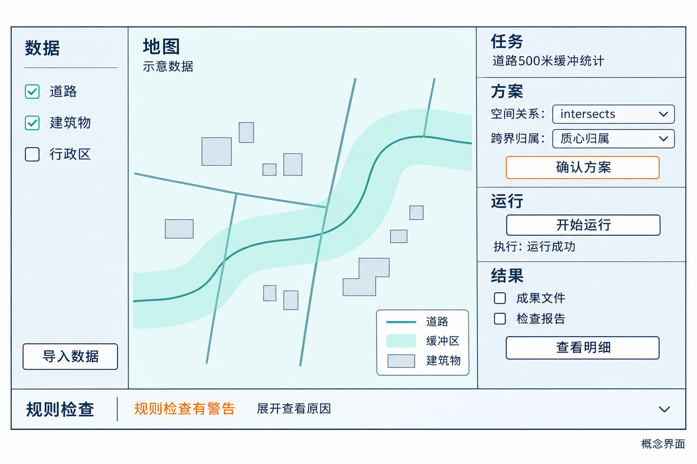

左侧数据面板用于选择和查看数据摘要，中间地图用于显示范围与成果，右侧按任务、方案、运行和结果组织。方法从目录选择，表单按输入角色和选项定义显示；字段筛选、矢量分析与栅格方法沿用同一页面结构。底部规则检查面板默认收起，出现警告或未通过时自动显示摘要。图中采用“运行成功／规则检查有警告”的示例组合，说明计算完成后仍需查看检查明细。

## 9.2 渐进式信息展示

任务阶段先显示目标、候选数据和缺失项。方案阶段优先显示关键选项与推荐值，再展开方法步骤和工具参数。运行阶段显示当前步骤、耗时和简要日志。结果阶段显示成果、来源和规则检查状态。

CRS、单位、方法版本、实际参数和完整日志放在可展开的详情中。状态同时使用文字与颜色，并能定位到对应运行记录。

运行页面轮询执行状态与检查状态，处于 `NOT_STARTED`、`RUNNING` 或 `CHECKING` 时继续查询，结束后停止自动轮询。页面刷新通过任务与运行编号恢复 SQLite 中的记录，当前步骤、日志和成果仍对应同一次运行。

栅格按“原始成果—本机预览—MapLibre 图层”显示。预览保存配色、拉伸、透明值和显示分辨率，点击像元则通过原始成果读取数值。两类文件分别登记并相互关联，用户调整样式时保持分析结果不变。

## 9.3 错误与重试

错误面板同时显示失败阶段、步骤和下一步动作。缺少选项时回到草稿编辑；进程或输入失败时查看日志并重新运行；检查器中断时可以只重新检查；地图预览失败时只重建预览。修改方案后先确认新版本，修复环境后未改方案则直接创建新的运行，均从第一步开始。

预览失败显示在对应图层旁，任务、方案、日志和文件入口继续保留。用户可先下载原始成果用本机 GIS 工具查看，再重建预览。这样能区分计算问题与显示问题，减少重复运行完整分析的次数。

## 9.4 本地脚本区

本地脚本区用于试写、运行和检查 Python 脚本，可重复使用的过程由用户手动收录。

下图显示脚本从草稿到手动收录的最短路径。关系标签说明每一步产生什么。

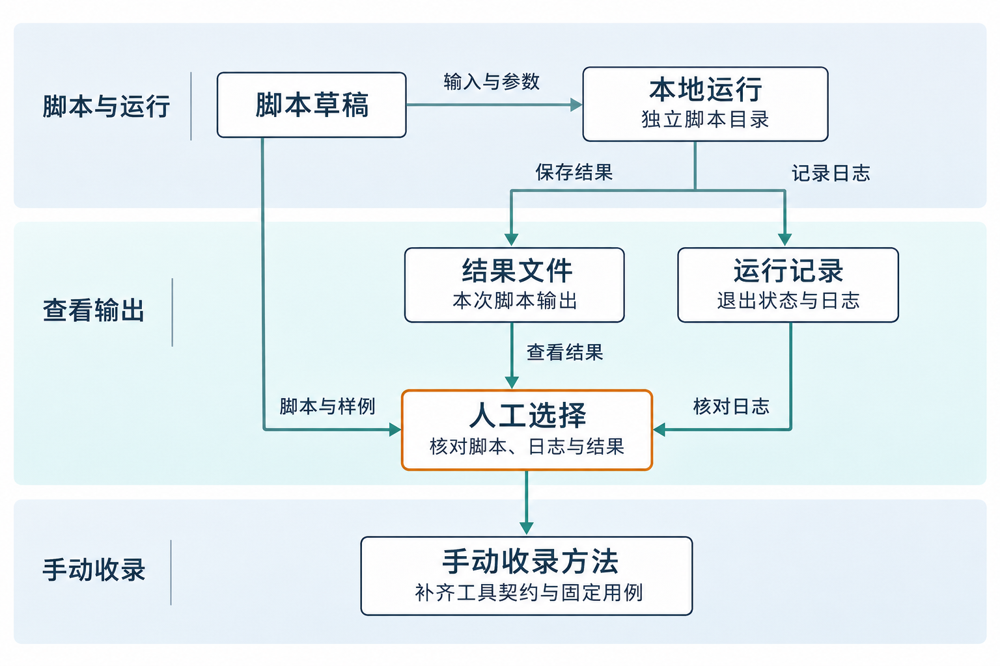

脚本区将快照、输入引用、参数、日志与结果保存在独立目录，失败后可修改再试。手动收录时，把脚本的输入假设、处理顺序和结果要求整理为工具契约与方法定义，配上固定用例，再进入正式方案执行和规则检查。


# 10 代表性任务样例

本章用四项任务演示通用能力的组合方式。每项样例按输入、方法步骤、用户选项、输出和检查展开，便于对照前面的模块与接口。其业务名称、参数值和步骤数量属于对应方法，成果和检查结果则进入共用的运行记录。

## 10.1 场景一：道路缓冲与分区统计

### 10.1.1 数据前提

输入包括分析区、道路、待统计对象和用于汇总的行政区。道路应为有效线要素；待统计对象可以是建筑物点、建筑物面或其他目标图层。每个数据资产要有可解析的 CRS，道路取数范围覆盖外扩分析区，不能只按原分析区过滤道路。

缓冲距离为 500 米时，不能直接在经纬度坐标或 EPSG:3857 上做平面缓冲。方案应选择适用的局部投影，或者使用工具明确支持的测地线方法。目标与缓冲区的关系从相交或内部包含中选择，面对象按其完整几何判断。

### 10.1.2 固定方法链

下图标出道路缓冲的取数和裁剪顺序：先纳入分析区外的影响道路，再计算并裁回范围。

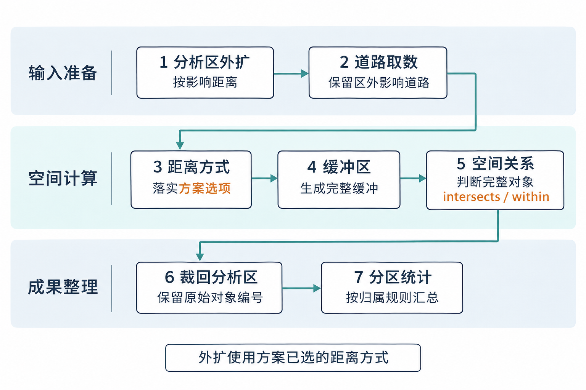

固定顺序为：按缓冲影响范围外扩分析区、从外扩范围内取道路、落实已选距离方式、生成缓冲区、判断空间关系、裁回原分析区、按分区统计。距离方式在方案确认时已经选定，外扩据此使用对应的距离计算；缓冲前的步骤负责检查该方式并完成所需坐标转换。先外扩可纳入区外影响道路，最后裁回则保持原分析区的成果范围。

### 10.1.3 用户选项

用户需要在方案中看到并选择：

- 距离方式：局部适用投影或测地线。
- 空间关系：`intersects` 或 `within`。
- 跨界对象：面对象可选面积拆分、质心归属或最大重叠归属，点对象按所在分区归属。
- 统计口径：计数按原始对象标识去重；分区归属并列或无法确定时列为未归属。
- 成果范围：正式统计使用分析区内对象，完整缓冲区及原始对象引用保留用于解释影响来源。

### 10.1.4 输出

道路场景同时保留完整缓冲区、选中对象和分区统计。完整缓冲区解释哪些道路产生影响，分析区内对象用于交付和统计，原始对象编号用于核对去重与跨界归属。成果记录将这些文件关联到同一次方案和运行。

### 10.1.5 规则检查

检查器按方案中的距离方式核对实际参数，再比较缓冲覆盖、裁回范围和统计明细。空间检查定位选错或漏选的对象，数量核对定位重复计数或归属遗漏。输入检查已经阻止的投影错误会保留原因；若过程记录仍出现测量口径不符，成果检查列为未通过。

检查结果同时列出区外道路的纳入情况、跨界对象的归属和去重结果，便于逐项核对方案中的选择。

## 10.2 场景二：DEM 坡度、坡向与阈值提取

### 10.2.1 数据前提

DEM 读取模块先取得 CRS、像元大小、水平与垂直单位、NoData 和覆盖范围。水平坐标决定相邻像元之间的距离，高程值决定高度差，两者共同影响坡度。单位不同就需要确定换算比例，并随实际参数保存。

坡度和坡向依赖周边像元。直接先把 DEM 裁到分析区边界再计算，会使边界像元缺少邻域，形成不真实的空值或异常值。

### 10.2.2 固定方法链

下图按邻域需求排列 DEM 处理步骤，先外扩裁取，计算后再裁回原范围。

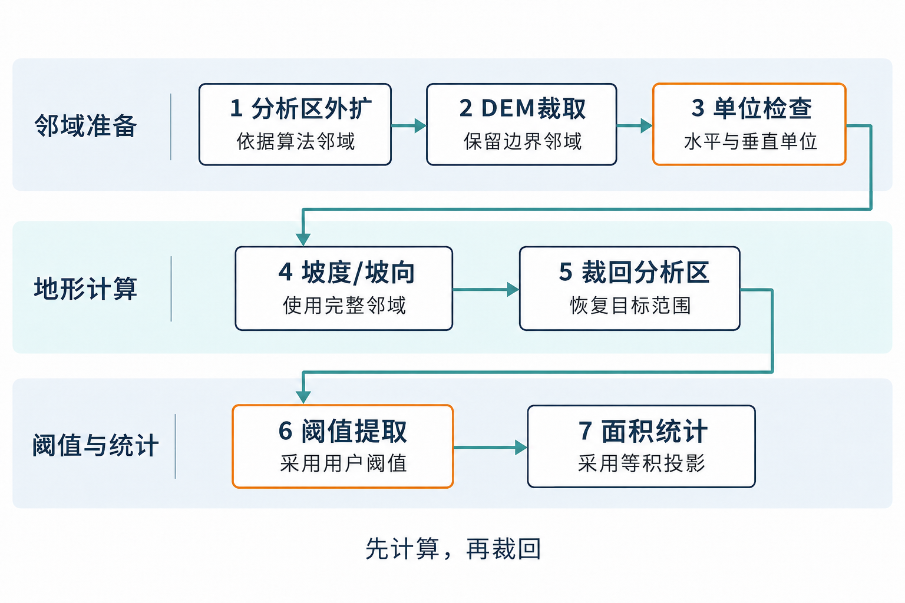

固定顺序为：按算法邻域外扩分析区、裁取 DEM、检查水平与垂直单位、计算坡度或坡向、裁回原分析区、按阈值提取、使用适当面积口径统计。外扩距离应由算法邻域和像元大小决定，不使用任意固定值。

### 10.2.3 用户选项

用户需要确认坡度单位是度还是百分比，坡向是否需要重分类，阈值区间如何定义，以及面积统计采用哪个分析范围。若方案包含面积结果，面积计算应转换到适用等积投影。

### 10.2.4 输出

坡度或坡向栅格保留连续计算值，阈值区域表示用户所选区间，面积表汇总这些区域。结果记录像元大小、单位与重采样方式，使用户能够从统计表回到原始计算栅格。地图预览根据这些成果配色，规则检查报告保留边界和单位核对结果。

### 10.2.5 规则检查

检查项包括覆盖范围、像元大小、无数据值、水平与垂直单位、边界像元以及阈值统计。可使用固定 DEM 小样本与参考结果逐像元比较，允许误差范围由具体算法实现确定。

报告记录实际单位比例、边缘处理顺序和重采样方式，便于解释边界像元与参考结果的差异。

## 10.3 场景三：遥感指数与变化分析

### 10.3.1 数据前提

输入包括两个时相的遥感产品及其元数据。两个时相应覆盖目标区域，并具有可比较的空间分辨率、投影和处理级别。云、阴影和无效像元需要由产品质量波段或明确规则处理。

产品元数据连接文件与波段角色：传感器、产品级别和处理版本确定红光、近红外及质量波段，同时给出缩放与偏移。数据源适配器负责找到文件，传感器配置负责解释数值，两者共同准备指数工具的输入。

### 10.3.2 固定方法链

下图以产品元数据为入口，依次确定波段与数值转换方式，再计算指数和变化。

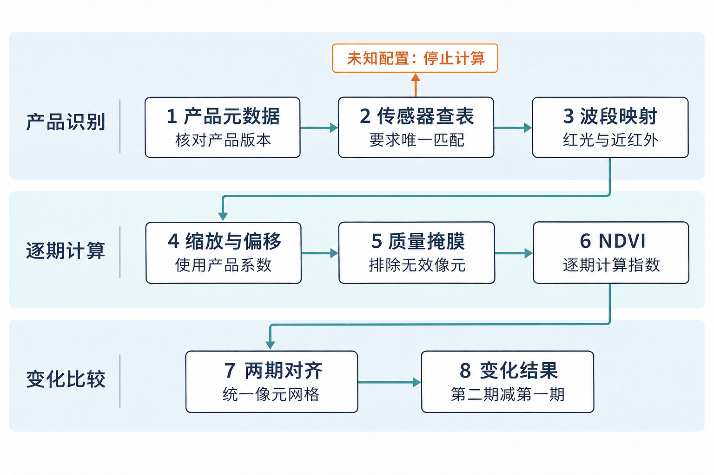

固定顺序为：读取产品元数据、匹配传感器配置、确定波段映射、应用缩放与偏移、生成质量掩膜、计算 NDVI、对齐两个时相并生成变化结果。任何必要配置查不到时，流程停止并说明缺少的键。

### 10.3.3 用户选项

方案列出两个时相、分析范围、云掩膜策略、变化表达和阈值。连续差值保留变化幅度；按用户给定阈值分类时，则输出增加、稳定和减少等类别。阈值及其区间写入方案，统计表按同一分组汇总。

### 10.3.4 输出

输出包括每个时相的指数栅格、质量掩膜、变化栅格、可选变化分类、统计摘要和规则检查报告。成果记录实际使用的传感器配置版本。

### 10.3.5 规则检查

检查器先核对唯一的产品配置、波段映射及缩放来源，再读取分母为零的处理记录、有效像元比例和时相对齐信息。NDVI 范围检查用于定位异常值，产品与网格检查用于解释异常来自哪里。报告按输入准备、指数计算和变化计算组织这些明细。

## 10.4 场景四：土地利用变化

### 10.4.1 数据前提

输入为两个时相的土地利用数据和分类体系说明。两期数据可能使用不同的分类编码，因此必须先建立映射表。几何应有效，时间、来源和最小制图单元应可追溯。

统计面积前需要选择适用的等积投影。若图斑跨越行政区或统计分区，还要明确面积拆分、质心归属或最大重叠归属。

### 10.4.2 固定方法链

下图回答“分类映射为什么必须在空间叠加之前完成”，并把跨界规则放在变化统计之前。

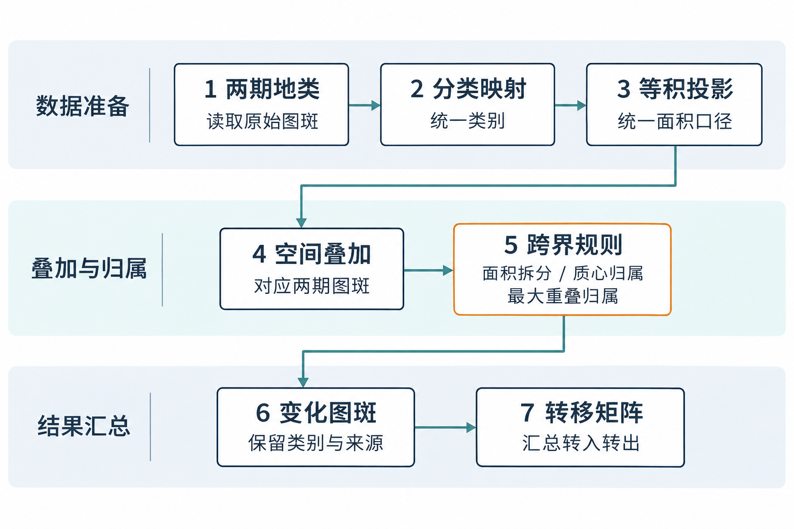

固定顺序为：读取两期地类、映射到统一分类、转换或选择等积投影、空间叠加、应用跨界规则、形成变化图斑、生成转移矩阵。若分类映射存在未覆盖编码，流程停止并列出未映射值。

### 10.4.3 用户选项

方案集中显示分类映射、分析范围、最小变化面积、跨界归属和相邻同类图斑合并选项。最小变化面积决定哪些细小图斑进入正式统计，因此连同过滤数量和面积一起保留。用户比较不同阈值的结果时，可以看出总量变化来自筛选还是地类转移。

### 10.4.4 输出

变化图斑保存来源类别、去向类别和两期要素引用，转移矩阵按类别组合汇总面积，分区表再按所选归属规则汇总。读者可从矩阵中的某一组合回查对应图斑，核对这些变化发生在哪里。地图图层和规则检查报告与同次运行关联。

### 10.4.5 规则检查

检查项包括分类编码覆盖率、几何有效性、叠加前后面积平衡、跨界规则、最小面积过滤和转移矩阵总量。面积平衡允许的数值误差应由测试数据精度确定。

运行记录保留分类映射、几何修复、碎片过滤和跨界处理说明，便于解释面积变化的来源。

# 11 测试与原型验收

第 13.14 节的比较落实为三类检查：步骤是否遵循方法、实际参数是否对应方案、成果是否符合参考。验收同时检查通用模块行为、已登记方法及其扩展过程；现有 16 个固定用例作为首批 GIS 计算约束回归，失败报告给出所在步骤和差异值。

## 11.1 测试策略

每个固定用例都保存输入、任务参数、预期状态、参考结果和自动断言。错误输入用例检查调用能否在合适位置停止，正确输入用例比较几何、像元或统计结果。修改方法、工具适配或界面状态后，运行同一组用例，便于定位行为变化。

下图说明固定输入如何产生实际结果，并与参考结果共同进入自动断言。左侧列出主要覆盖范围，断言结果汇总为回归报告。

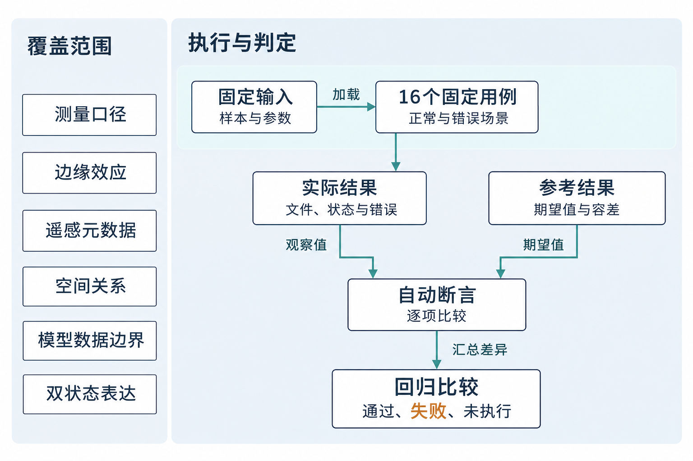

## 11.2 参考结果建设

参考结果优先由可解释的小样本构成。矢量用例使用少量人工可核对几何；栅格用例使用尺寸较小的人工栅格或官方示例；遥感用例保存产品元数据与期望波段、系数；外部模型边界用例直接检查请求快照。

参考结果记录生成工具、版本、参数和人工核对说明，容差随样本精度与算法特点保存。结果变化时先比较输入与参数，再判断是实现偏差还是参考答案需要修正；修正原因与新旧结果一同记录。失败报告由此能给出具体差异和回查依据。

## 11.3 16 个固定用例

| 编号 | 场景与输入 | 自动断言 | 预期结果 |
|---|---|---|---|
| T01 | 经纬度道路，500 米平面缓冲 | 执行前检查测量策略 | 拒绝平面缓冲 |
| T02 | EPSG:3857 道路，平面距离 | 执行前检查 CRS | 拒绝执行 |
| T03 | 局部适用投影道路 | 与参考缓冲面积和边界比较 | 在容差内一致 |
| T04 | 支持测地线的缓冲工具 | 与参考测地结果比较 | 在容差内一致 |
| T05 | EPSG:3857 图斑面积 | 检查面积策略 | 拒绝执行 |
| T06 | 等积投影图斑面积 | 与参考面积比较 | 在容差内一致 |
| T07 | 分析区外道路缓冲后进入区内 | 检查道路是否被取入 | 正确纳入 |
| T08 | 超出影响范围的道路 | 检查选择结果 | 不被纳入 |
| T09 | DEM 外扩计算再裁回 | 比较边界坡度 | 与参考结果一致 |
| T10 | Landsat Collection 2 元数据 | 检查缩放与偏移来源 | 使用元数据配置 |
| T11 | Sentinel-2 产品配置 | 检查红光与近红外映射 | 选择正确波段 |
| T12 | 未知传感器或处理版本 | 检查查表结果 | 阻断且不猜测 |
| T13 | 同一几何分别使用两种空间关系 | 比较对象集合 | 各自符合预期 |
| T14 | 三种跨界归属方式 | 比较分区统计 | 各自符合预期 |
| T15 | 构建外部模型请求 | 扫描禁止字段和内容 | 不含空间原始信息 |
| T16 | 工具成功但检查发现阻断问题 | 比较双状态 | 执行成功、检查未通过 |

## 11.4 指标分母与结果表达

测试报告列出固定清单中的通过数、失败数和未执行数，三者合计为 16；每个失败项附上断言与差异。

需要汇总时同时给出“已执行数/16”和“通过数/有效执行数”。参考结果无效的用例单独标记，仍作为未完成项保留在清单中；测量、边缘处理和模型数据边界分别列出结果。

## 11.5 报告验收

文档交付检查包括：

1. Markdown 中所有图片路径存在，图片中文无错字、乱码和水印。
2. 图题按章编号，图前有导读，图后有关系说明。
3. Word 目录、页码、表头重复和长表格显示正常。
4. PDF 可以打开、打印，图片和代码块没有截断。
5. DOCX 压缩结构完整，所有引用图片已内嵌。
6. 术语、状态、需求与接口示例保持一致。

## 11.6 通用能力与方法扩展的验收

通用模块的验收使用不同类型和不同长度的方法，检查输入、选项、步骤及成果是否由配置驱动。运行管理的失败、取消、重试和检查中断也单独留存记录。16 个固定用例报告计算约束的覆盖情况，下面的检查报告核心模块能否复用。

| 检查内容 | 操作方式 | 完成判定 | 关联需求 |
|---|---|---|---|
| 方法接入 | 选择一项未预置任务，登记配置与所需契约 | 可从目录选择，复用确认、运行和结果页面 | MTH-001<br>EXEC-001 |
| 选项适用性 | 分别使用属性处理与空间测量方法 | 表单和请求各自只含所需选项 | PLAN-004<br>UI-002 |
| 步骤连接 | 使用一步方法和多步方法，另构造无效引用 | 正确连接可执行，无效引用在启动前定位 | MTH-002<br>MTH-003 |
| 成果展示 | 返回矢量、栅格或表格及各自规则结果 | 按类型展示，来源与双状态可查询 | ART-001—003<br>UI-003 |
| 手工与模型入口 | 对已接入方法分别手填和辅助生成方案 | 共用确认、执行与检查流程 | MODEL-003<br>MODEL-004 |

未预置任务可选“按属性条件筛选要素并导出”，也可选实际工作中的同等规模任务。检查重点是新增配置、工具或检查函数的改动位置：无需在方案生成器、调度器或结果页加入该业务名称的专门分支。新增算法所需的适配代码和样本另行记录。

每项新方法附上自己的输入条件、参考结果和断言，加入方法回归清单。通用检查、方法检查和首批 16 项回归分别报告结果，避免把单组样例的通过情况当成整个系统的完成程度。

# 12 分步骤实现计划与完成标准

本章把设计拆成十二个工作步骤。先建立通用数据、方案与执行结构，用道路样例检查首次交接，再接入运行管理和工作台。矢量、栅格与产品配置逐步增加方法覆盖，模型入口在手工流程稳定后接入；每一步留下可复用的模块和可核对的结果。

当前工作区以报告、图稿和构建脚本为主，计划按产品代码从基础模块起步安排。下列完成标准是开发验收条件，当前执行状态均为待实现；日期与耗时在实际完成后记录。

## 12.1 调研结论与安排依据

本轮于 2026 年 11 月 11 日核对官方资料，关注能直接影响开发顺序的接口与行为。QGIS 提供算法查询和命令行运行入口，因此第一阶段可以先用小数据检查工具与输出，再接入 Web 服务。方法目录和参数发现继续沿用第 13 章的借鉴选择。[QGIS Processing 命令行](https://docs.qgis.org/3.44/en/docs/user_manual/processing/standalone.html)

环境检查需要分别确认 QGIS 进程与 Python 进程能否读取数据。两类进程共用请求和结果结构，依赖按各自环境记录；这使原生 GIS 库的安装问题可以在方案、页面和模型加入前定位。Python 的进程接口提供退出信息与超时处理，适配器还需按第 7.7 节完成终止、日志保存和文件检查。[Python 子进程接口](https://docs.python.org/3/library/subprocess.html)

本机服务采用单个调度循环，SQLite 的写入集中在服务内。SQLite 同时只允许一个写事务，适合在这里用短事务保存方案与状态；空间计算期间由子进程读写文件。若采用 FastAPI，它负责接收与查询请求，耗时计算仍交给既定调度与子进程结构。[SQLite 事务](https://www.sqlite.org/lang_transaction.html)，[FastAPI 后台任务说明](https://fastapi.tiangolo.com/tutorial/background-tasks/)

测试从第一步开始积累。pytest 的临时目录可隔离每次输出，浮点比较可设置绝对与相对容差；GeoPilot 还要为每个样本记录容差来源、对象集合和空间断言。回归入口可以逐步完善，参考结果先于对应算法的验收建立。[pytest 临时目录](https://docs.pytest.org/en/stable/how-to/tmp_path.html)，[浮点数值比较](https://docs.pytest.org/en/stable/reference/reference.html#pytest-approx)

测地线道路缓冲单独列为早期技术验证项。QGIS 的 `QgsGeometry` 使用平面几何运算；PyProj 的 `Geod` 提供测地正反解，可用于核对距离，但道路缓冲还涉及沿线、端点与转角的面构造。P0 先确认候选实现与参考方法，P6 完成适配和 T04；前期道路样例采用已经核对的局部投影。[QGIS 几何计算说明](https://api.qgis.org/api/classQgsGeometry.html)，[PyProj 测地计算](https://pyproj4.github.io/pyproj/stable/api/geod.html)

## 12.2 实施步骤总览

P0—P5 建立共用基础，后续按表中依赖安排工作。P6—P8 使用首批样例补齐矢量、栅格与产品配置，P9 可在 P5 后开始模型联调；P10 按实际扩展需要接入。P11 分别检查通用能力和本轮选定的方法覆盖。

| 步骤 | 主要交付物 | 前置条件 | 进入下一步的标准 |
|---|---|---|---|
| P0 环境与参考样本 | 环境记录、最小输入、参考依据 | 现有设计 | QGIS/Python 均能独立读写样本 |
| P1 数据与状态存储 | 资产登记、版本、SQLite、运行目录 | P0 | 关闭读取会话后能按引用重开数据 |
| P2 契约与基础测量 | 结构校验、测量检查、单步适配 | P1 | T01、T02、T03、T05、T06 全部符合预期 |
| P3 通用方法执行链 | 方法加载、步骤连接、成果与检查 | P2 | 道路样例可复算，另一方法可沿同一流程接入 |
| P4 运行管理与接口 | 异步运行、取消、重试、状态查询 | P3 | T16 与失败、取消、中断联调符合状态表 |
| P5 通用 Web 工作台 | 方法目录、配置表单、地图与结果 | P4 | 不同方法共用页面，刷新可恢复运行记录 |
| P6 矢量能力补齐 | 测地线分支、三种归属、土地利用 | P3；页面使用 P5 | T04、T13、T14 及土地利用样例符合预期 |
| P7 DEM 与栅格预览 | 邻域处理、地形成果、栅格显示 | P4、P5 | T09、单位与预览取值检查符合预期 |
| P8 遥感变化 | 产品查表、指数、掩膜、时相对齐 | P7 | T10—T12 与两期 NDVI 样例符合预期 |
| P9 模型入口 | 摘要请求、候选解析、手工回退 | P5 与已可用方法 | T15 通过，候选随方法目录变化 |
| P10 脚本与可选数据源 | 本地脚本区；按需接入 PostGIS | P4；收录使用已接入工具 | 脚本独立运行；所选数据源完成快照检查 |
| P11 原型与方法验收 | 通用检查、方法回归、启动说明 | 共用基础与所选方法完成 | 核心可复用，已选方法检查符合预期，16 项清单逐项记录 |

P3 产生首个可计算结果，并用另一项方法检查复用方式；P5 提供共用网页。此后方法扩展与模型联调各按依赖推进，已有手工方案和参考结果用于核对新增行为。

## 12.3 每一步的具体工作

### 12.3.1 P0 环境与参考样本

先建立本机开发环境记录，列出 QGIS、GDAL、Python、SQLite 及所需 Python 库的实际版本、启动入口和安装来源。QGIS 环境与 Python 环境分别检查，再以文件传递样本。开发环境是否可用以实际调用结果判断。

1. 用 `qgis_process --version`、`qgis_process list` 和 `qgis_process help native:buffer` 保存版本、算法与参数信息，执行一次适用投影下的缓冲。
2. 用 Python 读取一个 GeoPackage 和一个 GeoTIFF，写出结果后关闭并重新打开，核对图层、字段、CRS、栅格尺寸和数值。
3. 先为首个矢量样例准备少量输入，保存 CRS、字段、预期对象与统计参考；小型栅格用于检查 Python 读写。DEM、两期地类和产品元数据在相应方法接入时补齐。
4. 调研测地线线缓冲的候选入口、依赖、许可、支持的几何类型和独立参考方法，保存可运行的最小试验或明确缺项，供 P6 接续。

**达到标准：** QGIS 与 Python 两条独立调用都有可读取输出和日志；样本各有 CRS、单位、来源与参考依据；无法启动的环境问题已定位到入口或依赖。测地线试验的结论单独记录，尚未完成时保留 T04 待执行。

### 12.3.2 P1 数据登记、版本与本地存储

先实现第 7.1 节的数据源适配和第 8.1 节中最基础的资产、任务与运行记录。登记负责把来源转成资产引用；大文件留在目录中，SQLite 保存元数据与状态。PostGIS 的正式适配放到 P10，本步骤使用本地文件。

1. 为 GeoPackage、GeoTIFF/COG 和本地矢量文件提取格式、类型、CRS、范围、字段或栅格结构。
2. 保存来源、轻量指纹和资产版本；相同内容再次登记返回原版本，内容变化后新增版本。
3. 以运行编号分配独立目录，准备请求、步骤日志、中间结果、最终成果和检查文件的位置。
4. 检查路径失效、图层缺失、格式不支持和 CRS 缺失，分别返回来源错误或可查看的元数据缺项。

**达到标准：** 关闭文件句柄和服务后仍能按资产编号、版本重新打开固定输入；修改输入能识别版本变化；原文件指纹在一次计算前后相同。目录创建与数据库保存失败时，记录指出失败位置，后续任务不引用半成品。

### 12.3.3 P2 工具契约与基础测量

实现工具契约、方案对象的结构校验，以及投影、单位和测量方式检查。此时先做能运行一条请求的最小 QGIS/Python 适配器，取得真实输出；P4 再补齐完整生命周期。Pydantic 用于字段与对象关系检查，GIS 条件由读取实际元数据的函数判断。[Pydantic 校验器](https://pydantic.dev/docs/validation/latest/concepts/validators/)

1. 解析附录 B 的测量策略，拒绝经纬度和 EPSG:3857 上的平面距离、面积计算。
2. 检查局部投影对样本分析区的适用性，将已确认参数转换为算法请求；面积步骤使用适用等积投影。
3. 执行一条 QGIS 缓冲请求和一条 Python 面积请求，返回第 8.9 节规定的结果结构。
4. 用进程启动记录确认错误输入在工具运行前被拒绝，再对正确输出执行几何与数值比较。

**达到标准：** T01、T02、T03、T05、T06 的全部断言通过，错误说明包含字段与原因，实际请求能回查到契约版本。测地线分支在取得相应实现前显示为不可用，T04 在 P6 完成。

### 12.3.4 P3 通用方法执行链与首个样例

用手工方案串起资产、方法、契约、执行和成果检查。第一项样例采用建筑物点、500 米距离、适用局部投影和明确分区归属，用于核对模块交接；再按第 11.6 节接入一项简单方法，检查步骤、输入和成果是否从配置读取。点面关系与多种跨界规则在 P6 展开。

1. 展开道路固定方法，按“外扩分析区—取道路—准备测量输入—缓冲—空间关系—裁回—分区统计”生成步骤。
2. 保存草稿并确认版本，再由单条运行链按顺序调用最小适配器；步骤输入只引用方案资产或前序命名输出。
3. 登记完整缓冲、目标对象和统计表，随后运行成果检查，保存实际参数、来源及两类状态。
4. 将区外影响道路和超出影响范围道路分别放入样本，核对取数、目标编号和分区计数。

**达到标准：** T07、T08 通过；固定样例的目标编号集合和分区计数与参考完全相同；所有预期文件均可打开。新建运行重复相同输入和参数时，结果按既定容差一致，两个运行目录和记录独立。另一方法可以复用方案和执行链，业务名称不进入调度分支。部分空间关系或归属断言完成时，T13、T14 仍按未完成用例记录。

### 12.3.5 P4 本地调度、异常处理与任务接口

把 P3 的计算过程放入本机服务的后台调度循环，连接第 8.6 节的既有接口。请求创建运行后返回编号，浏览器或接口测试再查询进展；同一时刻处理一条运行链。SQLite 中的记录用于页面恢复和错误定位。

1. 接通草稿确认、创建运行、状态查询、成果查询、取消和手动重查。确认操作保存快照，运行操作另行创建记录与目录。
2. 用测试替身分别返回启动失败、非零退出、超时、缺少输出、登记失败与检查中断，再用真实进程复核终止和日志处理。
3. 测试计算阶段取消、检查阶段取消和服务重启，按第 8.7 节保存执行状态与检查状态。
4. 重试创建新运行；仅检查中断且成果指纹未变时，沿用原规则版本重新检查。

**达到标准：** T16 全部断言通过；确认后没有计算进程启动，运行受理后能查询到相同版本；失败步骤之后没有新步骤启动。取消后的进程已停止，遗留记录能按实际阶段恢复说明。HTTP 错误与运行错误分别按第 8.6 节返回。

进程超时要同时处理进程与记录。Python 文档说明，`Popen.communicate()` 超时本身不会终止子进程；适配器应在结束进程并收集退出信息后，再保存最终状态。实际使用哪种进程调用方式，保存在适配器配置与联调记录中。[子进程超时处理](https://docs.python.org/3/library/subprocess.html#subprocess.Popen.communicate)

### 12.3.6 P5 通用 Web GIS 工作台

先把已稳定的方法执行链接到浏览器。页面提供方法选择、数据、关键选项、确认、运行、日志和成果；表单读取方法配置，地图按成果类型加载。道路与另一项方法共用这套页面，模型入口暂由手工表单承接。

1. 页面通过现有接口读取资产和方案，分别设置确认与运行操作，按运行编号轮询两类状态。
2. 用 MapLibre 展示本机服务提供的图层，结果点击能定位到对应成果与来源；统计值直接读取正式输出。
3. 测试页面刷新、任务切换、图层加载失败与错误详情展开，核对页面和 SQLite 保存的同一编号、版本及状态。

**达到标准：** 从浏览器完成 P3 的不同方法，选项随定义变化；下载成果与运行记录指向相同文件，刷新后可继续查看原任务。工具成功而检查失败时，页面同时显示两种状态和明细。地图预览失败时仍可访问成果、方案与日志。

### 12.3.7 P6 补齐矢量选项与土地利用变化

在已有道路流程上增加面对象、两种空间关系和三种跨界归属，再复用叠加、等积面积和统计能力实现土地利用变化。测地线缓冲作为独立工具契约接入，复用相同输入输出交接。

1. 为相交、内部包含、边界接触和跨分区对象建立可手算几何，按完整对象判断关系；裁剪后继续用原始标识去重。
2. 检查面积拆分、质心与最大重叠归属，包含边界或并列时的未归属记录，核对明细与汇总。
3. 根据 P0 试验接入明确支持道路线几何的测地线缓冲，记录椭球、离散方式与容差来源；用独立参考检查线段、端点和转角。
4. 完成两期分类映射、等积投影、空间叠加、变化图斑和转移矩阵，将未映射编码作为输入问题返回。

**达到标准：** T04、T13、T14 的全部断言通过；未归属与已归属数量之和等于去重目标数；面积拆分之和与约定范围内总面积一致。土地利用样例的类别转移、矩阵总量和图斑来源对应参考结果；这些场景检查单独记录，不新增固定用例编号。

若测地线候选尚不能满足 T04，继续保留明确的不可用状态并记录阻碍。局部投影道路样例和独立栅格工作可继续推进，首批方法覆盖记录保留该未完成项。

### 12.3.8 P7 DEM 方法与栅格预览

接入 DEM 后，原型开始处理有邻域关系的栅格。先固定一个算法及其单位解释，用覆盖范围较大的 DEM 产生参考结果，再比较外扩裁取后的计算。预览读取正式地形成果，数值与显示分别保存。

1. 根据算法邻域和像元大小外扩，裁取 DEM 后检查水平与垂直单位，再计算坡度或坡向并裁回分析区。
2. 增加单位缺失、NoData 和边界像元检查，按用户选择执行阈值提取与等积面积统计。
3. 本机生成栅格预览并由 MapLibre 加载，点击位置回到原始成果读取数值，记录预览分辨率与配色。

**达到标准：** T09 通过；边界与内部有效像元分别按容差比较，NoData 掩膜符合样本规则；单位换算能在请求和日志中找到。修改配色后原始栅格指纹不变，固定点击位置的返回值与原始文件一致。

GDAL 的自动单位处理随版本和元数据而异，运行记录应保存实际版本、单位与换算参数。栅格预览可采用 MapLibre 的栅格图层接口，本机服务负责准备对应的预览文件或瓦片。[GDAL 地形处理](https://gdal.org/en/stable/programs/gdaldem.html)，[MapLibre 栅格图层示例](https://maplibre.org/maplibre-gl-js/docs/examples/add-a-raster-tile-source/)

### 12.3.9 P8 产品元数据与两期 NDVI

复用 P7 的栅格读取、预览和成果检查，增加传感器配置与两期比较。先使用少量像元和保存完整产品信息的样本，分别核对配置选择、数值转换与时相对齐，再运行完整场景。

1. 按传感器、产品级别与处理版本唯一查表，定位红光、近红外和质量波段；未知或多重匹配返回具体原因。
2. 应用缩放与偏移，生成有效像元掩膜，再计算各期 NDVI；分母为零按配置处理。
3. 按已确认方式对齐网格，在共同有效范围计算第二期减第一期；阈值、变化分类与面积统计继续读取方案选项。
4. 页面显示两期指数、差值、有效范围及实际配置版本，固定像元同时核对显示值与原始文件。

**达到标准：** T10、T11、T12 通过；固定像元的反射率与 NDVI 对应手算参考；两期差值的方向、掩膜和网格与预期一致。未知产品在指数工具调用前停止，成果可回查两期输入与配置。

Landsat Collection 2 的官方资料给出表面反射率缩放与偏移；Sentinel-2 Level-2A 文档同时说明处理基线相关的偏移和量化信息。配置因此按具体产品保存；网格对齐还需核对 CRS 与仿射变换，不能只比较数组尺寸。[USGS 表面反射率产品](https://www.usgs.gov/landsat-missions/landsat-collection-2-surface-reflectance)，[Sentinel-2 产品说明](https://sentiwiki.copernicus.eu/web/s2-products)，[Rasterio 重投影](https://rasterio.readthedocs.io/en/stable/topics/reproject.html)

### 12.3.10 P9 自然语言入口与模型适配

模型接入依赖已可手工完成的方法、通用方案结构和工作台。P5 后即可用固定返回测试解析与错误分支，再发送经过检查的真实请求；方法目录增加时，候选随之更新。这样网络问题、任务理解与 GIS 计算可以分别定位。

1. 从任务和上下文构造允许外发的字段，检查目标文字、嵌套说明与摘要，路径、坐标和样本内容在本机转为引用。
2. 用固定返回覆盖有效候选、缺少参数、错误枚举、未知工具、超时和无效结构，确认草稿仍可编辑。
3. T15 通过后接入实际模型，让已登记方法的代表性任务生成草稿；增加方法后再次查询候选，用户补齐或修改选项，再确认与运行。
4. 将最终确认方案与对应手工方案的关键选项、方法版本和步骤比较，核对相同条件下的计算成果。

**达到标准：** T15 的请求检查通过；模型只能选择已登记候选，固定方法顺序由本机展开。模型不可用时已接入方法仍可手工完成；实际对话样例记录输入、返回与用户修改项，作为任务理解的检查记录。真实模型输出不计入固定 GIS 用例的成功率。

### 12.3.11 P10 本地脚本区与可选 PostGIS

脚本区复用已有进程调用和日志结构，但使用独立目录。它用于试验新处理过程，手动收录时把脚本假设整理成契约、方法与样例。PostGIS 根据实际数据需要接入，分析过程继续读取导入快照。

1. 保存脚本草稿与运行快照，传入明确输入和参数，返回日志、退出状态与结果文件。
2. 选取一个有用脚本，手动补齐契约、步骤和固定样例，再通过正式方案检查输入输出连接。
3. 需要 PostGIS 时，将选定图层导出为 GeoPackage，记录来源与导出条件；断开数据库后验证该快照仍可计算。
4. 修改数据库中的测试内容并重新导出，核对新资产版本，旧方案仍引用原快照。

**达到标准：** 脚本失败可定位到自己的日志与目录，正式成果不被覆盖；手动收录后的工具经过对应样例检查。启用 PostGIS 的环境还需确认快照稳定、重新导入产生新版本，连接信息不进入外部请求。未选择该数据源时，在交付记录中注明可选适配未接入。

### 12.3.12 P11 通用能力与本轮方法验收

最后从一个新的工作目录按启动说明运行，核对配置、输入、目录与结果是否足以复现。测试报告分别汇总通用检查、方法回归和固定用例，操作记录串起页面、方案、运行和成果。

1. 对本轮已接入方法执行相关固定用例和方法断言，报告列出观察值、参考值、差异及运行目录；T01—T16 中尚未覆盖的项目保留为未执行。
2. 完成第 11.6 节的通用与扩展检查，再对本轮方法逐项完成页面操作，保存确认版本、运行编号、成果与规则检查报告。
3. 复核启动失败、取消、重试、服务中断与检查重查，确认结果符合第 8.7 节状态表。
4. 保存环境版本、安装与启动步骤、样本入口、回归命令和当前限制；用新运行目录再次执行代表性样例。

**达到标准：** 通用与扩展检查符合第 11.6 节，已选方法各有可回查的操作和结果；本轮启用方法的相关检查全部符合预期，16 项初始回归清单完整记录通过、失败与未执行项；两类执行适配器均有真实进程运行证据。所有已选首版需求有对应检查记录，PostGIS 按是否选用单独说明。性能只记录样本规模、耗时与内存观察，作为后续优化依据。

## 12.4 完成标准如何判定

### 12.4.1 每一步共同提交的内容

完成一个步骤时，保存实现位置、输入样本、运行方式、实际输出和判断依据。命令或页面操作能重新产生结果，日志能解释停止位置，后续步骤可以直接使用其输出。开发记录以产物为依据更新状态。

| 检查方面 | 达到标准 | 留存内容 |
|---|---|---|
| 输入输出 | 按第 8 章约定解析，必需文件可重开 | 请求、结果与文件清单 |
| 计算行为 | 相关固定断言全部符合预期 | 输入版本、参考值与差异 |
| 异常处理 | 错误定位到阶段、步骤或字段 | 错误对象与日志 |
| 来源与状态 | 页面、SQLite 与文件对应同次运行 | 方案版本、运行编号、检查报告 |
| 可复现性 | 新目录中按记录重新生成结果 | 环境版本与运行说明 |

T13、T14 等用例包含多个分支，全部分支符合预期才计为该用例通过。只有部分断言完成时，记录已完成部分和剩余内容，固定清单仍保留该项未完成。

### 12.4.2 几何、数值与栅格标准

对象编号、分类编码、状态枚举和整数计数使用精确比较。几何比较先按原始标识对应对象，再核对选择集合、拓扑关系和范围；避免把文件中的行顺序作为结果依据。输入文件指纹用于识别版本，输出采用空间与数值比较判断一致性。

面积、距离、坡度与指数使用各样本预先确定的容差。容差记录单位、数据精度、算法离散参数和参考来源；绝对与相对容差的组合规则写入断言。首次验收前锁定这些条件，修改时同时说明参考或算法发生的变化。

栅格先比较 CRS、网格变换、尺寸、分辨率和 NoData 掩膜，再比较共同有效像元；边界像元单列，便于发现邻域处理差异。连续值按容差比较，变化类别与掩膜按精确值比较。地图颜色检查用于确认显示，原始数值通过成果文件判定。

参考结果优先采用手算几何、人工构造栅格或独立方法复核。测地线道路缓冲需要核对线段及端点、转角的影响，单个点的测地圆只能检查其中一部分。参考结果与被测实现共享工具时，补充可解释的独立断言，并记录仍需验证的部分。

### 12.4.3 通用能力与方法覆盖的阶段成果

| 可报告的成果 | 所需步骤 | 判断依据 |
|---|---|---|
| 通用计算链与首个样例 | P0—P3 | 道路结果符合参考，另一方法可接入共用流程 |
| 通用 Web 原型 | P0—P5 | 方法驱动表单，状态、结果与异常可定位 |
| 首批方法覆盖 | 按需完成 P6—P8 并接入工作台 | 四项样例及其固定用例、方法检查 |
| 本轮个人 GIS Agent 交付 | 共用基础、所选方法及 P9—P11 | 通用扩展检查、方法回归、16 项检查与复现记录 |

交付记录分别说明共用能力完成情况和方法覆盖。测地线工具或某项方法尚未完成时，保留该项缺口与对应测试状态，已完成的共用能力仍可单独检查和使用。

## 12.5 固定用例与阶段的对应

下表保留 T01—T16 的原有定义，只安排首次完成阶段。用例通过后加入后续回归；方法、契约或工具版本变化时重新执行受影响用例，P11 汇总全量结果。

| 固定用例 | 首次完整验收 | 核对重点 | 失败时优先查看 |
|---|---|---|---|
| T01、T02、T05 | P2 | 错误平面测量在调用前被拒绝 | CRS 与测量策略 |
| T03、T06 | P2 | 局部投影缓冲与等积面积 | 实际参数、几何与数值 |
| T07、T08 | P3 | 区外影响道路的取舍 | 外扩范围与取数结果 |
| T16 | P4 | 执行与检查状态独立 | 状态更新及检查中断记录 |
| T04 | P6 | 测地线道路缓冲 | 算法入口、椭球与参考依据 |
| T13、T14 | P6 | 关系判断与三种跨界统计 | 完整几何、标识与归属明细 |
| T09 | P7 | DEM 外扩计算再裁回 | 邻域、单位与边界像元 |
| T10、T11、T12 | P8 | 产品配置、波段与缩放 | 产品元数据与配置版本 |
| T15 | P9 外部调用前 | 完整请求不含禁止内容 | 摘要构建与序列化结果 |

土地利用分类映射、转移矩阵、地图拾取、取消、服务中断和 PostGIS 快照另有场景或联调检查。这些记录补充固定用例的覆盖范围，统计时与 16 项清单分开。

## 12.6 工作包与需求落实位置

WP1—WP8 继续表示模块归属，P0—P11 表示实际开发顺序。一个工作包可分几步完成，例如执行适配器先在 P2 支持单步调用，在 P4 补齐取消与异常，再随栅格场景扩展工具。

| 工作包 | 负责内容 | 对应步骤 | 主要需求 |
|---|---|---|---|
| WP1 数据与工作目录 | 本地资产、版本、状态目录；可选快照 | P0、P1、P10 | DATA、CTX |
| WP2 测量策略与契约 | 结构、投影、单位与工具前提 | P2、P6—P8 | TOOL |
| WP3 方法目录 | 方法加载、步骤连接与产品配置 | P3、P6—P8 | MTH、PLAN |
| WP4 方案与调度 | 草稿、确认、运行与本地接口 | P3、P4 | PLAN、EXEC |
| WP5 执行适配器 | QGIS/Python 请求、文件与进程 | P2—P4、P6—P8 | EXEC、TOOL |
| WP6 检查与来源 | 成果登记、报告和运行来源 | P3、P4、P6—P8 | CHECK、ART |
| WP7 工作台与模型入口 | 表单、地图、显示与模型适配 | P5、P7—P9 | UI、MODEL、CTX |
| WP8 回归与脚本区 | 全程样本积累、脚本与最终回归 | P0—P11，P10/P11 汇总 | 40 条原型需求的检查记录 |

需求落实记录沿用第 3 章的完整编号，至少包含实现位置、相关用例或场景、检查结果和记录路径。首版的 40 条需求逐项核对；可选数据源的采用情况随 DATA 需求记录，未实现内容与已检查内容分开标明。

## 12.7 限制、技术问题与后续验证

原型服务单个本机用户，以本地文件和 SQLite 组织数据与运行。各方法通过目录增加到同一工作台，后续遇到新任务时，从对应输入、步骤或工具缺口继续扩展。真实数据接入重点检查产品时相、云掩膜、分类映射和容差是否适用。

| 问题 | 发现阶段 | 处理动作 | 结束条件 |
|---|---|---|---|
| QGIS 或 Python 环境不一致 | P0、P2 | 固定各自入口，运行独立读写样本 | 两类进程都有可重开的结果 |
| 测地线道路缓冲入口未确定 | P0、P6 | 核对算法、几何类型与独立参考 | T04 全部断言通过 |
| CRS、单位或产品元数据不足 | P1、P2、P8 | 返回具体缺项，更新资产或配置版本 | 对应规则与固定用例符合预期 |
| 取消后进程或记录仍活动 | P4 | 核对终止、日志与状态保存顺序 | 进程停止且状态符合阶段 |
| 栅格显示与原值不同 | P7、P8 | 对照预览设置、原文件与取值接口 | 同一位置的原值可解释并一致 |
| 新组件带来额外部署工作 | 各步骤 | 对照当前缺口与最小样本评估 | 当前场景用到且能独立检查 |

每次问题处理保留最小输入、实际请求、日志与参考差异，再修改对应模块并重跑相关检查。未完成事项标明下一项试验与所需输入，直接成为后续开发任务。

## 12.8 第一次开发与阶段记录

第一次开发先完成 P0：记录环境，查询 QGIS 算法，用一份投影明确的道路样本生成缓冲，再用 Python 重开并检查。随后建立道路样本的目标对象编号与分区计数参考，进入 P1 的资产登记。这样第一批工作就能产生文件、日志和可核对的结果。

单次开发围绕一个可检查动作安排，例如“登记后按版本重开”“拒绝错误平面缓冲”或“取消后不再启动下一步”。结束时运行相关检查，记录产物位置和剩余问题。先积累实际耗时，再估计后续工作量；阶段顺序按依赖调整，完成标准保持可检查。

| 记录项 | 填写内容 |
|---|---|
| 当前步骤 | P 编号、对应 WP 与需求编号 |
| 本次动作 | 一个可直接验证的改动 |
| 输入与执行 | 样本版本、工具环境、命令或页面操作 |
| 实际结果 | 输出文件、日志、运行编号与检查记录 |
| 完成判断 | 符合哪条标准，剩余哪项断言 |
| 下一步 | 下一个动作及需要补齐的输入 |


# 13 开源项目比较与设计借鉴

GeoPilot 可以复用成熟的 GIS 计算工具，并借鉴现有 Agent 项目的工具组织、参数发现和结果展示方式。首版更合适的组合仍是普通 Python 控制固定方法、Pydantic 检查结构化输出、QGIS 与 Python 进程完成计算。现有项目各有侧重，直接接入一整套 Agent 系统通常还会带入它的桌面会话、数据假设、自动修复机制或模型环境。

调研截止日期为 2026 年 11 月 11 日，材料包括官方仓库、固定提交中的源码和官方文档；采用文档与源码调研，未安装运行第三方整套系统。附录 E 保存提交号、许可来源和关键文件，后续接入按这些位置核对实现。

## 13.1 比较范围与判断方式

### 13.1.1 先区分项目解决的问题

同样使用自然语言输入的项目，后续执行方式可能完全不同。规则解析器从句子中提取关键词和数字；工具调用型 Agent 根据工具说明选择算法并填写参数；代码生成型系统产生脚本，再交给进程执行。GeoPilot 的固定方法路径则先限定方法和关键选项，再把确认后的方案转成确定的调用序列。

下图对照四类任务路径，标出参数来源与检查位置；实际项目可以组合多类路径。

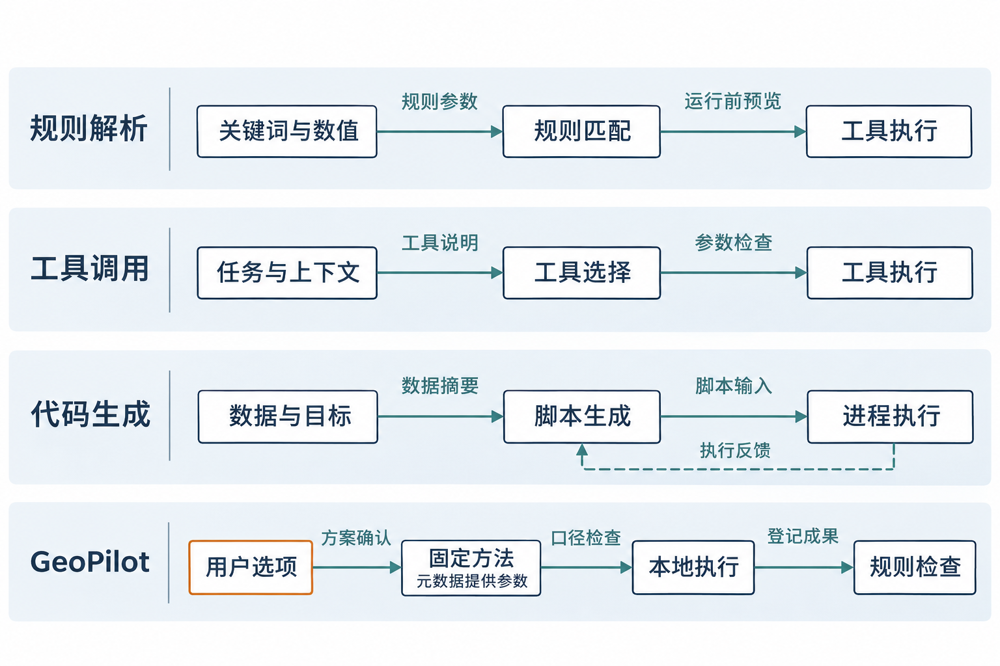

执行反馈箭头表示代码生成系统可能据报错修改脚本。GeoPilot 在执行前检查口径，执行后检查成果；失败时由用户修改方案并手动重试。

本章从任务入口、数据上下文、方法组织、工具参数、执行方式和结果判断六方面比较项目。接入成本以需要改造的模块和依赖说明，不设置综合排名。

### 13.1.2 项目现状表

下表记录本次查阅的 main 分支快照及提交日期（UTC）。完整提交号与链接见附录 E，实际接入时另行锁定安装版本。

| 项目与来源编号 | 所查提交／日期 | 当前材料形态 | 本章重点 |
|---|---|---|---|
| opengeos/GeoAgent，S1 | 3cff6db6／2026-11-04 | Python 核心、地图适配及 QGIS 插件 | 上下文与工具注册 |
| iamtekson/GeoAgent，S2 | f2585e83／2026-10-06 | QGIS 插件及开发文档 | 算法发现与步骤记录 |
| THU-ESIS/AutoGIS，S3 | c4f602a3／2026-09-17 | Web 客户端、服务与脚本执行流程 | 数据目录与脚本区 |
| GIS Work Agent，S4 | f709e6f9／2026-09-16 | QGIS 插件及规则解析源码 | 小任务模板与预览 |
| MapSmith，S5 | 97de54e8／2026-11-02 | MCP 服务、计划检查与来源记录 | 输入约束与结果解释 |
| TerraLogic / HieraPlan，S6 | e2b0c83b／2026-03-30 | 基准材料与分层规划实现 | 工具分类与方法组织 |
| Earth-Agent，S7 | ca1dfaef／2026-04-02 | 遥感工具及评测代码 | 工具分类与轨迹评价 |
| OpenEarthAgent，S8 | f0daed55／2026-10-26 | 工具服务、模型与评测入口 | 工具模式与输入假设 |

两个 GeoAgent 不是同一项目的不同版本。前者以跨地图环境的 Python 能力封装为主，后者以 QGIS 桌面插件为主要入口。TerraLogic 是基准与研究项目的名称，HieraPlan 是其分层规划 Agent；OpenEarthAgent 在本文中特指 mbzuai-oryx 仓库，不与 opendatalab 的 Earth-Agent 合并讨论。

### 13.1.3 如何阅读证据与建议

“官方说明”对应 README、论文和文档，“源码确认”对应已定位的处理逻辑，“本文建议”对应 GeoPilot 的设计选择。表中“未核实”表示本次材料尚不足以判断，后续接入时按所列文件继续核对。

## 13.2 opengeos/GeoAgent：上下文与工具注册

### 13.2.1 定位与使用方式

官方将该项目组织为可嵌入不同地图环境的 GIS Agent。Python 使用者可通过配置和工厂函数连接地图对象，仓库也提供浏览器地图示例和 QGIS 集成。GeoPilot 主要参考它识别运行环境和组织可用工具的方式。[S1 官方说明](https://github.com/opengeos/GeoAgent/blob/3cff6db6ac5dd96e44c46a1efd5d0890ecfc13cd/README.md)

源码中的数据上下文对象保存地图对象、QGIS 接口、项目对象、工作目录、当前图层提示和用户偏好。这里既包含可序列化的数据，也包含只能在当前进程中使用的活对象。GeoPilot 参考其显式传递上下文的方式，将进程内对象改为资产标识与任务摘要。[S1 上下文源码](https://github.com/opengeos/GeoAgent/blob/3cff6db6ac5dd96e44c46a1efd5d0890ecfc13cd/geoagent/core/context.py)

### 13.2.2 任务流程与关键模块

官方入口将模型、工具和地图环境组合后交给 Strands 驱动调用。工具工厂负责绑定地图或 QGIS 会话；注册表负责描述工具以及筛选当前可用的工具。这个分工让工具实现不必反复读取界面全局变量，也让缺少某个可选依赖时能够缩小工具集合。[S1 使用入口](https://github.com/opengeos/GeoAgent/blob/3cff6db6ac5dd96e44c46a1efd5d0890ecfc13cd/README.md)

源码确认工具注册表可以按名称查询元数据、列出工具配置，并根据上下文筛选工具。注册表还包含依赖可用性检查，以及需要用户确认的工具属性。GeoPilot 可以保留名称、输入输出、依赖和适用环境这些信息；确认仍沿用 GeoPilot 的分析方案状态。[S1 工具注册表](https://github.com/opengeos/GeoAgent/blob/3cff6db6ac5dd96e44c46a1efd5d0890ecfc13cd/geoagent/core/registry.py)

注册表解决当前环境有哪些可用工具，方法前提和工具契约则判断这些工具能否用于当前数据。例如，安装了 GDAL 只说明工具可调用，影像缩放是否正确仍需读取产品元数据。

### 13.2.3 借鉴内容、改造成本与适用结论

GeoPilot 的工具目录可采用类似注册表：每项保存名称、输入输出、依赖和执行入口，启动时据此整理本机可用工具。方案模块用方法前提筛选这份目录，再把候选名称和参数说明交给模型。可选库缺失时，对应方法显示缺少的依赖，其他方法仍可使用。

迁移这套上下文结构时，主要工作是把桌面中的活动对象换成持久引用。用户在浏览器选择图层后，方案保存资产编号与版本，执行适配器再打开对应文件；当前选中图层和 QGIS 的 iface 对象由此转成明确输入。模型侧另建摘要对象，T15 检查实际发出的字段。

接入可从不依赖地图对象的注册表开始：先为一个已有工具登记元数据，再检查查询结果能否直接用于方案选择。随后检查该模块的导入依赖和许可，并把上下文序列化接到 GeoPilot 的摘要构建函数。这样可以单独验证工具组织方式，再决定是否扩大复用范围。

## 13.3 iamtekson/GeoAgent：QGIS 算法发现与可复现步骤

### 13.3.1 定位与使用方式

官方开发文档将该项目定义为基于 LangGraph 的 QGIS 插件，包含一般对话和地理处理两种模式。用户在桌面工程中选择图层并提出任务，插件使用已有 QGIS 环境完成操作。这比本机 Web GIS 少了一层文件与会话适配，因为桌面工程已经持有图层、选择集和地图状态。[S2 架构说明](https://github.com/iamtekson/GeoAgent/blob/f2585e83e966a5291cfd332237066d1c6d866b62/docs/developer-guide/architecture.md)

地理处理模式先把任务拆成若干步骤，再逐步寻找算法、读取参数、填写参数、检查和执行。文档说明每一步会登记输出，后续步骤通过输出标签关联前面的结果；失败的步骤会终止外层流程。GeoPilot 可据此为每步结果设置稳定标识，供后续步骤引用。

### 13.3.2 关键模块与证据

架构文档把外层流程放在 `agents/workflow.py`，单步地理处理放在 `agents/geoprocessing_flow.py`，工具封装放在 `tools/geoprocessing.py`。参数规范化处理图层名称、枚举值、参数名大小写和步骤输出引用，参数检查使用 QGIS 的 `checkParameterValues`。这些模块在源码目录中相互对应，可据此定位输入从模型输出到 Processing 调用的转换位置。[S2 单步流程](https://github.com/iamtekson/GeoAgent/blob/f2585e83e966a5291cfd332237066d1c6d866b62/agents/geoprocessing_flow.py)，[S2 Processing 工具](https://github.com/iamtekson/GeoAgent/blob/f2585e83e966a5291cfd332237066d1c6d866b62/tools/geoprocessing.py)

QGIS 参数检查的价值在于及时发现不合法的输入类型、缺失值和部分参数组合。距离参数的单位和投影适用性则取决于具体算法与数据，需要额外检查。GeoPilot 应先检查坐标系与方法口径，再调用 QGIS 自身检查，两层检查的错误说明也分别保留。

官方文档还说明，成功步骤的算法、参数和输出图层标识会用于导出 QGIS 模型。模型导出模块把这些记录转成 Processing 模型结构；这类记录比聊天文本更适合复现。GeoPilot 首版可以先保存结构化步骤和请求，不把 `.model3` 导出设为验收前提。[S2 模型导出](https://github.com/iamtekson/GeoAgent/blob/f2585e83e966a5291cfd332237066d1c6d866b62/utils/model_export.py)

### 13.3.3 借鉴内容、改造成本与适用结论

QGIS 适配采用“发现算法—读取定义—规范化参数—检查—运行”的顺序。首批为已选方法使用的算法建立明确映射，后续算法沿用同一登记方式，方法目录据此提供候选。参数规范化把枚举、图层引用和单位转换为工具可读的值，这组最终值同时保存到方案中，供用户确认和运行时复用。

从插件迁移到 Web 服务，需要替换当前工程、图层 ID 和主线程调用。官方文档说明插件使用后台线程处理请求，并把涉及工程或地图画布的操作送回主线程；GeoPilot 可以让独立进程执行 Processing，浏览器通过任务状态查看进展。迁移前先确认算法是否依赖桌面界面，再确定对应的进程入口。

该项目最适合参考 QGIS 参数适配和步骤来源记录。执行失败后按第 4 章的方式修改方案并手动重试。T01—T06 检查测量约束，T16 检查运行与结果状态分离；步骤记录和参数回显则在这组用例的运行记录中一并核对。

## 13.4 AutoGIS：本地数据检索与 Web 脚本工作流

### 13.4.1 定位与使用方式

官方架构把 AutoGIS 分成 Vue Web 客户端、FastAPI 服务和空间分析工作流三层。用户可从命令行或 Web 提交任务，系统先判断任务类型，再检索数据、生成 PyQGIS 脚本并按配置执行。这个使用方式与 GeoPilot 的本机 Web 工作台较接近，尤其适合参考数据目录、任务状态和成果查看之间的衔接。[S3 架构与请求生命周期](https://github.com/THU-ESIS/AutoGIS/blob/c4f602a3f79f5bd20d48ff53425c9e38077f0469/docs/ARCHITECTURE.md)

两者的默认执行策略不同。AutoGIS 的官方流程把代码生成作为分析路径的重要环节，执行失败后可以借助文档检索和模型修改脚本。GeoPilot 首版的常规任务使用固定方法，代码生成只进入本地脚本区；这种选择让已登记方法的计算步骤能够提前检查和重复测试。

### 13.4.2 任务流程与关键模块

官方文档列出意图分析器、本地优先数据查询、代码生成器、执行器和代码优化器。数据目录先用于判断本地是否已有合适输入；只有需要时才进入外部检索。工作流与数据检索模块分开，Web API 记录任务状态并通过 WebSocket 推送进展，这为界面显示“正在找数据”或“正在运行脚本”提供了依据。

数据目录的筛选结果应同时显示资产与匹配原因。例如，DEM 任务先按栅格类型筛选，再查看高程信息、CRS 和覆盖范围；缺少垂直单位时，在该资产旁列出待补项。第 7.2 节的数据上下文保存这些判断，方案区可以直接引用。

AutoGIS 将源代码、配置和运行目录分开，工作流引擎组织生成、执行和反馈过程。迁移其启动方式时，需要把本机解释器、QGIS 环境、Processing 提供者和输出目录逐项对应到 GeoPilot 的执行配置。先通过一个读取并写出结果的最小调用核对环境，再接入任务流程。[S3 工作流源码](https://github.com/THU-ESIS/AutoGIS/blob/c4f602a3f79f5bd20d48ff53425c9e38077f0469/spatial_analysis_system/workflow_engine.py)，[S3 环境说明](https://github.com/THU-ESIS/AutoGIS/blob/c4f602a3f79f5bd20d48ff53425c9e38077f0469/README.md)

### 13.4.3 借鉴内容、改造成本与适用结论

GeoPilot 可沿用数据目录与任务阶段相邻展示的方式。用户选择候选资产时，地图显示已有数据，方案区列出匹配原因和待补信息；执行后再逐步显示日志与成果。数据准备、方案生成和计算的进展因此可以分别查看，对应第 7.2 节上下文与第 9 章工作台。

本地脚本区可以参考“脚本文本—运行日志—结果文件”三者关联的组织方式。每次运行保存脚本快照，运行结束后由用户查看文件；可重复使用的处理过程再手动整理成方法定义。收录前按对应场景补齐规则检查与固定用例。

迁移重点有三处：将检索结果转换为允许外发的摘要，将 QGIS 启动器接到本机环境，将脚本试验与固定方法的输出目录分开。数据目录可以在本机保存范围和文件位置，模型适配器再从中提取所需摘要。T15 检查这一交接，运行记录用于核对脚本与成果是否对应。

## 13.5 GIS Work Agent：规则解析与运行前预览

### 13.5.1 定位与使用方式

GIS Work Agent 提供 QGIS 内的自然语言操作入口，但所查 `PromptParser` 采用正则表达式、关键词与已知操作映射。它会拆分包含 then 等连接词的语句，识别数值和 EPSG 标识，并把已知请求整理为步骤。未识别的片段交给 Processing 注册表匹配，这与由大模型自由规划任务是不同机制。[S4 规则解析源码](https://github.com/AkmaulHoque/GIS-Work-Agent/blob/f709e6f9b898bc97cf5de0eead8e2ae4960c2fb7/gis_work_agent/prompt_parser.py)

规则入口的优势是处理路径直观，容易理解某个词触发了哪个操作。它的范围也由词汇和语法决定：输入表达变化、同一句话含多个数值、图层名称有歧义时，都需要额外消歧。GeoPilot 可以借鉴这种小范围模板思路，按方法配置生成可编辑的输入与选项，再用模型辅助填写。

### 13.5.2 任务流程与关键模块

解析器生成的步骤包含算法 ID、标签、参数、输出名称、说明和原句。随后执行模块匹配 Processing 工具，界面在运行前展示步骤。这些字段使用户能从自然语言回到具体操作，适合作为方案预览的最小结构。[S4 执行模块](https://github.com/AkmaulHoque/GIS-Work-Agent/blob/f709e6f9b898bc97cf5de0eead8e2ae4960c2fb7/gis_work_agent/agent_engine.py)，[S4 使用说明](https://github.com/AkmaulHoque/GIS-Work-Agent/blob/f709e6f9b898bc97cf5de0eead8e2ae4960c2fb7/gis_work_agent/README.md)

源码中的常见操作映射包含默认参数：缓冲请求缺少距离时会填入默认数值，并提示采用图层单位。GeoPilot 将距离拆成数值、单位和计算方式三个信息，一起显示在方案中。距离或 CRS 缺失时，草稿列出待补项，用户补齐后继续确认。

解析得到的参数作为候选值进入方案，随后检查距离单位、CRS 适用范围和缺失选项。识别到 EPSG 编号后，还需判断该坐标系是否适合当前分析区。

### 13.5.3 借鉴内容、改造成本与适用结论

方案预览将“缓冲道路”“选择建筑物”“分区统计”展开为逐步动作，每步显示输入资产和主要参数，细节中保留 Processing 算法 ID。用户可以先核对分析含义，再查看工具如何执行；开发时也能由某一步直接找到对应调用。

迁移时，QGIS 控件对应 Web 表单，项目图层对应资产引用，直接执行对应本地进程请求。中文入口可以用方法表单、有限同义词和结构化模型输出共同填写方案。这样无论用户输入一句话还是直接填写表单，后续检查都处理同一种对象。

该项目适合参考任务模板和方案预览，尤其适合原型早期验证界面是否说得清楚。计算口径由 GeoPilot 的工具契约负责，T01、T02、T13、T14 分别检查坐标单位、空间关系和跨界归属，并与方案中显示的选项对照。

## 13.6 MapSmith：执行前检查与成果来源

### 13.6.1 定位与使用方式

官方 README 将 MapSmith 描述为通过 MCP 提供地理处理能力的系统：先检查结构化计划，再调用 GIS 引擎执行，最后为成果保存来源清单。其计算工具包括 GeoPandas、DuckDB Spatial、exactextract 和 Whitebox Workflows；其中 Whitebox Workflows 与下文比较的 WhiteboxTools 是不同产品。[S5 官方定位与执行示例](https://github.com/mapsmith-ai/MapSmith/blob/97de54e86f2f551413a66b56bca989fcd02b5ce2/README.md)

MapSmith 对 GeoPilot 的主要启发是把成果与计算依据一起保存。用户查看一个 GeoPackage 时，可以沿来源记录找到输入版本、测量方式、实际参数和检查报告。结果有偏差时，先比较这些记录，便能判断差异来自输入变化、选项调整还是工具执行。

### 13.6.2 计划检查与来源记录

源码中的计划检查器会处理操作名称、参数类型、步骤引用、输出契约和输入 CRS 等信息。它区分结构检查与结合实际输入的检查，能够识别引用了后续步骤输出这类顺序问题。GeoPilot 的方法步骤已经固定，但同样需要检查步骤输入是否存在，输出是否被后续步骤正确引用。[S5 计划检查源码](https://github.com/mapsmith-ai/MapSmith/blob/97de54e86f2f551413a66b56bca989fcd02b5ce2/src/mapsmith/plans/validator.py)

来源模块记录输入输出指纹、引擎信息、坐标转换决策和参数。GeoPilot 可将这些信息分配给现有对象：方案保存选择，运行记录保存实际工具与参数，成果记录保存文件指纹，检查报告保存观察值。第 7.10 节通过对象引用把它们连接起来。[S5 来源记录源码](https://github.com/mapsmith-ai/MapSmith/blob/97de54e86f2f551413a66b56bca989fcd02b5ce2/src/mapsmith/provenance.py)

计划检查与用户确认承担不同职责。前者检查输入和步骤是否完整，后者确定 `intersects` 或 `within`、跨界归属等业务口径；两者共同决定实际执行参数。

### 13.6.3 借鉴内容、改造成本与适用结论

成果页可借鉴两种展示方式：检查错误直接定位到步骤、字段和输入；结果说明列出实际采用的测量方式及依据。例如面积出现偏差时，用户先看到本次等积投影和输入版本，再打开对应检查明细。执行状态与检查状态分别放在结果摘要中。

直接接入整个服务会引入 MCP 客户端、多个执行引擎和来源规范的兼容工作。源码根许可为 AGPL-3.0，复用方式需要对应具体文件和分发方式另行核对；首版采用现有 QGIS/Python 执行链，按实际算法缺口再评估其他引擎。

比较结果时需统一面积计算口径。MapSmith 官方示例采用椭球测地面积，GeoPilot 按第 5 章采用等积投影面积，两者应在来源说明中分别标明。GeoPilot 借鉴其 CRS 决策记录与执行前检查，并用 T05、T06 核对自身面积规则。

## 13.7 TerraLogic 与 HieraPlan：分层规划的可借鉴部分

### 13.7.1 定位与使用方式

TerraLogic 研究项目将基准任务与 HieraPlan Agent 放在同一研究体系中。官方材料关注多模态地理空间任务的工具组织、规划与修复；HieraPlan 通过分层处理减少直接在大量工具中逐步试探的问题。GeoPilot 可以参考其“先明确方法，再选择工具”的组织方式，用于组织首版方法与工具目录。[S6 项目说明](https://github.com/Ireliya/TerraLogic/blob/e2b0c83b7a71cc2f991081e27af26be572484e19/README.md)

方法层保存业务顺序，工具层保存每一步的实现。例如，道路缓冲的方法规定先外扩取数再缓冲，读取道路的工具则可以按数据源替换。这样的分层使算法替换集中在工具适配处，场景步骤、用户选项和测试仍有共同依据。

### 13.7.2 工具分类、依赖与输入前提

源码中的工具模型包含类别、说明、参数定义和依赖列表，工具目录与规划、参数处理、检查模块分别组织。部分工具按感知、空间关系、空间统计等类别提供参数。这些定义有助于缩小候选范围，也有助于判断某一步是否依赖上游识别结果。[S6 工具模型](https://github.com/Ireliya/TerraLogic/blob/e2b0c83b7a71cc2f991081e27af26be572484e19/spatialreason/plan/tools/tool_models.py)，[S6 工具目录](https://github.com/Ireliya/TerraLogic/blob/e2b0c83b7a71cc2f991081e27af26be572484e19/spatialreason/plan/tools/tool_registry.py)

所查部分工具以图片路径、像素地面尺寸、检测框或类别名称为输入，处理的是图像及识别结果。GeoPilot 借鉴分类时，需要在工具契约中同时写明坐标空间与尺度来源：像素位置由影像元数据解释，带 CRS 的矢量则按地理坐标处理。这些前提决定工具能否接入已有方法。

项目的规划与依赖检查模块提供了一个直接参考：工具前提应能独立查询，且方法中先产生的结果才能被后续步骤使用。对于道路外扩取数、DEM 外扩计算后裁回等顺序，直接写入固定方法比依靠模型修复更容易检验。[S6 检查模块](https://github.com/Ireliya/TerraLogic/blob/e2b0c83b7a71cc2f991081e27af26be572484e19/spatialreason/plan/validation/validators.py)

### 13.7.3 借鉴内容、改造成本与适用结论

首版方法目录可以按数据类型、任务类别、所需字段和执行环境分类，随后用固定映射选择工具。初期方法较少，可人工维护配置并直接检查步骤及依赖。目录明显增大后，再用检索缩小候选范围；运行失败仍按第 7.6 节由用户修正后重试。

研究工具的输入通常带有感知任务假设，迁移时需要补齐坐标与来源信息。检测结果要关联原始影像，像素尺度要与产品元数据对应。若后续加入检测或分割，先为这些转换准备独立样本，再连接到现有资产与方法目录。

该项目主要用于梳理方法与工具的层次，对应第 7.4 节的方法定义，以及 T07—T09 的边缘处理断言。

## 13.8 Earth-Agent：遥感工具分类与双层评测

### 13.8.1 定位与使用方式

opendatalab 的 Earth-Agent 面向地球观测任务。官方 README 将工具分为指数、反演、感知、分析和统计等类别，并介绍根据历史观察持续选择工具的 Agent 流程。仓库主分支同时包含工具和评测代码，RGB 专家模型的在线推理位于其他分支，不在本次主分支核查范围内。[S7 官方说明](https://github.com/opendatalab/Earth-Agent/blob/ca1dfaef750654331308a434966d307f1728fd90/README.MD)

这种分类比按 Python 包名排列工具更接近使用者的目标。用户想知道的是“计算指数”还是“统计变化”，不必先知道函数来自哪个库。GeoPilot 可以在方法目录中使用业务类别，在工具契约里保留实际实现名称，两种视图服务不同读者。

### 13.8.2 指数工具的输入与执行轨迹

所查 NDVI 函数接收近红外和红光的单波段栅格，读取数组计算指数，再写出浮点结果。该函数没有包含传感器查表或反射率缩放，因此 GeoPilot 的适配层需要先完成这两项准备，再传入波段文件。项目其他上游预处理的覆盖情况仍需另行核对。[S7 指数计算源码](https://github.com/opendatalab/Earth-Agent/blob/ca1dfaef750654331308a434966d307f1728fd90/agent/tools/Index.py)

GeoPilot 的遥感方法先按传感器、产品级别和处理版本取得配置，再定位波段、应用缩放与偏移，并生成有效像元掩膜。NDVI 工具接收的是经过这些步骤准备的数值。运行记录保留配置与输入引用，结果有异常时可以沿记录回查每个转换。

评测源码把工具集合、工具顺序、逐步匹配和参数匹配分别计算，能够帮助定位模型在哪个环节偏离参考轨迹。它们与最终答案评价相互补充。GeoPilot 可借鉴这种分层诊断，但固定方法的步骤本来就应保持一致，首版更关心错误是否在执行前被拦住，以及结果文件是否与参考结果一致。[S7 轨迹评价源码](https://github.com/opendatalab/Earth-Agent/blob/ca1dfaef750654331308a434966d307f1728fd90/evaluate/step_by_step.py)

### 13.8.3 借鉴内容、改造成本与适用结论

遥感步骤可采用“输入资产—配置版本—请求—输出”的记录方式。查看变化图时，用户既能找到两期指数，也能找到各自的波段与缩放配置；配置更新后可据此选择重新计算。T10—T12 核对产品处理，T16 核对结果状态的展示。

接入整套研究系统需要准备数据目录、感知模型、配置和评测输入。当前两期指数变化只需参考工具组织与记录方式；相关代码、数据和权重许可分别列在附录 E。

具体计算由本机 Rasterio/GDAL 工具完成，传感器参数由第 7.11 节的配置表提供。运行记录保存这两类版本，便于复算。

## 13.9 OpenEarthAgent：工具模式与多环境成本

### 13.9.1 定位与使用方式

mbzuai-oryx 的 OpenEarthAgent 官方说明涵盖遥感感知、GIS 操作、指数计算和 GeoTIFF 工具，使用结构化工具描述组织多步任务。项目还提供模型、数据集以及训练和评测入口。本文以 mbzuai-oryx 仓库为核查对象。[S8 官方说明](https://github.com/mbzuai-oryx/OpenEarthAgent/blob/f0daed5510b9134c8617d1c109138f62a0043c82/README.md)

官方工具服务与推理环境按用途配置依赖，部分感知工具还需要模型环境。GeoPilot 首版的 NDVI 路径集中在栅格读取、波段处理和指数计算，接入时从这些工具的输入输出定义开始。检测、分割和训练依赖按后续任务另行评估。

### 13.9.2 工具输入输出与隐含编码

源码中的 `ComputeIndexChange` 接收 GeoPackage、指数类型和两个图层名称，输出差值图层及统计说明。对应工具声明列出必填参数和指数枚举，有助于让调用者知道接口形状。工具模式据此明确名称、类型、必填项和返回对象。[S8 指数变化工具](https://github.com/mbzuai-oryx/OpenEarthAgent/blob/f0daed5510b9134c8617d1c109138f62a0043c82/tool_server/tool_workers/online_workers/ComputeIndexChange_worker.py)

所查差值表达式先按约定编码还原指数，再计算第二期减第一期。接入这类工具时，输入契约需要写清原始编码、数值范围和还原方式。已经保存为浮点 NDVI 的数据应直接进入差值步骤，保留其现有数值含义。

GeoPilot 将原始波段值、反射率、浮点指数和地图预览分别标明。前三者按方法需要进入计算，预览图用于显示并引用原始成果；传感器缩放与显示拉伸分别保存在运行信息和预览信息中。按数值阶段组织输入，可以在接线时发现重复缩放或误用预览图的问题。

### 13.9.3 借鉴内容、改造成本与适用结论

可回放记录应保存固定输入与实际参数，并通过执行适配器重新生成结果。GeoPilot 用 T10、T11 的产品配置和参考结果检查数值解释，再比较回放输出。若以后增加编码转换，把编码前后的对应值加入该工具的样本，便于定位转换误差。

整体接入需要配置工具服务之间的连接、多个运行环境和模型文件。首版先把有用的请求与结果结构接到本地适配器，通过一个固定样本检查参数转换和文件输出；需要调用独立服务时，再核对本机兼容性与环境依赖。

所查提交未找到根目录许可文件，代码许可尚未核实；模型卡单独标注 Apache-2.0。当前采用其工具模式作为设计参考，代码复用留待确认对应文件许可后评估。代码、模型与数据的来源分别列在附录 E。

## 13.10 横向比较与个人接入成本

### 13.10.1 能力对比表

下表汇总已定位到材料的任务路径和结果信息。尚未确认的能力在对应单元格标明。

| 项目 | 任务组织 | 参数与执行 | 结果判断的证据范围 |
|---|---|---|---|
| opengeos/GeoAgent | 上下文绑定与模型工具调用 | 注册表与环境适配 | 已确认工具元数据；完整 GIS 口径检查未找到充分证据 |
| iamtekson/GeoAgent | 外层任务拆分与单步处理 | QGIS 参数检查和 Processing | 步骤记录、输出引用与模型导出 |
| AutoGIS | 数据检索后生成脚本 | QGIS 启动器及执行反馈 | 日志、脚本和结果查看；完整 GIS 规则覆盖未核实 |
| GIS Work Agent | 规则解析与算法匹配 | 步骤参数及运行前预览 | 操作说明与诊断；不是大模型规划证据 |
| MapSmith | 结构化计划与步骤引用 | 计划契约及多个计算引擎 | 来源清单、CRS 决策和结果检查 |
| TerraLogic / HieraPlan | 方法分层与工具分类 | 参数定义、依赖与规划模块 | 研究任务检查；通用 CRS 测量覆盖未核实 |
| Earth-Agent | 遥感工具调用轨迹 | 指数等工具与模型调用 | 逐步匹配和最终答案评价 |
| OpenEarthAgent | 结构化多步工具调用 | 工具服务与多环境依赖 | 工具模式与回放评测；输入编码要逐项核对 |

表中的检查对象各不相同：QGIS 检查算法参数，Pydantic 检查对象结构，计划检查器检查步骤及引用，成果检查器读取实际输出。第 13.11.4 节据此划分 GeoPilot 的检查职责。

### 13.10.2 个人接入成本表

这里的成本按需要承担的改造工作说明。“参考设计”通常只带入少量信息结构，“局部接入”需要适配真实运行环境，“整体接入”还要接受原项目的任务控制和依赖组织。

| 项目 | 优先采用的方式 | 主要改造工作 | 开始接入前的检查 |
|---|---|---|---|
| opengeos/GeoAgent | 参考注册表，评估局部封装 | 活对象转资产标识；裁减模型上下文 | 工具能否脱离地图对象调用 |
| iamtekson/GeoAgent | 参考参数适配与步骤记录 | 桌面图层转文件输入；替换线程桥接 | 所选算法是否支持无界面执行 |
| AutoGIS | 参考目录与 Web 交互 | 环境启动器、本地路径、脚本路径分离 | 固定任务能否读取并展示结果 |
| GIS Work Agent | 参考模板与预览 | 中文入口、缺失参数处理、Web 表单 | 默认值是否掩盖关键用户选择 |
| MapSmith | 参考计划检查与来源结构 | 口径映射、许可核对、多引擎裁减 | 记录字段是否回答实际排错问题 |
| TerraLogic / HieraPlan | 参考分类与方法层次 | 区分像素空间和地理空间 | 工具依赖与尺度是否有明确依据 |
| Earth-Agent | 参考遥感分类与评价维度 | 产品查表、掩膜、对齐和配置记录 | T10—T12 的输入前提是否成立 |
| OpenEarthAgent | 仅作模式与轨迹设计参考 | 核实许可、编码、环境与调用边界 | 不复制未核实许可的代码 |

### 13.10.3 桌面插件迁移到本机 Web GIS

第一项改造是 QGIS 会话。桌面插件可以依赖当前工程、活动图层和临时图层；Web 请求跨越进程后，这些对象不能直接传递。GeoPilot 的方案引用资产标识，本机执行适配器再解析为具体文件和图层名称，临时结果也在工作目录登记后供下一步读取。

第二项改造是线程和进程。界面相关操作通常受桌面主线程约束，不能直接在任意 Web 请求线程里调用。对于不依赖界面的 Processing 算法，原型可通过 `qgis_process` 或独立 PyQGIS 进程执行；确实需要画布或桌面交互的功能应单独识别，保留在桌面端处理。[QGIS 命令行执行说明](https://docs.qgis.org/3.44/en/docs/user_manual/processing/standalone.html)

第三项改造是文件生命周期。插件中的内存图层可能在工程关闭后消失，Web 工作台则需要在请求结束后仍能查看结果。原型应把可复用输出写入当前运行目录，记录格式、图层名和实际生成路径；本地路径只在本机服务与执行进程间使用，不进入外部模型请求。

第四项改造是错误表达。桌面插件可以弹出消息，Web 界面需要保存可再次读取的任务状态。GeoPilot 应将退出码、失败步骤和错误摘要写入运行记录，让刷新页面后仍能知道发生了什么；用户修改方案后发起新的运行。

### 13.10.4 借鉴决策表

下图用虚线连接开源来源与 GeoPilot 模块，箭头标签说明参考内容。它展示设计借鉴关系，运行依赖见第 13.13.3 节。

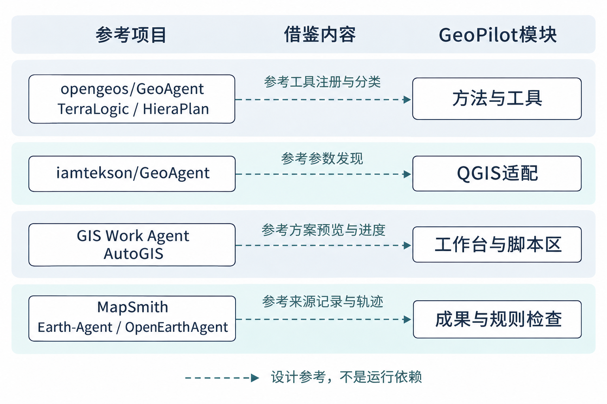

图中把工具分类、参数发现、方案预览和来源记录分别连接到对应模块。遥感项目的轨迹组织主要用于解释和排错；GeoPilot 的结果检查仍依据本地规则与固定参考数据。具体采用边界如下表。

| 借鉴内容 | 来源与采用边界 | 对应模块 | 现有用例或检查 |
|---|---|---|---|
| 工具注册与依赖摘要 | S1；只提供已允许的工具信息 | 第 7.4、7.5 节 | T15；可用工具清单检查 |
| QGIS 参数发现 | S2；保留本机口径检查 | 第 7.7 节 | T01—T06 |
| 方案预览与进度 | S3、S4；采用界面结构 | 第 9 章 | T13、T14、T16 的界面回显 |
| 方法分类和依赖 | S6；不接入自动修复 | 第 7.4 节 | T07—T09 的固定顺序 |
| 来源记录与错误定位 | S5；保存原型所需字段 | 第 7.10、8.1 节 | T16 与成果来源核对 |
| 遥感工具输入说明 | S7、S8；补足产品前提 | 第 7.11 节 | T10—T12 |
| 轨迹和成果分别判断 | S7、S8、S9；只取诊断思路 | 第 11 章 | 16 个用例逐项断言 |

接入时先运行表中对应的 GeoPilot 用例，再核对适配层的实际调用。例如，T15 检查发出的摘要；若引入会自行联网的库，还需检查该库的请求内容。

## 13.11 GIS 计算工具：按职责组合

### 13.11.1 QGIS Processing 与 qgis_process

QGIS Processing 提供算法目录、参数定义和执行入口，适合作为原型已有 GIS 操作的主要来源。`qgis_process` 可以不启动桌面界面，直接列出、查询和运行算法或模型，并提供 JSON 输入输出方式。这使 GeoPilot 可以把 QGIS 环境放在独立进程中，通过明确的参数交接执行任务。[QGIS 官方文档](https://docs.qgis.org/3.44/en/docs/user_manual/processing/standalone.html)

QGIS 工具目录按当前方法需要登记算法 ID、提供者和参数。应用启动时查询这些算法是否可用，方案模块只从可用项中选择；缺失项显示算法名称与环境信息。检查范围因此对应实际方法，也便于复现另一台机器上的环境差异。

测地线缓冲需要有明确实现的算法入口。适配器将它与平面缓冲分别登记，按契约解释距离和椭球参数；全局椭球选项本身不改变平面缓冲的算法含义。目标工具缺少测地线实现时，方案列出工具缺项；实现接通后，用 T04 与参考结果比较。

### 13.11.2 Python 计算库各自承担什么

| 组件 | 适合承担的职责 | GeoPilot 需要补充的控制 | 本轮建议 |
|---|---|---|---|
| GDAL | 格式读取、重投影、栅格处理与 DEM 工具 | 参数、网格、NoData 和单位记录 | 作为基础数据工具 |
| GeoPandas | 带属性表的矢量读取、连接和叠加 | 适用 CRS、空间关系和跨界规则 | 用于可读性较好的矢量脚本 |
| Shapely | 几何关系、缓冲、相交等平面几何运算 | 输入已经处于合适计算空间 | 不独自承担 CRS 决策 |
| PyProj | CRS 解析、坐标转换和测地计算 | 适用范围、轴序、所需转换资源 | 支撑测量策略 |
| Rasterio | 栅格窗口读写、元数据与数组计算衔接 | 缩放、掩膜、网格对齐和结果写回 | 支撑指数与变化计算 |

Shapely 在平面坐标空间中执行几何运算，GeoPandas 则保存 CRS 并提供坐标转换接口。GeoPilot 据此区分两项操作：设置 CRS 是说明已有坐标的含义，重投影是计算另一坐标系中的位置。来源 CRS 明确后，方法步骤把数据转换到选定的计算空间，再调用平面几何工具。[Shapely 手册](https://shapely.readthedocs.io/en/stable/manual.html)，[GeoPandas 投影说明](https://docs.geopandas.org/en/stable/docs/user_guide/projections.html)

PyProj 可用于距离、方位和坐标转换等计算。GeoPilot 的距离步骤从局部投影与测地线实现中选择，面积步骤按第 5 章使用等积投影；工具契约保存各自的适用条件。局部投影的覆盖范围、坐标轴序和转换资源在执行前核对，实际参数写入运行记录。[PyProj Geod 文档](https://pyproj4.github.io/pyproj/stable/api/geod.html)

Rasterio 通过窗口读写把大栅格拆成较小数据块，便于控制本机内存。涉及邻域的计算还需要读入块边缘周围的数据：坡度方法先按算法邻域外扩，计算后裁回目标范围。GDAL 的单位与边缘处理参数保存在方法和运行记录中，便于比较分块处理与参考结果。[Rasterio 窗口读写](https://rasterio.readthedocs.io/en/stable/topics/windowed-rw.html)，[GDAL 地形工具](https://gdal.org/en/stable/programs/gdaldem.html)

### 13.11.3 何时增加专项工具

遇到现有方法缺少的地形、水文或空间建模算法时，可进一步评估 GRASS；适配工作主要是衔接其数据组织、计算区域和分辨率。SAGA 可作为地学分析方法的补充，先选择具体算法，再比较参数、输出与现有工具的差异。两者按算法需要接入。[GRASS 官方概览](https://grass.osgeo.org/learn/overview/)，[SAGA 官方介绍](https://saga-gis.sourceforge.io/en/about/software.html)

WhiteboxTools 可作为地形、水文或点云任务的补充。选型时按具体工具记录可执行文件、版本与许可，区分开源组件、扩展组件和 Whitebox Workflows。随后用相同样本比较结果及安装维护工作，再决定是否加入本机环境。[WhiteboxTools 项目说明](https://github.com/jblindsay/whitebox-tools/blob/master/readme.txt)，[Whitebox 许可说明](https://whiteboxgeo.com/terms.html)

新增工具应对应明确的算法缺口，并配有固定输入和参考结果。已有算法的替代实现先比较输出差异与安装成本，再决定是否采用。

### 13.11.4 参数检查与计算正确性检查

参数检查回答“这个调用是否符合工具接口”：距离是否为数字，输入是否为矢量，必填项是否存在。GIS 计算正确性检查回答“这些参数和数据能否表达当前任务”：距离单位是否正确，投影是否适用，道路是否在分析前被错误裁掉。两者解决的问题不同，因此要分别记录检查结果。

成果检查读取实际输出，判断文件、几何、数值和范围是否符合预设规则。固定用例依次检查错误输入能否被拒绝、正确输入能否得到预期结果，以及界面能否区分执行与检查状态。

## 13.12 Web GIS 前端：保留单一主地图引擎

### 13.12.1 三种候选的使用差异

| 地图库 | 适合的使用方式 | 栅格与投影需要注意什么 | 对个人原型的判断 |
|---|---|---|---|
| MapLibre GL JS | 矢量样式、图层交互与统一地图工作台 | 栅格以瓦片或图像等来源显示，COG 需配套读取或转换 | 保持现有基线 |
| OpenLayers | 多类型 GIS 数据源与投影交互 | 官方提供 GeoTIFF/COG 与 WebGLTile 示例 | 栅格直读成为主要需求时评估 |
| Leaflet | 简单地图、标记、GeoJSON 与瓦片叠加 | 高级栅格和投影处理通常需要额外插件或服务 | 适合较轻的浏览页面 |

MapLibre 的样式与图层能力适合统一呈现道路、缓冲区、行政区和分类成果。OpenLayers 提供 GeoTIFF 数据源与 COG 示例，适合评估栅格读取路径；Leaflet 提供瓦片、图像叠加和 GeoJSON 等基础接口。选型重点是成果文件怎样进入地图，以及这条显示路径需要多少配套处理。[MapLibre API](https://maplibre.org/maplibre-gl-js/docs/API/)，[OpenLayers COG 示例](https://openlayers.org/en/latest/examples/cog.html)，[Leaflet 1.9.4 文档](https://leafletjs.com/reference-1.9.4.html)

本章以 Leaflet 1.9.4 稳定版为比较基线，官网同时列有 2.0 预发布入口。实际安装时统一记录 MapLibre、OpenLayers 或 Leaflet 的包版本与所用示例版本，便于复现显示差异。

### 13.12.2 MapLibre 显示栅格的配套处理

栅格显示包含读取数值、配色和提供浏览器图层三个环节。首版本机服务从 GeoTIFF/COG 读取结果，生成彩色瓦片或预览图，再由 MapLibre 加载。预览记录保存配色、拉伸、NoData 透明度和原始成果标识，用户可以调整显示方式而保留分析数值。

如果以后选择浏览器直读 COG，需要核对读取库、HTTP 范围请求、跨域条件、数据投影及内存消耗。OpenLayers 的现成数据源是一个值得比较的实现，但仍要用实际 DEM 和指数图检查显示效果。三种前端的性能需用本机样本另行测量。

地图显示与数值查询使用两条关联路径。预览图按地图需要投影和配色，鼠标拾取则通过成果标识回到原始栅格取值；距离与面积仍按第 5 章在本机计算。结果属性同时列出原始分辨率和预览分辨率，解释重采样后外观与原数据的差别。

### 13.12.3 原型采用边界

首版采用 MapLibre，先实现图层显示、结果点击和栅格预览；OpenLayers 与 Leaflet 作为后续替代方案。并行维护多个引擎会增加图层状态、坐标转换、选择对象和事件同步的工作，只有明确需求能抵消这些成本时才值得改变基线。

第 9 章按数据、任务、方案、运行和结果组织操作。前端展示本机服务保存的数值、状态与来源，结果面积直接取自统计成果。存在规则问题的图层仍可打开用于排查，检查摘要随图层一同显示，便于把异常位置与具体规则对应起来。

## 13.13 Agent 框架：先保持控制流程清楚

### 13.13.1 普通 Python 与 Pydantic 基线

初期采用有序方法，普通 Python 函数按配置连接步骤，Pydantic 负责字段类型、必填项和枚举检查。涉及 CRS 适用范围、测量方式和传感器参数的判断，由本机函数读取元数据后完成。结构校验与 GIS 检查分别返回错误位置，方案区据此提示需要补充的内容。[Pydantic 模型说明](https://pydantic.dev/docs/validation/latest/concepts/models/)

这条基线便于个人调试：从已确认方案开始，可以顺序查看输入解析、契约检查、进程请求和结果登记。模型返回不完整对象时，系统给出缺失字段，方案保持草稿；外部模型暂不可用时，仍能通过手动填写关键选项验证本地计算链路。这样开发不必先依赖对话能力稳定。

### 13.13.2 框架比较

| 选择 | 能减少的重复工作 | 引入后要维护的内容 | 采用条件 |
|---|---|---|---|
| Python + Pydantic | 结构定义、类型检查与明确分支 | 自行维护少量任务状态和调用封装 | 首版默认 |
| LangGraph | 状态图、分支、持续执行与中断 | 图状态、节点、持久化语义及版本适配 | 分支明显增多且顺序代码难以维护 |
| Strands | 模型和工具调用循环、工具描述适配 | 框架调用行为、上下文和工具范围 | 确需借用其工具生态时评估 |
| PydanticAI | 类型化模型输出、工具与依赖组织 | 模型适配、重试和上下文生命周期 | 模型调用封装出现持续重复时评估 |

LangGraph 官方文档强调状态图、持久化和流式执行等能力，适合需要显式分支和暂停恢复的流程。iamtekson/GeoAgent 使用它组织一般对话与地理处理两类模式，但 GeoPilot 目前只有有限固定方法。原型先明确状态对象，出现难以维护的分支后再评估该框架。[LangGraph 官方概览](https://docs.langchain.com/oss/python/langgraph/overview)

Strands 在 opengeos/GeoAgent 中组织模型与工具调用。GeoPilot 若接入其工具定义，需要核对模型调用时机、上下文累积方式和工具选择范围，并以项目依赖文件中的 SDK 版本对应文档。这样能明确哪些状态由框架维护，哪些仍由本机方案与调度模块保存。[S1 依赖定义](https://github.com/opengeos/GeoAgent/blob/3cff6db6ac5dd96e44c46a1efd5d0890ecfc13cd/pyproject.toml)， [Strands 官方入口](https://strandsagents.com/latest/)

PydanticAI 将类型化输出、工具和依赖组织在 Agent 接口中，适合减少模型调用封装的重复。它比单独的 Pydantic 多负责模型交互与重试，因此接入点宜放在模型适配模块。固定方法仍由本机调度执行；对有文件输出的调用，需核对框架重试是否会重复执行。[PydanticAI 官方概览](https://pydantic.dev/docs/ai/overview/)

### 13.13.3 框架与计算模块的分工

测量口径、固定步骤、传感器配置和规则检查由 GeoPilot 的普通 Python 函数实现，并单独测试。框架负责模型与工具调用的组织；更换框架时，这些计算约束保持一致。

下图给出本章建议的最小依赖关系，箭头表示调用或访问。实线表示首版必需连接，虚线表示按需要接入外部模型或 PostGIS；本地计算链路可以先独立调试，再接入自然语言入口。

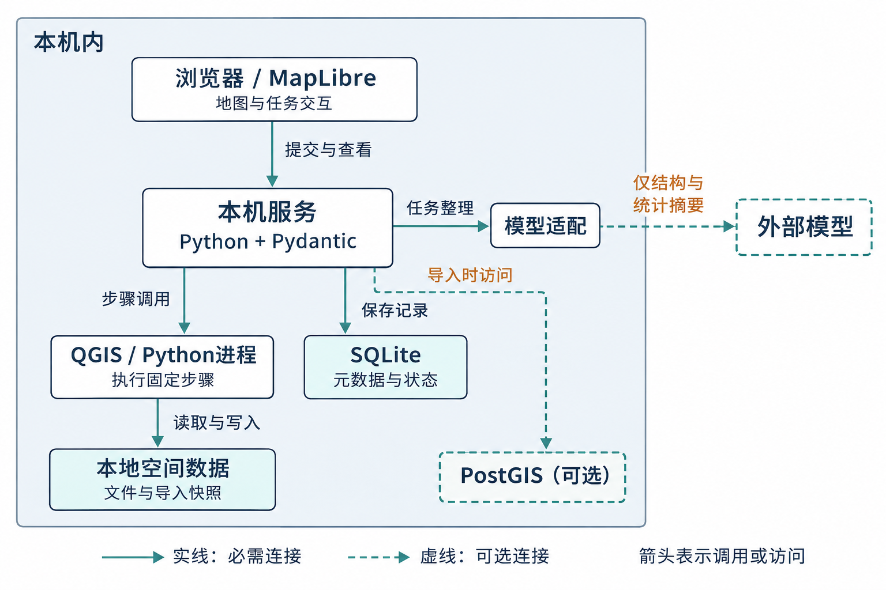

浏览器向本机服务提交任务，服务保存方案与状态，并调用 QGIS/Python 进程完成计算。服务通过数据源适配器访问 PostGIS 并导入本地快照，外部模型通过模型适配器接收摘要；具体数据流见第 6.2、7.8 节。

## 13.14 评测借鉴：分清轨迹、参数与成果

### 13.14.1 GABench 与 GISAgentBench 的区别

GeoX-Lab/GABench 仓库自称 GeoAgentBench，公开了任务、运行器、逐步评价、端到端评价和地图视觉评价等材料。其 README 说明可以从日志回放工具调用而不重新经过模型。这一能力适合用于复现工具错误，也提醒 GeoPilot 将结构化请求与聊天消息分开保存。[S9 基准使用说明](https://github.com/GeoX-Lab/GABench/blob/357d0f531d55bfbd701a79a77af86c1db3b22325/README.md)

GABench 的地图评价由视觉语言模型参与评分，用于比较图层表达与制图效果。GeoPilot 将这类材料用于检查工作台的可读性，空间结果则由集合、数值、几何和状态断言判定。两类评价分别对应显示与计算，样本来源与许可见附录 E。[S9 地图评价实现](https://github.com/GeoX-Lab/GABench/blob/357d0f531d55bfbd701a79a77af86c1db3b22325/evaluation/vlm_judge.py)

GISAgentBench 从实际 GIS 问题构造任务，并比较输出文件与参考成果。所查论文版本仍注明任务、参考轨迹和成果将公开发布，本次尚未核实到官方代码与数据入口，因此采用其成果比较思路作为论文参考。它与 GABench 分别记录来源和评价对象。[GISAgentBench 论文 v1](https://arxiv.org/html/2608.01645v1)

### 13.14.2 不同评价能说明什么

| 评价对象 | 能说明的问题 | 不能单独证明的内容 | GeoPilot 用法 |
|---|---|---|---|
| 工具集合与顺序 | 是否调用参考工具、是否遵循依赖 | 输入数据与数值结果正确 | 检查固定方法顺序 |
| 参数匹配 | 数值、字段与选项是否符合参考 | 参数背后的单位或元数据可靠 | 检查关键选项和查表结果 |
| 最终成果比较 | 文件、几何、统计或像元是否符合参考 | 未覆盖场景也同样可靠 | 作为固定用例主要断言 |
| 地图视觉评价 | 图层显示、配色和可读性是否合理 | 原始数值与分析口径正确 | 仅用于人工检查界面 |

Earth-Agent 的逐步评价提供了工具集合、顺序和参数等不同维度，OpenEarthAgent 官方材料也区分逐步与端到端评价。这些做法有助于定位错误发生在理解、工具选择还是执行阶段。GeoPilot 将这些维度用于失败定位，固定用例仍按本地断言判定。[S7 逐步评价](https://github.com/opendatalab/Earth-Agent/blob/ca1dfaef750654331308a434966d307f1728fd90/evaluate/step_by_step.py)，[S8 评测说明](https://github.com/mbzuai-oryx/OpenEarthAgent/blob/f0daed5510b9134c8617d1c109138f62a0043c82/README.md)

测试按约束的性质选择断言。外扩、单位检查和裁回的顺序影响结果，直接比较步骤序列；可以替换的底层算法则比较成果与容差。这样更换读取库或等价实现时，测试仍围绕方法要求定位差异。

### 13.14.3 保持 16 个固定用例

第 11 章的 T01—T16 用固定输入、预期选项、参考结果和自动断言检验设计。开源借鉴表中的每项建议对应其中的相关用例，接入时先核对参数与步骤，再比较最终结果。新增能力需要自己的样本与断言，覆盖范围单独记录。

参考结果优先采用可手算的小数据，并用独立方法复核。例如，道路边界样本可预先列出应选中的对象编号；NDVI 样本可用已知红光与近红外值计算期望结果。独立建立参考答案，能够发现执行代码与参考生成代码可能共有的错误。

测试报告分别列出输入问题、工具失败和规则未通过。未执行项单列，汇总时说明分母；结果表达见第 11.4 节。

## 13.15 贯穿示例一：道路 500 米缓冲统计

### 13.15.1 从任务到可确认选项

假设用户提出“统计道路周边 500 米内的建筑物，并按行政区汇总”。规则解析路径可以识别缓冲与数值，工具调用路径可以寻找缓冲和空间连接算法，代码生成路径可以把这些操作写成脚本。但它们都还需要明确“建筑物落在范围内”的关系，以及跨越行政区的对象如何计入统计。

GeoPilot 先把道路、建筑物和行政区对应到已登记资产，并列出 `intersects` 或 `within`、跨界归属方式、距离方式和分析范围。模型可以帮助解释选项，最终值由当前用户确认。这一步借鉴 GIS Work Agent 的预览方式，落在第 7.3 节分析方案与第 9 章界面，通过 T13、T14 的结果与回显检查确认。

### 13.15.2 数据读取与参数确定

系统先检查道路来源是否覆盖外围影响范围，再外扩分析区取数。区外道路的缓冲区可能进入区内，因此外扩取数固定在方法开头；仅按原分析区裁道路会漏掉这部分影响。T07、T08 分别检查应纳入和应排除的区外对象。

方案将“500 米”保存为距离值、单位和计算方式。执行适配器参考 iamtekson/GeoAgent 的参数发现方式，把它们转换为算法参数；本机契约检查再核对输入 CRS 与算法的距离含义。T01、T02 检查错误平面输入，T03、T04 分别比较局部投影与测地线结果。

### 13.15.3 执行与结果判定

固定方法按“外扩取数—落实已选距离方式—缓冲—空间关系判断—裁回分析区—统计”执行。空间关系在需要的完整对象上判断，裁回后的几何用于约定的输出与面积统计；如果按对象数量归属，应保留原始对象标识，避免裁成多个部分后重复计数。面积拆分使用等积投影，仍受 T05、T06 约束。

成果旁列出输入版本、关键选项、实际工具和 CRS 决策，承接 MapSmith 的来源记录思路。规则检查比较选中建筑物集合、边界结果和分区汇总；如果工具完成计算却漏取区外道路，T07 会在对象集合比较中定位差异。结果页同时显示执行完成和这项检查的明细。

## 13.16 贯穿示例二：两期 NDVI 变化

### 13.16.1 任务与产品识别

“两期影像的植被变化”先整理为两期产品、时间、分析区和变化方向。本场景计算第二期减第一期的 NDVI 差值，表示指数变化；需要分类时，再由用户给出阈值。成果说明随结果列出这一含义，土地覆盖转移则由土地利用变化场景处理。

Earth-Agent 的工具分类用于定位指数与统计方法，AutoGIS 的目录思路用于展示候选影像。选中产品后，第 7.11 节的配置表按传感器、产品级别和处理版本确定红光、近红外、缩放、偏移与质量波段。T12 检查产品未知时能否返回明确缺项并停止计算。

### 13.16.2 波段、缩放与有效像元

两期数据分别查表后，先将原始值转换为反射率，再计算指数。若两个波段都按 `反射率 = a × DN + b` 转换，NDVI 的分母包含 `2b`，直接使用原始 DN 就会遗漏偏移量的影响。T10 检查 Landsat 缩放与偏移来源，T11 检查 Sentinel-2 波段映射，各自采用对应产品配置。

质量掩膜标记参与比较的有效像元；网格检查核对投影、位置、分辨率和像元对应关系。两期数组即使行列数相同，也要检查它们覆盖的地面位置。准备完成后，差值计算使用两期共同有效范围，成果说明同时保存掩膜与对齐信息。

OpenEarthAgent 的编码还原方式对应它自己的输入约定。GeoPilot 的指数计算输出浮点栅格，差值步骤直接读取这些数值，地图预览另行配色。方法与成果元数据标明数值阶段，便于检查步骤之间是否传入了正确类型的文件。

### 13.16.3 变化计算与解释

计算过程先分别得到两期 NDVI，再在共同有效像元上计算差值。阈值、时间顺序和统计范围属于用户可见选项；阈值变化后方案回到草稿，由用户再次确认。若需要变化面积，按等积投影规则形成统计，不能直接把任意经纬度栅格的像元数乘同一个固定面积。

规则检查读取指数值、掩膜和元数据，分别比较数值范围、有效区域和网格关系。T10—T12 检验产品配置，T16 检验执行与检查状态的独立显示。真实影像接入时，再为云掩膜、重采样和时相可比性补充样本；这些后续验证项在第 12.7 节记录。

成果说明从运行记录提取两期产品、配置版本、差值方向、有效范围和阈值，并关联统计结果。模型可以把这些已保存信息整理成自然中文。用户由此能将地图上的变化位置与计算条件逐项对应，面积等数值直接取自实际成果。

## 13.17 将比较结果转成实现顺序

先检查本机环境，完成数据登记、测量契约与最小执行适配器，再用手填方案接通道路流程。这里借鉴 S1 的工具组织、S2 的参数发现和 S5 的来源记录；P2 完成基础测量测试，P3 检查区外道路取数。测地线缓冲在 P0 验证候选，P6 完成 T04。

道路流程可复算后，补齐取消、重试与状态查询，再接最小工作台。随后补齐矢量选项和土地利用，接入 DEM、栅格预览与遥感变化；目录和预览参考 S3、S4，遥感工具模式参考 S7、S8。每个场景接入时都使用同一组方案、运行与成果对象。

模型入口依赖稳定的手工方案和通用工作台，外发请求先经 T15 检查；它可在 P5 后开始联调，P6—P8 继续补充方法覆盖。脚本区与可选 PostGIS 在基础运行管理稳定后完善，最终按第 12 章的十二步计划和完成标准逐项验收。

# 附录 A 方法定义示例

## A.1 道路缓冲统计

第 8.5 节列出方法主体及七步输入输出连接，本节补充预期成果与规则。两部分合并后形成完整方法配置；方案生成器再绑定实际工具和参数。

```yaml
expected_artifacts:
  - buffer_extent
  - selected_targets
  - zone_statistics
check_rules:
  - measurement_policy_satisfied
  - outside_roads_within_influence_included
  - output_clipped_to_analysis_extent
  - detail_count_matches_summary
```

`output_clipped_to_analysis_extent` 检查范围内目标成果；`buffer_extent` 保留完整缓冲区用于解释影响来源，不适用该裁剪规则。分区计数核对“已归属数量＋未归属数量＝去重后目标数量”，面积统计另按面积总量核对。

道路缓冲的完整顺序为：`expand_analysis_extent`、`select_roads_from_expanded_extent`、`choose_measurement_method`、`create_buffer`、`apply_spatial_relation`、`clip_back_to_analysis_extent`、`aggregate_by_zone`。外扩和缓冲采用同一个已确认距离方式，统计按原始对象标识去重。

## A.2 DEM 地形分析

```yaml
id: dem-terrain-analysis
version: 1
locked_order: true
inputs:
  analysis_extent: vector_polygon
  dem: raster_elevation
critical_options:
  terrain_output: [slope, aspect]
  slope_unit: [degree, percent]
  threshold: user_defined
steps:
  - {key: expand_extent_by_algorithm_neighborhood}
  - {key: read_dem_for_expanded_extent}
  - {key: check_horizontal_vertical_units}
  - {key: calculate_slope_or_aspect}
  - {key: clip_back_to_analysis_extent}
  - {key: extract_by_threshold}
  - {key: calculate_area_with_equal_area_projection}
expected_artifacts: [terrain_raster, threshold_regions, area_statistics]
check_rules:
  - dem_covers_expanded_extent
  - units_resolved
  - border_pixels_match_reference
```

## A.3 遥感变化

```yaml
id: remote-sensing-index-change
version: 1
locked_order: true
inputs:
  first_product: raster_product
  second_product: raster_product
  analysis_extent: vector_polygon
critical_options:
  resampling: user_selected
  change_threshold: user_defined
steps:
  - {key: read_product_metadata}
  - {key: lookup_sensor_configuration}
  - {key: map_band_roles}
  - {key: apply_scale_and_offset}
  - {key: build_quality_mask}
  - {key: calculate_ndvi}
  - {key: align_two_dates}
  - {key: calculate_change}
expected_artifacts: [first_ndvi, second_ndvi, change_raster]
preconditions:
  - sensor_configuration_is_unique
  - required_bands_exist
  - scale_and_offset_are_known
check_rules:
  - product_configuration_matches
  - common_valid_pixels_aligned
  - change_direction_is_second_minus_first
```

## A.4 土地利用变化

```yaml
id: land-use-change
version: 1
locked_order: true
inputs:
  first_classes: vector_polygon
  second_classes: vector_polygon
  zones: vector_polygon
  analysis_extent: vector_polygon
critical_options:
  boundary_assignment: [split_by_area, centroid, largest_overlap]
  minimum_change_area: user_defined
steps:
  - {key: read_two_periods}
  - {key: map_classification_systems}
  - {key: choose_equal_area_projection}
  - {key: overlay}
  - {key: apply_boundary_assignment}
  - {key: build_change_polygons}
  - {key: build_transition_matrix}
expected_artifacts: [change_polygons, transition_matrix, zone_statistics]
check_rules:
  - classification_mapping_complete
  - overlay_area_balanced
  - transition_totals_match
```

# 附录 B 工具契约与错误示例

## B.1 测量策略

| 任务 | 允许方式 | 阻断条件 |
|---|---|---|
| 距离或缓冲 | 适用局部投影或测地线 | 经纬度或 EPSG:3857 平面计算 |
| 面积 | 适用于分析区的等积投影 | 经纬度面积、EPSG:3857 面积 |
| 非测量工具 | `not_applicable` | 契约未明确且任务包含测量 |

## B.2 错误摘要

错误字段见第 8.9 节。界面显示原因与建议，堆栈保存在日志中。

| 错误类型 | 示例说明 | 用户下一步 |
|---|---|---|
| `SOURCE_UNREADABLE` | 来源、文件或图层不可读 | 修正来源后重新登记 |
| `INPUT_CHANGED` | 输入指纹与方案记录不同 | 刷新资产并生成新草稿 |
| `PLAN_NOT_CONFIRMED` | 请求的方案版本仍是草稿 | 补齐并确认该版本 |
| `RUN_BUSY` | 已有计算或检查正在进行 | 查看已有运行 |
| `CRS_UNKNOWN` | 无法解析输入 CRS | 补充或指定正确 CRS |
| `MEASUREMENT_POLICY_REJECTED` | 坐标系不适合当前测量 | 调整距离或面积方式 |
| `SENSOR_CONFIG_NOT_FOUND` | 产品信息没有匹配配置 | 检查产品元数据或补充配置 |
| `SENSOR_CONFIG_AMBIGUOUS` | 同一产品匹配了多条配置 | 修正配置范围，使其唯一 |
| `METHOD_PRECONDITION_FAILED` | 当前数据不满足方法前提 | 更换数据或选择其他方法 |
| `PROCESS_START_FAILED` | 本地进程无法启动 | 查看工具路径与日志 |
| `PROCESS_FAILED`／`PROCESS_TIMEOUT` | 进程退出异常或超时 | 修复环境后重新运行 |
| `OUTPUT_MISSING` | 进程结束但预期成果不存在 | 查看步骤日志并修改方案 |
| `STORAGE_FAILED` | 运行或成果记录保存失败 | 检查磁盘与 SQLite 后重试 |
| `RUN_INTERRUPTED` | 服务中断导致计算未完成 | 查看日志并重新运行 |
| `CHECK_INTERRUPTED` | 检查器异常或服务中断 | 修复后重新检查 |
| `CHECK_CANCELLED` | 用户在检查阶段取消 | 需要时重新检查 |
| `CHECK_BLOCKED` | 成果触发阻断规则 | 修正口径后重新运行 |


# 附录 C 固定用例清单

## C.1 用例文件结构

```text
tests/golden/
  T01-geographic-planar-buffer/
    input/
    task.json
    expected.json
  T02-web-mercator-distance/
  ...
  T16-execution-and-check-status/
```

`expected.json` 保存预期状态、输出结构和数值容差。空间结果较大时保存参考摘要和关键几何断言，不必把全部输出嵌入 JSON。

## C.2 自动断言类别

| 类别 | 断言示例 | 适用用例 |
|---|---|---|
| 状态断言 | 执行被拒绝、运行成功、检查未通过 | T01、T02、T05、T12、T16 |
| 参数断言 | 实际使用的 CRS、波段、系数与期望一致 | T03、T04、T10、T11 |
| 空间断言 | 指定对象被纳入或排除、边界像元一致 | T07、T08、T09、T13 |
| 数值断言 | 面积、计数或统计在容差内 | T03、T04、T06、T14 |
| 请求断言 | 序列化请求不含禁止字段与模式 | T15 |

## C.3 测试报告最小内容

每次运行记录代码版本、方法配置版本、工具版本、开始结束时间和环境摘要。报告逐项列出输入、断言、观察值、期望值和差异。失败用例保留工作目录，方便复现。

# 附录 D 需求变更、图稿与参考资料

## D.1 从完整方案收敛到个人原型

| 原设计方向 | 本稿处理 | 保留原因或推迟原因 |
|---|---|---|
| 多角色与组织控制 | 推迟 | 单用户本机原型没有组织边界 |
| 平台级运行保障 | 推迟 | 当前不提供长期共享服务 |
| 正式工具发布体系 | 改为本地脚本与手动收录 | 先验证方法和计算结果 |
| 大规模综合评测 | 以 16 项初始回归起步，补充通用与方法检查 | 分别维护计算约束和可复用能力的证据 |
| 复杂自动修复 | 改为错误说明、修改方案、手动重试 | 保持行为可理解 |
| 投影、边缘、遥感元数据 | 保留并强化 | 这些问题会让原型静默算错 |
| 关键业务口径 | 按方法定义呈现用户选项 | 影响结果的选择进入确认方案 |
| 以四个场景界定产品 | 改为通用能力与可扩展方法目录 | 四项任务只承担首批实现与验收样例 |
| 模型数据边界 | 保留并测试 | 同时降低数据暴露与上下文开销 |

## D.2 图稿说明

27 张图稿由内置 Imagen 逐张生成，中文直接绘制。功能与数据分区采用淡色底，模块名采用中等字重，说明采用常规字重，字形参考思源黑体；均按 A4 页宽检查。稳定文件名、提示词与修正记录见图稿目录的 `imagen-prompts.md`。

## D.3 参考资料

以下资料说明图形表达和 GIS 计算原则；开源项目的版本、源码与许可见附录 E。

1. [C4 Model：分层架构图](https://c4model.com/diagrams)
2. [arc42：结构视图](https://docs.arc42.org/section-5/)
3. [arc42：运行时视图](https://docs.arc42.org/section-6/)
4. [Microsoft：架构图设计规范](https://learn.microsoft.com/en-us/azure/well-architected/architect-role/design-diagrams)
5. [ArcGIS Pro：测地距离与平面距离](https://pro.arcgis.com/en/pro-app/3.4/tool-reference/spatial-analyst/geodesic-versus-planar-distance.htm)
6. [ArcGIS Pro：Mercator 投影](https://pro.arcgis.com/en/pro-app/3.5/help/mapping/properties/mercator.htm)
7. [GDAL：gdaldem 地形处理](https://gdal.org/en/stable/programs/gdaldem.html)
8. [USGS：Landsat Level-2 缩放系数](https://www.usgs.gov/faqs/how-do-i-use-a-scale-factor-landsat-level-2-science-products)
9. [Copernicus：Sentinel-2 产品文档](https://documentation.dataspace.copernicus.eu/Data/SentinelMissions/Sentinel2.html)

# 附录 E 项目版本与来源索引

## E.1 核查范围与使用方法

本附录记录 2026 年 11 月 11 日查阅的官方材料。源码链接固定到本次取得的 main 分支提交，正文 S1—S9 与下表对应；动态文档记录查阅日期，安装版本在实际接入时锁定。

正文链接定位到支持判断的文件。复现时另行记录实际代码、配置、数据版本和运行环境，调研方式与证据标记见第 13.1 节。

| 编号 | 官方仓库 | 所查 main 提交（链接含完整提交号） |
|---|---|---|
| S1 | [opengeos/GeoAgent](https://github.com/opengeos/GeoAgent) | [3cff6db6ac5d](https://github.com/opengeos/GeoAgent/commit/3cff6db6ac5dd96e44c46a1efd5d0890ecfc13cd) |
| S2 | [iamtekson/GeoAgent](https://github.com/iamtekson/GeoAgent) | [f2585e83e966](https://github.com/iamtekson/GeoAgent/commit/f2585e83e966a5291cfd332237066d1c6d866b62) |
| S3 | [THU-ESIS/AutoGIS](https://github.com/THU-ESIS/AutoGIS) | [c4f602a3f79f](https://github.com/THU-ESIS/AutoGIS/commit/c4f602a3f79f5bd20d48ff53425c9e38077f0469) |
| S4 | [AkmaulHoque/GIS-Work-Agent](https://github.com/AkmaulHoque/GIS-Work-Agent) | [f709e6f9b898](https://github.com/AkmaulHoque/GIS-Work-Agent/commit/f709e6f9b898bc97cf5de0eead8e2ae4960c2fb7) |
| S5 | [mapsmith-ai/MapSmith](https://github.com/mapsmith-ai/MapSmith) | [97de54e86f2f](https://github.com/mapsmith-ai/MapSmith/commit/97de54e86f2f551413a66b56bca989fcd02b5ce2) |
| S6 | [Ireliya/TerraLogic](https://github.com/Ireliya/TerraLogic) | [e2b0c83b7a71](https://github.com/Ireliya/TerraLogic/commit/e2b0c83b7a71cc2f991081e27af26be572484e19) |
| S7 | [opendatalab/Earth-Agent](https://github.com/opendatalab/Earth-Agent) | [ca1dfaef7506](https://github.com/opendatalab/Earth-Agent/commit/ca1dfaef750654331308a434966d307f1728fd90) |
| S8 | [mbzuai-oryx/OpenEarthAgent](https://github.com/mbzuai-oryx/OpenEarthAgent) | [f0daed5510b9](https://github.com/mbzuai-oryx/OpenEarthAgent/commit/f0daed5510b9134c8617d1c109138f62a0043c82) |
| S9 | [GeoX-Lab/GABench](https://github.com/GeoX-Lab/GABench) | [357d0f531d55](https://github.com/GeoX-Lab/GABench/commit/357d0f531d55bfbd701a79a77af86c1db3b22325) |

## E.2 代码、权重与数据许可

下表分别记录代码、模型权重与数据的许可来源。外部下载内容按自身条款核对，未核实项仅作设计参考。

| 项目 | 项目代码许可证据 | 模型权重 | 数据 |
|---|---|---|---|
| S1 opengeos/GeoAgent | [MIT 文件](https://github.com/opengeos/GeoAgent/blob/3cff6db6ac5dd96e44c46a1efd5d0890ecfc13cd/LICENSE) | 外部模型依各自条件；本轮未核实权重许可 | 示例与外部数据未逐项核实 |
| S2 iamtekson/GeoAgent | [MIT 文件](https://github.com/iamtekson/GeoAgent/blob/f2585e83e966a5291cfd332237066d1c6d866b62/LICENSE)；QGIS 等依赖分别核对 | 外部模型条件单独适用 | 示例数据未逐项核实 |
| S3 AutoGIS | [Apache-2.0 文件](https://github.com/THU-ESIS/AutoGIS/blob/c4f602a3f79f5bd20d48ff53425c9e38077f0469/LICENSE) | 提及模型的权重许可本轮未核实 | 检索所得数据依原始来源 |
| S4 GIS Work Agent | [GPL v2 文本](https://github.com/AkmaulHoque/GIS-Work-Agent/blob/f709e6f9b898bc97cf5de0eead8e2ae4960c2fb7/LICENSE)；[README 标为 GPL-2.0-or-later](https://github.com/AkmaulHoque/GIS-Work-Agent/blob/f709e6f9b898bc97cf5de0eead8e2ae4960c2fb7/README.md) | 所查规则入口不依赖专属权重 | 用户输入和样例分别核对 |
| S5 MapSmith | [AGPL-3.0 文件](https://github.com/mapsmith-ai/MapSmith/blob/97de54e86f2f551413a66b56bca989fcd02b5ce2/LICENSE) | 外部模型及检索模型分别核对 | 示例与外部数据不由代码许可概括 |
| S6 TerraLogic | [Apache-2.0 文件](https://github.com/Ireliya/TerraLogic/blob/e2b0c83b7a71cc2f991081e27af26be572484e19/LICENSE) | 第三方感知权重未逐项核实 | 基准原始数据许可未逐项核实 |
| S7 Earth-Agent | [MIT 文件](https://github.com/opendatalab/Earth-Agent/blob/ca1dfaef750654331308a434966d307f1728fd90/LICENSE) | online_infer 分支权重不在本次核查内 | Earth-Bench 卡片标为 Apache-2.0 |
| S8 OpenEarthAgent | 所查提交未见根 LICENSE，代码许可未核实 | 官方模型卡标为 Apache-2.0 | 官方数据卡标为 Apache-2.0 |
| S9 GABench | [Apache-2.0 文件](https://github.com/GeoX-Lab/GABench/blob/357d0f531d55bfbd701a79a77af86c1db3b22325/LICENSE) | 调用的外部模型分别核对 | 仓库关联数据来源与单独条款未逐项核实 |

数据与权重卡片查阅于 2026 年 11 月 11 日：[Earth-Bench 数据卡](https://huggingface.co/datasets/Sssunset/Earth-Bench)、[OpenEarthAgent 模型卡](https://huggingface.co/MBZUAI/OpenEarthAgent)、[OpenEarthAgent 数据卡](https://huggingface.co/datasets/MBZUAI/OpenEarthAgent)。卡片标注只记录当前页面声明；后续若下载或再分发，应核对所取文件版本、基础模型及原始影像来源。

## E.3 关键文件与能力对应

| 来源 | 本次定位的关键文件 | 支持的比较判断 |
|---|---|---|
| S1 | [context.py](https://github.com/opengeos/GeoAgent/blob/3cff6db6ac5dd96e44c46a1efd5d0890ecfc13cd/geoagent/core/context.py)；[registry.py](https://github.com/opengeos/GeoAgent/blob/3cff6db6ac5dd96e44c46a1efd5d0890ecfc13cd/geoagent/core/registry.py)；[依赖定义](https://github.com/opengeos/GeoAgent/blob/3cff6db6ac5dd96e44c46a1efd5d0890ecfc13cd/pyproject.toml) | 活对象上下文、工具元数据、Strands 依赖 |
| S2 | [架构文档](https://github.com/iamtekson/GeoAgent/blob/f2585e83e966a5291cfd332237066d1c6d866b62/docs/developer-guide/architecture.md)；[单步流程](https://github.com/iamtekson/GeoAgent/blob/f2585e83e966a5291cfd332237066d1c6d866b62/agents/geoprocessing_flow.py)；[模型导出](https://github.com/iamtekson/GeoAgent/blob/f2585e83e966a5291cfd332237066d1c6d866b62/utils/model_export.py) | 算法发现、参数处理、成功步骤导出 |
| S3 | [架构文档](https://github.com/THU-ESIS/AutoGIS/blob/c4f602a3f79f5bd20d48ff53425c9e38077f0469/docs/ARCHITECTURE.md)；[工作流引擎](https://github.com/THU-ESIS/AutoGIS/blob/c4f602a3f79f5bd20d48ff53425c9e38077f0469/spatial_analysis_system/workflow_engine.py) | 本地数据优先、脚本生成与执行、Web 状态 |
| S4 | [解析器](https://github.com/AkmaulHoque/GIS-Work-Agent/blob/f709e6f9b898bc97cf5de0eead8e2ae4960c2fb7/gis_work_agent/prompt_parser.py)；[执行模块](https://github.com/AkmaulHoque/GIS-Work-Agent/blob/f709e6f9b898bc97cf5de0eead8e2ae4960c2fb7/gis_work_agent/agent_engine.py) | 规则拆句、参数提取、Processing 匹配 |
| S5 | [计划检查](https://github.com/mapsmith-ai/MapSmith/blob/97de54e86f2f551413a66b56bca989fcd02b5ce2/src/mapsmith/plans/validator.py)；[来源记录](https://github.com/mapsmith-ai/MapSmith/blob/97de54e86f2f551413a66b56bca989fcd02b5ce2/src/mapsmith/provenance.py) | 顺序引用、参数约束、CRS 与指纹记录 |
| S6 | [工具模型](https://github.com/Ireliya/TerraLogic/blob/e2b0c83b7a71cc2f991081e27af26be572484e19/spatialreason/plan/tools/tool_models.py)；[依赖检查](https://github.com/Ireliya/TerraLogic/blob/e2b0c83b7a71cc2f991081e27af26be572484e19/spatialreason/plan/validation/validators.py) | 工具类别、参数和像素尺度前提 |
| S7 | [项目说明](https://github.com/opendatalab/Earth-Agent/blob/ca1dfaef750654331308a434966d307f1728fd90/README.MD)；[指数工具](https://github.com/opendatalab/Earth-Agent/blob/ca1dfaef750654331308a434966d307f1728fd90/agent/tools/Index.py)；[逐步评价](https://github.com/opendatalab/Earth-Agent/blob/ca1dfaef750654331308a434966d307f1728fd90/evaluate/step_by_step.py) | 波段路径输入、NDVI 计算与轨迹评价 |
| S8 | [项目说明](https://github.com/mbzuai-oryx/OpenEarthAgent/blob/f0daed5510b9134c8617d1c109138f62a0043c82/README.md)；[指数变化工具](https://github.com/mbzuai-oryx/OpenEarthAgent/blob/f0daed5510b9134c8617d1c109138f62a0043c82/tool_server/tool_workers/online_workers/ComputeIndexChange_worker.py) | 多环境说明、工具模式及特定编码还原 |
| S9 | [使用说明](https://github.com/GeoX-Lab/GABench/blob/357d0f531d55bfbd701a79a77af86c1db3b22325/README.md)；[地图评价](https://github.com/GeoX-Lab/GABench/blob/357d0f531d55bfbd701a79a77af86c1db3b22325/evaluation/vlm_judge.py) | 工具回放入口与视觉评价边界 |

## E.4 官方文档与论文入口

计算工具资料采用 [QGIS 3.44 命令行文档](https://docs.qgis.org/3.44/en/docs/user_manual/processing/standalone.html)、[GDAL 地形处理](https://gdal.org/en/stable/programs/gdaldem.html)、[GeoPandas 投影说明](https://docs.geopandas.org/en/stable/docs/user_guide/projections.html)、[Shapely 手册](https://shapely.readthedocs.io/en/stable/manual.html)、[PyProj Geod](https://pyproj4.github.io/pyproj/stable/api/geod.html) 和 [Rasterio 窗口读写](https://rasterio.readthedocs.io/en/stable/topics/windowed-rw.html)。这些资料用于核对组件职责与算法前提，实际安装版本随本机环境记录。

前端资料采用 [MapLibre API](https://maplibre.org/maplibre-gl-js/docs/API/)、[OpenLayers COG 示例](https://openlayers.org/en/latest/examples/cog.html) 和 [Leaflet 1.9.4 稳定版文档](https://leafletjs.com/reference-1.9.4.html)。框架资料采用 [Pydantic 模型](https://pydantic.dev/docs/validation/latest/concepts/models/)、[LangGraph 概览](https://docs.langchain.com/oss/python/langgraph/overview)、[Strands 官方入口](https://strandsagents.com/latest/) 和 [PydanticAI 概览](https://pydantic.dev/docs/ai/overview/)。以上动态资料均查阅于 2026 年 11 月 11 日。

研究论文入口包括 [TerraLogic / HieraPlan](https://arxiv.org/abs/2607.12497)、[Earth-Agent](https://arxiv.org/abs/2509.23141)、[OpenEarthAgent](https://arxiv.org/abs/2602.17665)、[GABench](https://arxiv.org/abs/2604.13888) 与 [GISAgentBench v1](https://arxiv.org/html/2608.01645v1)。GISAgentBench 的官方代码和数据入口本次未核实，保留为论文方法参考。

## E.5 后续实测的最小步骤

1. 从本章借鉴决策表选择一个确有需要的模块，固定代码提交和实际依赖版本；先核对对应文件许可，再决定设计参考或局部复用。
2. 按所选模块准备最小输入，可参考任务样例或实际待接入方法；安装依赖并记录工具发现结果、坐标系、参数和输出位置。
3. 使用现有 T01—T16 中对应的用例检查约束，比较最终文件与参考结果，同时保留实际请求和错误摘要。
4. 检查 Web 预览、结果数值和运行记录是否一致，确认外部模型请求仍满足允许清单；结果不一致时先定位输入前提和参数转换。
5. 按样本结果决定是否保留该依赖，记录已覆盖的行为及后续需补充的样本。


## E.6 分步实施计划的官方资料

以下资料于 2026 年 11 月 11 日核对，用于第 12 章的执行方式与验收设计。安装环境按 P0 记录实际版本；动态文档中的示例版本与本机环境分别保存。阶段顺序和完成条件是结合个人原型范围作出的设计选择。

| 官方资料 | 本轮核对内容 | 对应步骤 |
|---|---|---|
| [QGIS 3.44 命令行执行](https://docs.qgis.org/3.44/en/docs/user_manual/processing/standalone.html) | 算法列表、帮助、参数与 JSON 调用 | P0、P2、P3 |
| [QGIS 几何 API](https://api.qgis.org/api/classQgsGeometry.html) | 平面几何与测地计算的区别 | P0、P6 |
| [Python 子进程](https://docs.python.org/3/library/subprocess.html) | 启动、退出、超时与终止 | P0、P2、P4 |
| [SQLite 事务](https://www.sqlite.org/lang_transaction.html) | 事务提交与单个写事务 | P1、P4 |
| [Pydantic 校验器](https://pydantic.dev/docs/validation/latest/concepts/validators/) | 字段、对象与自定义检查 | P2、P9 |
| [FastAPI 后台任务](https://fastapi.tiangolo.com/tutorial/background-tasks/) | 请求返回后的任务及耗时计算区别 | P4 |
| [GDAL 地形处理](https://gdal.org/en/stable/programs/gdaldem.html) | 单位、算法、NoData 与边缘处理 | P7 |
| [Rasterio 重投影](https://rasterio.readthedocs.io/en/stable/topics/reproject.html) | CRS、变换与目标网格 | P7、P8 |
| [USGS Collection 2 表面反射率](https://www.usgs.gov/landsat-missions/landsat-collection-2-surface-reflectance) | 产品缩放与偏移 | P8 |
| [Sentinel-2 产品资料](https://sentiwiki.copernicus.eu/web/s2-products) | 处理基线、偏移与量化元数据 | P8 |
| [MapLibre 栅格示例](https://maplibre.org/maplibre-gl-js/docs/examples/add-a-raster-tile-source/) | 栅格来源与图层连接 | P5、P7 |
| [pytest 临时目录](https://docs.pytest.org/en/stable/how-to/tmp_path.html)；[数值比较](https://docs.pytest.org/en/stable/reference/reference.html#pytest-approx) | 输出隔离与数值容差 | P0—P11 |
| [PyProj Geod](https://pyproj4.github.io/pyproj/stable/api/geod.html) | 测地正反解及距离核对 | P0、P6 |
