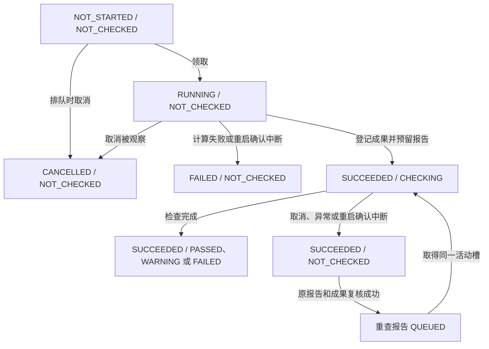

# P12-10 单活动调度与 SQLite 并发审计

- 执行 Agent：D/F。主控复核 JUnit 和独立复跑后签收，状态 ACCEPTED。产品源码、配置、接口、Schema 和既有测试均沿用 V1。
- 审计和复跑提交：`80d724f35fba31cacb9d3f740265b2713c6be6f4`。测试来自独立净工作树。Linux 5.15.0-139-generic x86_64、Python 3.13.13、pytest 8.3.4、SQLite 3.51.2、Schema v4、QGIS 3.44.15。
- 结论：正常工作台以一个 SQLite 项目为调度边界。领取、取消意图、成果登记和报告发布由事务仲裁。验证发现 SQLite 写锁等待耗尽后调度线程退出，服务仍可读取运行状态。AUD-06 的容量和压力验证留至 P13。

## 单活动边界

- 服务启动将数据库路径解析为绝对路径，取得同目录 `<数据库名>.scheduler.lock` 的非阻塞排他 `flock`。持锁覆盖恢复、调度线程运行和关闭等待。独立进程占有同一锁时，另一调度服务启动失败。无执行回调的应用不启动调度。CLI 监听 `127.0.0.1`。 [应用生命周期](../../../src/geopilot/api/app.py#L48) · [锁实现](../../../src/geopilot/execution/worker_lease.py#L14) · [本地入口](../../../src/geopilot/api/server.py#L133)
- 提交运行时，`create_run` 对整个数据库查找最早的 `NOT_STARTED`、`RUNNING` 或 `SUCCEEDED/CHECKING` 行，并复用该运行 ID。合并条件没有按任务、方案或版本过滤。并发提交可以先各自复制数据，再在 `BEGIN IMMEDIATE` 下二次确认，只发布一个运行，另一方清理未登记目录。重试沿用该入口，使用指定或原确认版本，已有活动运行时仍按同一规则返回。 [提交与去重](../../../src/geopilot/runs/service.py#L20) · [重试入口](../../../src/geopilot/runs/retry_service.py#L10)
- 调度在 `BEGIN IMMEDIATE` 内检查有没有 `RUNNING` 或 `SUCCEEDED/CHECKING`，再选择并原子领取一项。标准应用把待执行运行与 `QUEUED` 重查合并排序，以创建时间和 ID 决定顺序。旧的仅执行运行入口以 `created_at, id` 排序。已有活动计算或检查时两条路径都停止领取。调度等待间隔默认 0.25 秒。 [领取与循环](../../../src/geopilot/scheduler/loop.py#L21)
- 单活动约束来自同路径服务锁与约定入口的事务。Schema 约束状态枚举、标识、引用及步骤序号。同步辅助入口 `run_confirmed_plan` 直接插入 `RUNNING` 行，无全局活动槽判断。仓库调用点是独立测试。该入口与工作台共用数据库，以及不同数据库别名、外部写入或远程文件系统部署，均未得到单活动保证。 [状态和表约束](../../../src/geopilot/persistence/schema.py#L48) · [直接入口](../../../src/geopilot/application/plan_runner.py#L405)

## 执行、检查与恢复

下图表示单次运行的 `execution_status / check_status`。重查在报告表排队，领取之前运行仍是 `SUCCEEDED / NOT_CHECKED`。



| 边界 | 核查结果 |
|---|---|
| 计算与成果登记 | 领取和写入步骤的事务先提交，实际 GIS 在事务外运行，结果随后落库。成果在事务外重开及取指纹，提交时复查取消意图，将成果登记、清单发布、`SUCCEEDED/CHECKING` 与首个报告预留合并。数据库回滚与文件系统动作有补偿及恢复路径。 [步骤执行](../../../src/geopilot/scheduler/step_executor.py#L46) · [成果登记](../../../src/geopilot/application/plan_runner.py#L101) |
| 取消 | 排队运行直接终止。活动计算和活动检查先提交取消意图并返回 HTTP 202。计算在派发前、进程等待和步间读取取消意图，活动子进程按 POSIX 进程组终止。检查在规则边界读取意图，最终报告事务再次检查，计算成功仍然保留。已经结束的运行或尚未被领取的排队重查没有此路由的取消动作，HTTP 返回 200。 [取消事务](../../../src/geopilot/scheduler/cancellation.py#L21) · [进程终止](../../../src/geopilot/execution/process_manager.py#L39) · [检查发布](../../../src/geopilot/application/plan_runner.py#L181) · [HTTP 状态](../../../src/geopilot/api/app.py#L101) |
| 重查与报告指针 | 仅成功执行、检查中断、可取得原报告及原规则版本的运行可以重查。请求在写事务外复核正式成果和工具文件，再在写事务内复查资格并创建或复用唯一未完成报告。领取用保存点同时更新报告和运行，执行前再次核验原成果。重查复用运行和原计算证据。发布在保存点内写报告和当前指针，旧报告保留。 [重查申请](../../../src/geopilot/checks/recheck_service.py#L218) · [重查领取](../../../src/geopilot/checks/recheck_service.py#L91) · [检查执行](../../../src/geopilot/application/plan_runner.py#L514) · [发布保存点](../../../src/geopilot/checks/report_service.py#L93) |
| 重启和旧进程 | 进程继承运行目录 `.worker.lock` 的文件描述符。新服务取得调度锁后才检查工作目录锁。无法取得旧 worker 锁时拒绝恢复或派发。旧计算中断标记 `RUN_INTERRUPTED`，未登记清单按条件清理，后续步骤保持待执行。旧检查中断保留已登记成果，尝试发布中断报告。已入库的排队工作仍可在启动后领取。 [worker 租约](../../../src/geopilot/execution/worker_lease.py#L27) · [传递锁描述符](../../../src/geopilot/execution/process_manager.py#L59) · [重启恢复](../../../src/geopilot/scheduler/loop.py#L178) |

## 锁等待、长事务和剩余风险

| 优先级 | 证据与影响 | 后续验证 |
|---|---|---|
| P1，已复现 | `open_database` 使用默认连接超时。净 v4 库测得 `busy_timeout=5000`、`journal_mode=delete`。外部连接持有 `BEGIN IMMEDIATE` 时，调度线程约 5 秒后抛出 `OperationalError: database is locked`。真实应用生命周期中，持锁方提交后 HTTP 仍返回 200，运行保持 `NOT_STARTED`，新生命周期可领取。领取或执行后的收尾事务在 `run_once` 的执行异常捕获范围之外，`run_loop` 未恢复锁等待失败。 [连接配置](../../../src/geopilot/persistence/schema.py#L137) · [循环边界](../../../src/geopilot/scheduler/loop.py#L137) · [运行中 HTTP 探测](p12-10-api-lock-probe.log) | 将锁耗尽分类为可观测的调度可用性缺陷。P13 评估有界重试或明确服务降级，覆盖写锁释放、关闭、重启、重复派发以及恢复中的回滚。 |
| P1，源码边界 | 持锁事务仍会创建步骤目录、登记多条记录、写出首次兼容检查报告、发布文件硬链接及清理恢复文件。I/O 卡顿或 SQLite 读写争用可能扩大持锁时间。DB 提交与文件系统动作分属不同机制，启动恢复依赖已登记运行，进程在提交前突然退出时，未登记 staging 目录的清理未获本轮验证。 [步骤目录](../../../src/geopilot/scheduler/step_executor.py#L77) · [报告写入](../../../src/geopilot/application/plan_runner.py#L188) · [恢复补偿](../../../src/geopilot/scheduler/loop.py#L97) | 单独采样锁持有时间与等待时间，并在慢磁盘、长读事务和提交故障下注入测试。 |
| P1，运行环境边界 | 非阻塞服务锁的同路径跨进程排斥已实测，既有测试验证 supervisor 被杀后仍持有继承锁的原生 Python 子进程。Docker 后端由宿主客户端连接守护进程，容器进程不处在同一个宿主 POSIX 进程组和继承描述符模型内。本轮 QGIS 调用通过实际容器 CLI 测试，容器在强制停止、守护进程中断、重启下的清理时限尚未证明。 [跨进程探测](p12-10-lock-probe.log) · [实际旧 worker 测试](../../../tests/runs/test_run_api.py#L149) | 在 P13-07/08 分开测量原生与容器环境，验证真实进程和容器结束，包含重启后无重叠派发。 |
| P2，队列语义边界 | 运行提交在活动时返回数据库中的已有运行 ID。数据库中的待执行运行与待查报告仍有调度顺序，但多用户、多任务并行接受、严格提交时间 FIFO 及吞吐上界未在本轮验证。 [提交判定](../../../src/geopilot/runs/service.py#L20) · [合并排序](../../../src/geopilot/scheduler/loop.py#L50) | 在变更队列语义前定义冲突请求的 API 期望，并测量入队、排队、执行及取消各自耗时。 |

当前保留单活动策略。P13-07/08 的真实队列压力、长事务和跨进程退出测量完成后，再决定运行约束是否可以放宽。上述 SQLite 写锁故障与 P12-05 已记录的 QGIS 调用超过测试轮询期限是不同的实测现象。 [P12-05 复跑记录](p12-05.md)

## 实际执行与证据

在净 V1 原型目录执行，先确认 `git rev-parse HEAD` 与上方 SHA 一致。pytest 收集 178 项，178 通过、0 失败、0 错误、0 跳过，耗时 113.01 秒，退出 0。JUnit 按目录为 scheduler 25 项、runs 26 项、checks 127 项。唯一提示来自 Starlette TestClient 对 AnyIO 弃用别名的引用。覆盖并发领取、同一数据库并发提交、重查并发去重及发布回滚、真实子进程取消、启动恢复、成果和实际 QGIS 证据。 [JUnit](p12-10-junit.xml) · [原始 stdout/stderr](p12-10-pytest.log) · [领取竞争断言](../../../tests/scheduler/test_scheduler.py#L41) · [并发提交断言](../../../tests/runs/test_run_creation.py#L81) · [重查竞争断言](../../../tests/checks/test_recheck_service.py#L213)

```bash
audit=/home/mtd/liweigis/GeoPilot-round2/system-prototype-v1
set -o pipefail
export PYTEST_DISABLE_PLUGIN_AUTOLOAD=1 PYTHONDONTWRITEBYTECODE=1
export GEOPILOT_QGIS_PROCESS="$audit/.environments/qgis-deb/qgis_process"
mkdir -p artifacts/test-results/tmp
p12_scheduler_tmp=$(mktemp -d 'artifacts/test-results/tmp/p12-10.XXXXXXXX')
"$audit/.venv/bin/python" -m pytest tests/scheduler tests/runs tests/checks -q -p no:cacheprovider \
  --basetemp="$p12_scheduler_tmp" --junitxml="$audit/docs/round2/audit/p12-10-junit.xml" \
  2>&1 | tee "$audit/docs/round2/audit/p12-10-pytest.log"
```

补充探测均在临时 SQLite 上使用 `PYTHONPATH=src PYTHONDONTWRITEBYTECODE=1 "$audit/.venv/bin/python" -`，退出 0 表示预期断言成立。第一项测得真实同路径进程排斥和调度循环锁超时，第二项测得 HTTP 仍存活及重启领取。探测只用现有应用、数据库和调度函数。测试运行机临时目录未纳入仓库，可按上方命令重建。

### 补充探测复跑

以下代码汇总两个已执行探测的关键断言。第一个原始探测还直接对空队列 `run_loop` 持写锁，测到 5.008 秒后线程停止。HTTP 探测测到 5.257 秒后线程停止。 [跨进程及直接循环输出](p12-10-lock-probe.log) · [HTTP 探测输出](p12-10-api-lock-probe.log)

```bash
PYTHONPATH=src PYTHONDONTWRITEBYTECODE=1 "$audit/.venv/bin/python" - <<'PY'
from datetime import UTC, datetime
from multiprocessing import get_context
from pathlib import Path
from tempfile import TemporaryDirectory
from threading import Event
from time import monotonic
import sqlite3
import threading

from fastapi.testclient import TestClient
from geopilot.api.app import create_app
from geopilot.domain.step_io import ExecutionStatus
from geopilot.persistence.run_repository import insert_run, update_run
from geopilot.persistence.schema import initialize_database, open_database
from geopilot.runs.models import Run

def hold_scheduler(db, ready, release):
    with TestClient(create_app(db, execute_run=lambda run: None)):
        ready.set()
        assert release.wait(10)

with TemporaryDirectory(prefix="geopilot-p12-10-") as directory:
    db = Path(directory) / "project.sqlite"
    print("SQLite:", sqlite3.sqlite_version, "schema:", initialize_database(db))
    with open_database(db) as connection:
        print("busy_timeout:", connection.execute("PRAGMA busy_timeout").fetchone()[0])
        print("journal_mode:", connection.execute("PRAGMA journal_mode").fetchone()[0])
    ctx = get_context("fork")
    ready, release = ctx.Event(), ctx.Event()
    first = ctx.Process(target=hold_scheduler, args=(db, ready, release))
    first.start()
    try:
        assert ready.wait(5)
        try:
            with TestClient(create_app(db, execute_run=lambda run: None)):
                raise AssertionError("Unexpected second scheduling lifespan")
        except BlockingIOError as error:
            print("Same-path scheduler excluded:", error.errno)
    finally:
        release.set()
        first.join(6)
        if first.is_alive():
            first.terminate()
            first.join(3)
    assert first.exitcode == 0, first.exitcode

    dispatched = Event()
    errors = []
    original_hook = threading.excepthook
    threading.excepthook = lambda args: errors.append(args.exc_value)
    try:
        with TestClient(create_app(db, execute_run=lambda run: dispatched.set())) as client:
            scheduler, = [thread for thread in threading.enumerate() if thread.name == "geopilot-scheduler"]
            with open_database(db) as connection, connection:
                connection.execute("BEGIN IMMEDIATE")
                connection.execute("INSERT INTO task VALUES ('task', '{}', NULL, '2026-11-12')")
                connection.execute("INSERT INTO analysis_plan VALUES ('plan', 1, 'task', 'confirmed', '{}', '2026-11-12')")
                insert_run(connection, Run(id="pending", plan_id="plan", plan_version=1,
                    workdir=str(Path(directory) / "pending"), created_at=datetime.now(UTC)))
                start = monotonic()
                scheduler.join(7)
                assert not scheduler.is_alive()
                assert len(errors) == 1 and isinstance(errors[0], sqlite3.OperationalError)
                print("Scheduler exited:", errors[0], f"{monotonic() - start:.3f}s")
            response = client.get("/api/runs/pending")
            assert response.status_code == 200
            assert response.json()["execution_status"] == "NOT_STARTED"
            assert not dispatched.is_set()
            print("Live HTTP returned 200, queued run remained NOT_STARTED")
    finally:
        threading.excepthook = original_hook

    def finish(run):
        with open_database(db) as connection, connection:
            update_run(connection, run.model_copy(update={"execution_status": ExecutionStatus.SUCCEEDED}))
        dispatched.set()

    with TestClient(create_app(db, execute_run=finish)) as client:
        assert dispatched.wait(5)
        assert client.get("/api/runs/pending").json()["execution_status"] == "SUCCEEDED"
        print("New service lifespan claimed the preserved queue entry")
PY
```

新增本文、`p12-10-junit.xml`、`p12-10-pytest.log`、`p12-10-lock-probe.log`、`p12-10-api-lock-probe.log`。既有代码和接口不变。回滚仅需撤销这些审计交付。
